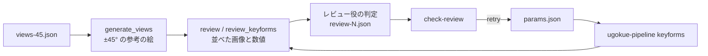

# エージェントによる顔の向きの判定

顔の向きのキーフォーム（[頭の3D形状による顔の向き](head-rotation.md)）の出来を、レビュー役のエージェントが、生成した ±45° の参考の絵と数値から判定し、不合格なら調整役のエージェントがイラストごとの頭の3D形状の値を直して作り直す仕組み（#48）。人の確認と修正のやりとりを減らすのが目的。方法を選んだ理由は [ADR 0012](../adr/0012-agent-review-of-face-rotation.md) にある。

このページの「手順」と「判定の基準」は、エージェントが従う手順書を兼ねる。

- **調整役：** 作り直し、材料の書き出し、値の反映を行うエージェント（Claude Code の会話の本体）。判定はしない。
- **レビュー役：** `.claude/agents/face-turn-reviewer.md` のサブエージェント。Live2D・イラスト・デッサン・人体解剖学に精通したキャラクターデザイナーとして、材料を見て判定し、`review-<回数>.json` を書く。モデルや値は直さない。作った側が判定すると甘くなるので、役を分ける（1回目の試行で、調整役の判定が人の確認と合わなかった）。

## 構成



| 場所 | 役割 |
| --- | --- |
| `pipeline/samples/views-45.json` | ±45°（上下 −20、0、20）の参考の絵を生成する設定。`generate_views --spec pipeline/samples/views-45.json --out artifacts/views-45` で使う |
| `pipeline/python/src/ugokue_pipeline/head3d.py` の `HeadParams` | 頭の3D形状と回し方の値。既定値は `head3d.py` の定数 |
| `.../keyforms.py` の `load_params` | `artifacts/keyforms/<イラスト名>/params.json` を読む。なければ既定値を書く |
| `.../review.py` | 判定の材料（`review_pack`）と、判定の結果の確認（`validate_review`） |
| `cli.py` の `review`、`check-review` | 材料の書き出し（特徴点なし）と、判定の結果の確認 |
| `modal_app.py` の `review_keyforms` | 描いたモデルの特徴点を Modal（CPU）で検出してから、材料を書き出す |

## イラストごとの値（params.json）

`artifacts/keyforms/<イラスト名>/params.json` に、既定値から変える値だけを camelCase のキーで書く（全部書いてもよい）。未知のキーや数でない値があれば、`keyforms` は失敗する。使った値は `evaluation.json` の `params` に記録する。

| キー | 既定値 | 意味 | 大きくすると |
| --- | --- | --- | --- |
| `headDepth` | 0.8 | 前面の奥行き ÷ 断面の半幅 | 目・鼻・口が回るときに大きく横へ動き、奥の目が強く縮む |
| `chinDepth` | 0.55 | いちばん下の行（あご先）の奥行き ÷ 頭の半径 | あご先が向いた側へ大きく動く |
| `noseProtrusion` | 0.15 | 鼻の浮き ÷ 頭の半径 | 鼻が顔より大きく横へ動く |
| `shellOffset` | 0.06 | 前髪・頭の飾りの殻の太り ÷ 頭の半径 | 前髪が顔より大きく動き、顔から離れて見える |
| `backHairDepth` | 0.3 | 後ろ髪の板の奥行き ÷ 頭の半径 | 後ろ髪が顔と逆へ大きく動く |
| `eyewearLift` | 0.08 | 眼鏡の浮き ÷ 頭の半径 | 眼鏡が顔より大きく動く |
| `featureForeshortening` | 0.6 | 目・眉・口・鼻の形の変化を弱める倍率（重心の動きはそのまま） | 奥の目が細く、手前の目が広くなる |
| `pivotDepth` | 0.5 | 左右に回す軸の、頭の中心からの奥行き ÷ 頭の半径 | 頭全体が向いた側へ大きく動く |
| `pitchScale` | 0.6 | `AngleY` の角度に掛ける倍率 | 上下の向きで顔が大きく上下する |
| `neckFollow` | 1.0 | 首の上端が頭に追従する割合 | 首が頭と一緒に大きく動く |

## 判定の材料

`ugokue-pipeline review`（または `review_keyforms`）は、`artifacts/keyforms/<イラスト名>/review/` に書く。判定する向きは、`AngleX` が ±45、`AngleY` が −20、0、20 の6つ。

- `sheet-y+20.png`、`sheet-y+00.png`、`sheet-y-20.png`：上下の向きごとに、左右の向き（−45、+45）を1行ずつ。列は、正面のモデル・その向きのモデル・参考の絵・目元（モデル、参考）・口元とあご（モデル、参考）。参考の絵がなければ灰色。目元と口元の範囲はモデルの変形後の特徴から決めるので、参考の絵では顔が範囲からずれることがある。
- `metrics.json`：使った値（`params`）、頭の中心と半径（`head`）、向きごとの次の値（`angles`）。
  - `stretch`：描かれている（テクスチャが不透明な）三角形だけの伸び（特異値）の分布。`maxP50`・`maxP95`・`maxP99` は大きいほうの特異値の 50・95・99 パーセンタイル、`minP1`・`minP5` は小さいほうの 1・5 パーセンタイル。透明な縁の三角形は数えない。
  - `featureVerticesOutsideFace`：目（白目、黒目、まぶた）・眉・口・鼻の描かれている頂点のうち、変形後の顔の描かれている範囲の外に出た数（メッシュごと。0 のメッシュは書かない）。まつ毛の目尻は正面でも輪郭の外に出ることがある。
  - `proportions`：目の釣り合いと奥側の輪郭の形を正面と比べた値。`nearEye`・`farEye` は手前・奥の白目のパーツ、`nearEyeWidth`・`farEyeWidth` は白目の横幅の正面に対する倍率、`farToNear` はその比（奥 ÷ 手前）。`farEyeGap` は奥の目尻から同じ高さの輪郭までの余白（正面の白目の幅に対する割合）、`cheekBulge` は目の高さから口の高さまでの奥側の輪郭が、両端を結ぶ線からどれだけ外にふくらむか（頭の半径に対する割合）。どちらも正面（`front`）とその向き（`turned`）の値を持つ。
  - `pose`：anime-face-detector の28点から求めた向きの値（[向きの判定](view-generation.md)の `estimate_pose`）の、正面からの変化。`render` はモデル、`reference` は参考の絵。`yawRatio`・`pitchRatio` は モデルの変化 ÷ 参考の絵の変化（参考の変化が小さすぎるか、顔を検出できなければ null）。`review_keyforms` で実行したときだけ、モデルの値が入る。
  - `reference`：参考の絵があるか。

## 手順

イラスト1枚ごとに、最大3回まで繰り返す。リポジトリのルートで実行する。

1. 作る：`uv run --project pipeline/python ugokue-pipeline keyforms --names <イラスト名>`
2. 材料を書き出す：`uv run --project pipeline/python --extra modal modal run pipeline/python/src/ugokue_pipeline/modal_app.py::review_keyforms --only <イラスト名>`（Modal が使えなければ `ugokue-pipeline review --names <イラスト名>`。このとき `pose` のモデルの値は null）
3. 判定を頼む：調整役は、レビュー役（`face-turn-reviewer`）を起動し、イラスト名と回数を伝える。レビュー役は `metrics.json` と3枚のシートを見て、下の基準で向きごと・項目ごとに判定し、`review/review-<回数>.json` に書く。
4. 確かめる：`uv run --project pipeline/python ugokue-pipeline check-review artifacts/keyforms/<イラスト名>/review/review-<回数>.json`（問題がなければ何も出さずに 0 で終わる）。レビュー役が書いたあと、調整役も確かめる。
5. `verdict` が `retry` なら、`changes` の値を `params.json` に書き込んで 1 に戻る。`pass` か `stop` なら終わり、結果を人に報告する。

## 判定の基準

参考の絵は**正解ではない**。生成した絵は指定より横顔に寄り、顔立ちも変わる（[向きと表情の差分の生成](view-generation.md#実機の結果)）。形を一致させるのではなく、次の2つを見る。

| 項目 | 合格の条件 |
| --- | --- |
| `direction`（同じ向き） | モデルが、参考の絵と同じ向き（左右と上下）に回って見える。顔の中心線（鼻、口）とあご先が向いた側へ寄り、奥の目が手前の目より細い。`pose` があれば、`yawRatio` が 0.4 以上（参考の絵は回りすぎるので、1 未満でよい）。上下は、同じ左右の向きの `sheet-y+00.png` と比べて、上なら顎の下、下なら頭頂が見えるかで見る（`pitchRatio` は 45° では特徴点の誤差で符号まで揺れるので、参考にとどめる） |
| `breakage`（破綻がない） | 目・眉・口が顔の外に出ていない（`featureVerticesOutsideFace` はまぶた以外 0、まぶたは 3 以下）。描かれている三角形の伸びが `maxP99` ≤ 2.0、`minP1` ≥ 0.3。シートで、パーツの裂け目や隙間、あごの輪郭のぎざぎざ、前髪と顔の間のずれ、首の継ぎ目が見えない。**形が自然である**：手前の目が正面より大きくならず（`nearEyeWidth` ≤ 1.08）、奥の目がつぶれず（`farToNear` ≥ 0.65）、輪郭に押し付けられない（`farEyeGap.turned` ≥ 0.15）。奥側の頬に、頬骨から顎へのふくらみがあり（`cheekBulge.turned` ≥ `cheekBulge.front` × 0.8）、まっすぐな斜めの線や折れになっていない。顔が細くなりすぎていない |

数値の基準は、見落としを防ぐための最低限で、仮の値。数値が基準内でも、絵として不自然なら不合格にする。迷ったら不合格にする。

### 症状と直す値

1回に直す値は2つまで、変える量は今の値の ±10〜30% を目安にする。

| 症状 | 直す値 |
| --- | --- |
| 回り方が足りない（`yawRatio` < 0.4、参考より正面に近い） | `headDepth` を上げる（`pivotDepth` は顔の輪郭ごと動かすので、`yawRatio` は変わらない） |
| 頭全体が体に対して横に動かない／流れすぎる | `pivotDepth` を上げる／下げる |
| 奥の目がつぶれる、手前の目が広がりすぎる | `featureForeshortening` を下げる、`headDepth` を下げる |
| 鼻が顔から離れる／ほとんど動かない | `noseProtrusion` を下げる／上げる |
| あご先が尖る、向いた側へ寄りすぎる | `chinDepth` を下げる |
| あご先がほとんど動かない | `chinDepth` を上げる |
| 上下の向きで顔がずれすぎる／ほとんど動かない | `pitchScale` を下げる／上げる |
| 前髪・頭の飾りが顔から浮く／めり込む | `shellOffset` を下げる／上げる |
| 眼鏡が顔からずれる | `eyewearLift` を下げる |
| 後ろ髪が顔と逆へ動きすぎる | `backHairDepth` を下げる |
| 首がゆがむ、首の継ぎ目が見える | `neckFollow` を下げる |

値で直らない症状（パーツ分解の欠け、テクスチャの透け、参考の絵が別人など）は `stop` にして、理由を `summary` に書く。今の頭の3D形状では、奥側の頬のふくらみ不足と、手前の目の広がりは、値ではほとんど直らない（形の作り方の問題）。

## 判定の結果（review-N.json）

```json
{
  "illustration": "01-long-straight",
  "iteration": 1,
  "params": {"headDepth": 0.8, "...": 0.0},
  "angles": [
    {
      "angleX": 45,
      "angleY": 0,
      "direction": {"pass": true, "reason": "鼻と口が右へ寄り、奥の目が細い。yawRatio 0.62"},
      "breakage": {"pass": false, "reason": "あご先が尖り、輪郭がぎざぎざ"}
    }
  ],
  "verdict": "retry",
  "changes": {"chinDepth": 0.45},
  "summary": "右向きであご先が尖る。chinDepth を下げる"
}
```

`check-review`（`validate_review`）が確かめること：

- `illustration`、`summary` が空でない文字列。`iteration` が 1〜3 の整数。
- `params` と `changes` が、`params.json` と同じキーと数の値だけを持つ。
- `angles` が判定する6つの向きをちょうど1回ずつ持ち、各向きの `direction`、`breakage` が真偽値の `pass` と空でない `reason` を持つ。
- `verdict` が `pass`（すべて合格、`changes` は空）、`retry`（不合格の項目があり、`changes` が空でない。3回目には使えない）、`stop`（`changes` は空）のどれか。

## テスト

`pipeline/python/tests/test_review.py` と `test_head3d.py`。合成した左右対称の顔を使う。

| 確かめること | 方法 |
| --- | --- |
| 値が形状とキーフォームに反映される | `headDepth`・`chinDepth` で断面の奥行き、`noseProtrusion`・`pivotDepth` で鼻の横の動き、`pitchScale` で上下の動きが変わる |
| 未知の値の拒否 | 未知のキー、数でない値で `HeadParams.from_json` と `load_params` が失敗する |
| 描かれている三角形 | 顔のテクスチャの透明な角の三角形を数えない |
| 数値 | 正面では伸びがすべて 1、外に出た特徴はなし。白目を顔の外へ動かすと数える。目の釣り合いと奥側の輪郭の値が左右で対称になり、奥の目を輪郭へ寄せると余白が減る |
| 向きの値の比較 | 作った28点で、比が モデルの変化 ÷ 参考の変化 になり、逆向きなら負 |
| 書き出し | 6つの向きの数値と3枚のシートを書き、参考の絵と特徴点を読む |
| 判定の結果の確認 | 正しい `pass`・`retry`・`stop` を通し、向きの抜け・重複、空の理由、整合しない `verdict`、未知の値、3回目の `retry` を拒否する |
| 参考の絵の設定 | `views-45.json` が判定する6つの向きを持つ |

## 実機の結果

01-long-straight で1回試した（2026-10-31）。参考の絵は `views-45.json` で5枚とも生成した（A100、1枚あたり6つの向き）。参考の絵は指定の 45° よりも横顔に近い。

| 回 | 値 | 判定 | 主な理由 |
| --- | --- | --- | --- |
| 1 | 既定値 | `retry`（`pitchScale` 0.6→0.8、`pivotDepth` 0.5→0.65） | 破綻はないが、上下の向きがほとんど見えない。+45・下20 で `yawRatio` 0.32 |
| 2 | 上の2つ | `retry`（`headDepth` 0.8→0.95、`pitchScale` 0.8→1.0） | 下向きは見えるようになった。`yawRatio` はほぼ変わらない（`pivotDepth` は効かない） |
| 3 | 上の4つ | `stop` | 上下は見える。+45 の `yawRatio` は 0.37〜0.49 で、左向き（0.57〜0.65）より弱いまま。+45・上20 で `minP1` 0.27 |

- 判定の JSON は3回とも `check-review` を通った。
- わかったこと：`pitchRatio` は 45° では揺れが大きく、上下の判定には使えない。`pivotDepth` は `yawRatio` を変えない。この2つを基準と「症状と直す値」に反映した。
- 右向きだけ回りが弱いのは、元の絵がわずかに左を向いているためかもしれない。左右で別の値を持つかは、人の確認のあとで決める。
- **人の確認：** 3回とも `breakage` を合格にしたが、人が見ると明らかに破綻していた（輪郭のゆがみ、左右の目の釣り合いの悪さ、頬のふくらみ不足で顔が細すぎる）。基準が裂け目と数値に偏り、形の自然さを見ていなかったのと、作った側が判定して甘くなったため。形の自然さの基準と `proportions` を加え、判定をレビュー役に分けた。

レビュー役（`face-turn-reviewer`）で、既定値から判定し直した（2026-10-31）。

- 1回目で `stop`。`breakage` は6つの向きすべて不合格で、人の確認と合った。理由は、手前の目の広がり（`nearEyeWidth` 1.09〜1.13）、奥の目のつぶれ（`farToNear` 0.57〜0.59）、下20 で奥の目尻が輪郭に押し付けられる（`farEyeGap` 約 0.10）、奥側の頬が頬骨からあごまでまっすぐな線で、あご先が V 字に尖ること。数値が基準内の向きも、輪郭が直線的なので不合格にした。
- `direction` は +45・下20 だけ不合格（`yawRatio` 0.32）。上下の向きは全体に弱い。
- 値で効く範囲（`featureForeshortening`、`pitchScale`、`headDepth`）はあるが、頬の形を直さない限り合格にならないとして、値は変えずに止めた。あるべき形は、奥側の輪郭が目の下の頬骨で外へ張り、丸く絞りながらあご先へつながるゆるい S 字で、あご先は幅を保って丸い。手前の目は正面と同じかわずかに小さく、奥の目は 0.65〜0.75 倍。
