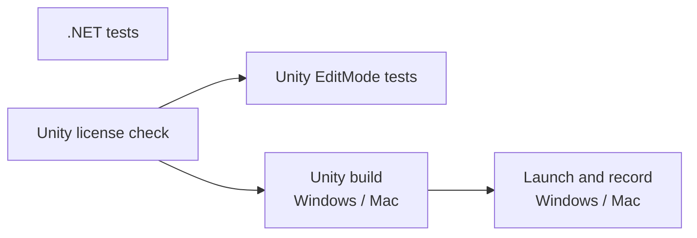

# CI のテスト

GitHub Actions（`.github/workflows/ci.yml`）で自動実行するテストの一覧。テストを追加・変更・削除する PR では、同じ PR でこのページを更新する。

## 実行のタイミング

- PR を作成・更新したとき
- main に push されたとき
- Actions 画面から手動で実行したとき（`workflow_dispatch`）

同じブランチで新しい実行が始まると、古い実行は中止される。

## ジョブの流れ

| ジョブ | 実行環境 | 内容 |
| --- | --- | --- |
| .NET tests | ubuntu | Unity に依存しないコードの単体テスト（`dotnet test dotnet/Ugokue.sln`） |
| Unity license check | ubuntu | Secrets `UNITY_LICENSE`、`UNITY_EMAIL`、`UNITY_PASSWORD` が登録されているかを確かめる。欠けていれば失敗し、Unity のジョブは実行されない |
| Unity EditMode tests | ubuntu（game-ci の Docker イメージ） | Unity エディター上のテスト。結果は PR のチェックとして表示される |
| Unity build | ubuntu（game-ci の Docker イメージ） | Windows（StandaloneWindows64）と Mac（StandaloneOSX）のプレイヤーをビルドし、成果物として保存する |
| Launch and record | windows-latest、macos-latest | ビルドしたプレイヤーを各 OS で起動し、計測の記録を検証する |

Unity エディターは game-ci が実行ごとに Docker イメージとして取得する。バージョンは `unity/ProjectSettings/ProjectVersion.txt` に従う。

## テストの一覧

### .NET tests

| クラス | テスト | 確かめること |
| --- | --- | --- |
| `FrameRecorderTests` | `RecordsEveryFrameForTheRequestedDuration` | 60fps で 10 秒記録すると、フレーム番号 0〜600 が欠けなく並び、最後の時刻が 10 秒以上になる |
| | `IgnoresFramesAfterCompletion` | 記録完了後のフレームは追加されない |
| | `SkipsFramesDuringWarmup` | ウォームアップ中のフレームは記録されず、ウォームアップ後の最初のフレームが時刻 0 になる |
| | `RejectsNonPositiveDuration` | 記録秒数が 0 以下・NaN なら例外になる |
| | `RejectsNegativeWarmup` | ウォームアップ秒数が負・NaN なら例外になる |
| `FrameSummaryTests` | `ComputesAveragesPercentilesAndMaximum` | 平均 fps、平均フレーム時間、p95、p99、最大、平均 CPU 時間が仕様どおりに計算される |
| | `LeavesCpuTimeEmptyWhenNoSampleHasIt` | CPU 時間が1つも取れていなければ平均 CPU 時間は空になる |
| | `RejectsEmptySamples` | フレームが0件なら例外になる |
| `FrameCsvWriterTests` | `WritesOneRowPerSampleWithInvariantNumbers` | 1フレーム1行で書き出し、ドイツ語環境でも小数点がピリオドになる |
| | `WritesSummaryMetrics` | 集計 CSV の項目と値が仕様どおりになる |
| `RollingFrameStatsTests` | `ReturnsZeroBeforeAnyFrame` | フレームがないとき表示値は 0 になる |
| | `AveragesOnlyTheMostRecentWindow` | 直近の指定フレーム数だけで平均する |
| | `RejectsNonPositiveWindow` | 平均に使うフレーム数が 0 以下なら例外になる |
| `RecordingOptionsTests` | `DisablesAutoRecordWithoutArguments` | 計測の引数がなければ自動記録しない。ウォームアップは既定値になる |
| | `ReadsAllRecordingArguments` | 記録秒数、ウォームアップ、出力先、記録後の終了を読み取る |
| | `RejectsInvalidSeconds` | 記録秒数が 0、負、数値以外なら例外になる |
| | `RejectsInvalidWarmup` | ウォームアップ秒数が負、NaN なら例外になる |
| | `RejectsMissingValue` | 値が必要な引数に値がなければ例外になる |

### Unity EditMode tests

| クラス | テスト | 確かめること |
| --- | --- | --- |
| `MainSceneTests` | `MainSceneIsTheOnlyEnabledBuildScene` | ビルドに含まれるシーンが Main シーンだけである |
| | `MainSceneHasCameraAndPerformanceMonitor` | Main シーンにカメラと `PerformanceMonitor` がある |
| | `FrameTimingStatsAreEnabled` | Player Settings の Frame Timing Stats がオン（CPU 時間の計測に必要） |
| | `PlayerKeepsRunningWhenUnfocused` | Player Settings の Run In Background がオン（OBS などにフォーカスがあっても止まらない） |

### Unity build

- Windows と Mac のプレイヤーがエラーなくビルドできる。

### Launch and record

`.github/scripts/perf_smoke.py` が、プレイヤーを `-batchmode -nographics` で起動して 3 秒記録し、次を確かめる。描画しないため、fps の値は [数値目標](performance-targets.md) の判定には使わない。

- プレイヤーが記録を保存して自分で終了する（180 秒でタイムアウト）
- 本体 CSV のヘッダーが仕様どおり
- フレーム番号が 0 から連番で、時刻が減らず、フレーム時間が負でない
- 最初の時刻が 0 で、最後の時刻が指定秒数以上
- 集計 CSV のフレーム数が本体 CSV の行数と一致し、記録時間が指定秒数以上

## チケットのテスト項目との対応

| チケット | テスト項目 | CI での確認 |
| --- | --- | --- |
| PoC-01 #3 | 自動ビルドが通る | Unity build |
| PoC-01 #3 | 計測の記録が、指定した秒数ぶん欠けなく保存される | `FrameRecorderTests.RecordsEveryFrameForTheRequestedDuration`、Launch and record |

## 成果物

| 名前 | 内容 |
| --- | --- |
| `unity-test-results` | EditMode テストの結果 XML とログ |
| `ugokue-StandaloneWindows64`、`ugokue-StandaloneOSX` | ビルドしたプレイヤー（tar.gz） |
| `perf-windows-latest`、`perf-macos-latest` | 起動確認で記録した CSV |
