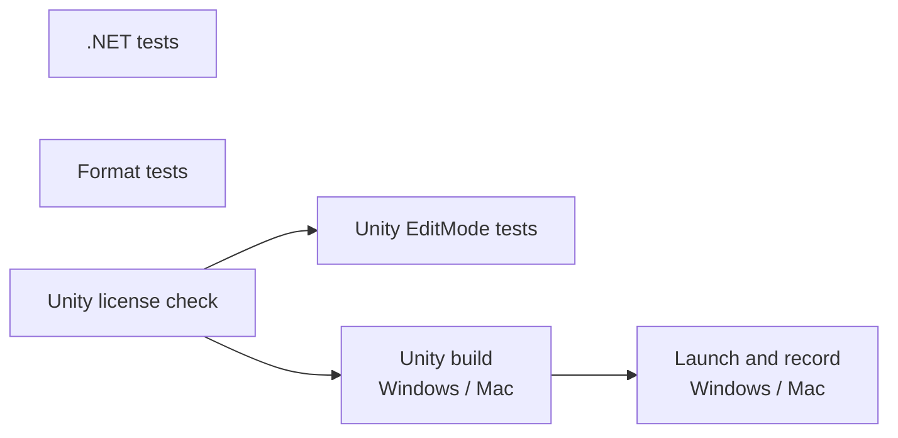

# CI のテスト

GitHub Actions（`.github/workflows/ci.yml`）で自動実行するテストの一覧。テストを追加・変更・削除する PR では、同じ PR でこのページを更新する。

## 実行のタイミング

- PR を作成・更新したとき
- main に push されたとき
- Actions 画面から手動で実行したとき（`workflow_dispatch`）

同じブランチで新しい実行が始まると、古い実行は中止される。

## ジョブの流れ

| ジョブ | 実行環境 | 内容 |
| --- | --- | --- |
| .NET tests | ubuntu | Unity に依存しないコードの単体テスト（`dotnet test dotnet/Ugokue.sln`） |
| Format tests | ubuntu | 中間形式のサンプルと固定テストモデルの検証、Python のテスト、Python → C# → Python の往復 |
| Unity license check | ubuntu | Secrets `UNITY_LICENSE`、`UNITY_EMAIL`、`UNITY_PASSWORD` が登録されているかを確かめる。欠けていれば失敗し、Unity のジョブは実行されない |
| Unity EditMode tests | ubuntu（game-ci の Docker イメージ） | Unity エディター上のテスト。結果は PR のチェックとして表示される |
| Unity build | ubuntu（game-ci の Docker イメージ） | Windows（StandaloneWindows64）と Mac（StandaloneOSX）のプレイヤーをビルドし、成果物として保存する |
| Launch and record | windows-latest、macos-latest | ビルドしたプレイヤーを各 OS で起動し、計測の記録を検証する |

Unity エディターは game-ci が実行ごとに Docker イメージとして取得する。バージョンは `unity/ProjectSettings/ProjectVersion.txt` に従う。

## 必須チェック

main の保護ルールで、上の表の全ジョブ（Windows と Mac の両方）を必須チェックにしている。ジョブを追加した PR では、マージ後に人が保護ルールへ追加する。どれかが通らない PR はマージできない。必須チェックはジョブの表示名で照合するため、ジョブ名や matrix の値を変える PR では、人が保護ルールの必須チェックも同時に更新する。game-ci が作る「Test Results」チェックは必須にしていない。

## テストの一覧

### .NET tests

| クラス | テスト | 確かめること |
| --- | --- | --- |
| `FrameRecorderTests` | `RecordsEveryFrameForTheRequestedDuration` | 60fps で 10 秒記録すると、フレーム番号 0〜600 が欠けなく並び、最後の時刻が 10 秒以上になる |
| | `IgnoresFramesAfterCompletion` | 記録完了後のフレームは追加されない |
| | `SkipsFramesDuringWarmup` | ウォームアップ中のフレームは記録されず、ウォームアップ後の最初のフレームが時刻 0 になる |
| | `RejectsNonPositiveDuration` | 記録秒数が 0 以下・NaN なら例外になる |
| | `RejectsNegativeWarmup` | ウォームアップ秒数が負・NaN なら例外になる |
| `FrameSummaryTests` | `ComputesAveragesPercentilesAndMaximum` | 平均 fps、平均フレーム時間、p95、p99、最大、平均 CPU 時間が仕様どおりに計算される |
| | `LeavesCpuTimeEmptyWhenNoSampleHasIt` | CPU 時間が1つも取れていなければ平均 CPU 時間は空になる |
| | `RejectsEmptySamples` | フレームが0件なら例外になる |
| `FrameCsvWriterTests` | `WritesOneRowPerSampleWithInvariantNumbers` | 1フレーム1行で書き出し、ドイツ語環境でも小数点がピリオドになる |
| | `WritesSummaryMetrics` | 集計 CSV の項目と値が仕様どおりになる |
| `RollingFrameStatsTests` | `ReturnsZeroBeforeAnyFrame` | フレームがないとき表示値は 0 になる |
| | `AveragesOnlyTheMostRecentWindow` | 直近の指定フレーム数だけで平均する |
| | `RejectsNonPositiveWindow` | 平均に使うフレーム数が 0 以下なら例外になる |
| `RecordingOptionsTests` | `DisablesAutoRecordWithoutArguments` | 計測の引数がなければ自動記録しない。ウォームアップは既定値になる |
| | `ReadsAllRecordingArguments` | 記録秒数、ウォームアップ、出力先、記録後の終了を読み取る |
| | `RejectsInvalidSeconds` | 記録秒数が 0、負、数値以外なら例外になる |
| | `RejectsInvalidWarmup` | ウォームアップ秒数が負、NaN なら例外になる |
| | `RejectsMissingValue` | 値が必要な引数に値がなければ例外になる |

`Format` 名前空間（`dotnet/Ugokue.Core.Tests/Format/ModelPackageTests.cs`）：

| テスト | 確かめること |
| --- | --- |
| `SaveLoadSaveGivesIdenticalBytes` | 書き出し → 読み込み → 書き出しで、model.json とテクスチャのバイト列が一致する |
| `LoadedModelKeepsValues` | 小数を含む値が読み書きで変わらない |
| `WritesPropertiesInSpecOrder` | 項目が仕様の表の順に書かれる |
| `WritesNullParentAndNullPartMesh` | `parent` とパーツの `mesh` が null のとき、null として書かれる |
| `OmitsOptionalFieldsWhenNotSet` | 省略できる項目は、値がなければ書かれない |
| `RejectsUnsupportedVersion`、`AcceptsOtherPatchVersion` | 0.1.x 以外のバージョンを拒否し、PATCH 違いは読む |
| `RejectsWrongFormat`、`RejectsMissingFormat` | `format` が違う・ないファイルを拒否する |
| `RejectsUnknownTopLevelProperty`、`RejectsUnknownNestedProperty`、`RejectsMissingNullableRequiredProperty` | 未定義の項目と、必須項目の欠けを拒否する |
| `KeepsDateLikeStringsAsWritten` | 日付のような文字列を日付に変換しない |
| `LoadRejectsTexturePathOutsideFolder`、`SaveRejectsTexturePathOutsideFolder` | フォルダの外を指すテクスチャのパスを拒否する |
| `LoadRejectsMissingTexture`、`SaveRejectsMissingOrUnreferencedTexture` | テクスチャの欠けと、参照されないテクスチャの書き出しを拒否する |
| `NumbersAreCultureInvariant` | ドイツ語環境でも同じ内容を書き出す |

### Format tests

`ugokue-format validate` で `format/samples/minimal` と `format/samples/test-face`（[固定テストモデル](test-model.md)）を検証したあと、`format/python/tests/` を実行する。表の「各サンプル」のテストは、2つのフォルダのそれぞれで実行する。

| ファイル | テスト | 確かめること |
| --- | --- | --- |
| `test_roundtrip.py` | `test_sample_regenerates_byte_identically` | サンプルの生成結果が、リポジトリのサンプルとバイト単位で一致する |
| | `test_test_face_regenerates_byte_identically` | 固定テストモデルの生成結果が、リポジトリのフォルダとバイト単位で一致する |
| | `test_python_roundtrip`（各サンプル） | Python で読み込んで書き出すと、元と一致する |
| | `test_csharp_roundtrip`（各サンプル） | C#（`dotnet/Ugokue.Format.Cli`）で読み込んで書き出すと、元と一致する（JSON は値として、PNG はバイト列で比較）。CI では `UGOKUE_REQUIRE_DOTNET=1` を設定し、dotnet がなければ失敗させる |
| | `test_load_rejects_unreadable_version` | 読めないバージョンを拒否する |
| | `test_compare_reports_differences` | 比較ツールが値とテクスチャの違いを検出する |
| `test_validate.py` | `test_sample_is_valid` | サンプルが検証を通る |
| | `test_missing_required_field`、`test_wrong_type`、`test_unknown_field`、`test_confidence_out_of_range`、`test_bad_version` | 必須項目の欠け、型の違い、未定義の項目、範囲外の値、読めないバージョンを検出する |
| | `test_rule01_`〜`test_rule14_` で始まるテスト | [中間形式の検証規則](intermediate-format.md#検証) の 1〜14 を、それぞれ1つ以上の壊したサンプルで検出する |
| | `test_malformed_document_reports_without_crash` | 構造が大きく壊れたファイルでも、例外で止まらずにエラーを報告する |
| `test_face_model.py` | `test_test_face_is_valid` | 固定テストモデルが検証を通る |
| | `test_has_about_twenty_face_parts` | パーツが 20 以上あり、前髪・眉・まぶた・白目・黒目・口の中などの役割がそろっている |
| | `test_every_head_mesh_has_angle_grid` | 頭の子孫のメッシュがすべて、AngleX × AngleY の 3×3 のキーフォームを持つ |
| | `test_blink_and_mouth_move_their_meshes` | EyeOpenL、EyeOpenR、MouthOpenY のキーフォームが、目と口（あごを含む）のメッシュを動かす |
| | `test_default_parameters_give_base_shape` | パラメータが初期値のとき、どのキーフォームも移動量が 0 |
| | `test_views_cover_angle_grid` | ビューが顔の向きの 3×3 の格子と一致する |
| | `test_landmarks_exist_in_every_view_where_visible` | 特徴点が、隠れていない限りすべてのビューにある |
| | `test_vertex_matches_follow_angle_keyforms` | 頂点の対応の位置が、そのビューの角度のキーフォームを適用した頂点位置と一致する |

### Unity EditMode tests

| クラス | テスト | 確かめること |
| --- | --- | --- |
| `MainSceneTests` | `MainSceneIsTheOnlyEnabledBuildScene` | ビルドに含まれるシーンが Main シーンだけである |
| | `MainSceneHasCameraAndPerformanceMonitor` | Main シーンにカメラと `PerformanceMonitor` がある |
| | `FrameTimingStatsAreEnabled` | Player Settings の Frame Timing Stats がオン（CPU 時間の計測に必要） |
| | `PlayerKeepsRunningWhenUnfocused` | Player Settings の Run In Background がオン（OBS などにフォーカスがあっても止まらない） |
| `FormatSampleTests` | `SampleLoadsWithPngTextures`（`minimal`、`test-face`） | Unity 上でサンプルを読み込め、すべてのテクスチャが PNG として読める |
| | `SampleRoundTripsThroughSave`（`minimal`、`test-face`） | Unity 上で読み込み → 書き出し → 読み込みをしても、内容が Python で書いた元と値として一致する |

### Unity build

- Windows と Mac のプレイヤーがエラーなくビルドできる。

### Launch and record

`.github/scripts/perf_smoke.py` が、プレイヤーを `-batchmode -nographics` で起動して 3 秒記録し、次を確かめる。描画しないため、fps の値は [数値目標](performance-targets.md) の判定には使わない。

- プレイヤーが記録を保存して自分で終了する（180 秒でタイムアウト）
- 本体 CSV のヘッダーが仕様どおり
- フレーム番号が 0 から連番で、時刻が減らず、フレーム時間が負でない
- 最初の時刻が 0 で、最後の時刻が指定秒数以上
- 集計 CSV のフレーム数が本体 CSV の行数と一致し、記録時間が指定秒数以上

## チケットのテスト項目との対応

| チケット | テスト項目 | CI での確認 |
| --- | --- | --- |
| PoC-01 #3 | 自動ビルドが通る | Unity build |
| PoC-01 #3 | 計測の記録が、指定した秒数ぶん欠けなく保存される | `FrameRecorderTests.RecordsEveryFrameForTheRequestedDuration`、Launch and record |
| PoC-02 #4 | Python で書き出し → C# で読み込み → 再び書き出し、元と一致する | Format tests の `test_csharp_roundtrip`、Unity EditMode tests の `FormatSampleTests` |
| PoC-02 #4 | 必須項目の欠けや不正な値を、検証ツールが検出する | Format tests の `test_validate.py` |
| PoC-03 #5 | 検証ツールでエラーが出ない | Format tests の「Validate samples」と `test_test_face_is_valid` |
| PoC-03 #5 | 以降のチケットの自動テストで、常に同じ入力として使える | Format tests の `test_test_face_regenerates_byte_identically`、`test_face_model.py`、各サンプルの往復、Unity EditMode tests の `FormatSampleTests` |

## 成果物

| 名前 | 内容 |
| --- | --- |
| `unity-test-results` | EditMode テストの結果 XML とログ |
| `ugokue-StandaloneWindows64`、`ugokue-StandaloneOSX` | ビルドしたプレイヤー（tar.gz） |
| `perf-windows-latest`、`perf-macos-latest` | 起動確認で記録した CSV |
