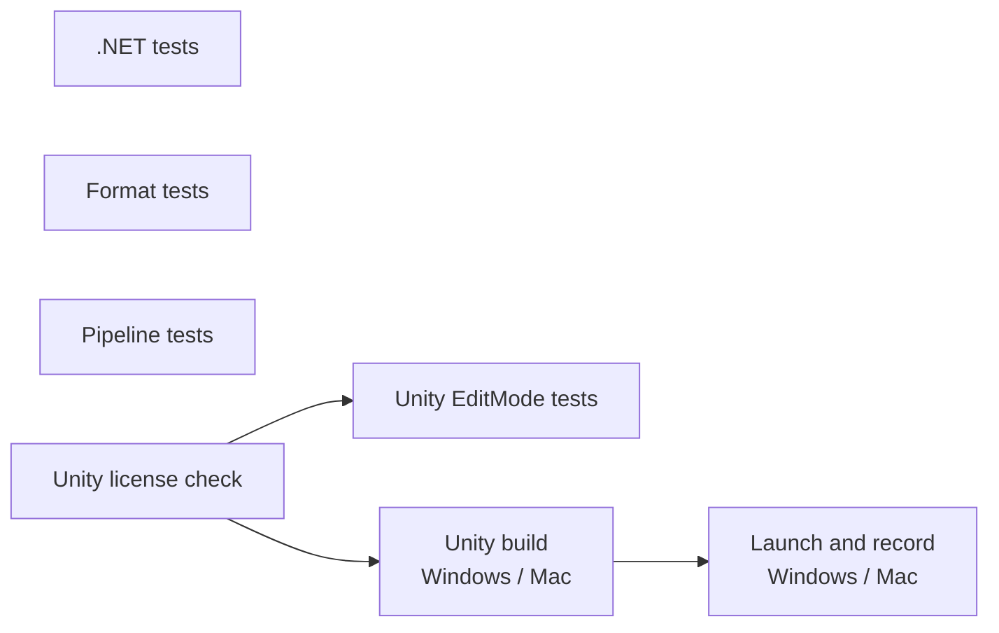

# CI のテスト

GitHub Actions（`.github/workflows/ci.yml`）で自動実行するテストの一覧。テストを追加・変更・削除する PR では、同じ PR でこのページを更新する。

## 実行のタイミング

- PR を作成・更新したとき
- main に push されたとき
- Actions 画面から手動で実行したとき（`workflow_dispatch`）

同じブランチで新しい実行が始まると、古い実行は中止される。

## ジョブの流れ

| ジョブ | 実行環境 | 内容 |
| --- | --- | --- |
| .NET tests | ubuntu | Unity に依存しないコードの単体テスト（`dotnet test dotnet/Ugokue.sln`） |
| Format tests | ubuntu | 中間形式のサンプルと固定テストモデルの検証、Python のテスト、Python → C# → Python の往復 |
| Pipeline tests | ubuntu | 生成パイプラインのうち GPU を使わない部分（分解結果の読み書き、中間形式への変換、重ねた画像の比較、向きと表情の絵の頭の戻しと向きの判定、顔の向きのキーフォームの推定と評価、頭の3D形状による顔の向き）のテスト（`uv run --project pipeline/python pytest pipeline/python`）。参照レンダラーで描くために dotnet を入れ、`UGOKUE_REQUIRE_DOTNET=1` で dotnet がなければ失敗させる |
| Unity license check | ubuntu | Secrets `UNITY_LICENSE`、`UNITY_EMAIL`、`UNITY_PASSWORD` が登録されているかを確かめる。欠けていれば失敗し、Unity のジョブは実行されない |
| Unity EditMode tests | ubuntu（game-ci の Docker イメージ） | Unity エディター上のテスト。結果は PR のチェックとして表示される |
| Unity build | ubuntu（game-ci の Docker イメージ） | Windows（StandaloneWindows64）と Mac（StandaloneOSX）のプレイヤーをビルドし、成果物として保存する |
| Launch and record | windows-latest、macos-latest | ビルドしたプレイヤーを各 OS で起動し、計測の記録を検証する |

Unity エディターは game-ci が実行ごとに Docker イメージとして取得する。バージョンは `unity/ProjectSettings/ProjectVersion.txt` に従う。

## 必須チェック

main の保護ルールで、上の表の全ジョブ（Windows と Mac の両方）を必須チェックにしている。ジョブを追加した PR では、マージ後に人が保護ルールへ追加する。どれかが通らない PR はマージできない。必須チェックはジョブの表示名で照合するため、ジョブ名や matrix の値を変える PR では、人が保護ルールの必須チェックも同時に更新する。game-ci が作る「Test Results」チェックは必須にしていない。

## テストの一覧

### .NET tests

| クラス | テスト | 確かめること |
| --- | --- | --- |
| `FrameRecorderTests` | `RecordsEveryFrameForTheRequestedDuration` | 60fps で 10 秒記録すると、フレーム番号 0〜600 が欠けなく並び、最後の時刻が 10 秒以上になる |
| | `IgnoresFramesAfterCompletion` | 記録完了後のフレームは追加されない |
| | `SkipsFramesDuringWarmup` | ウォームアップ中のフレームは記録されず、ウォームアップ後の最初のフレームが時刻 0 になる |
| | `RejectsNonPositiveDuration` | 記録秒数が 0 以下・NaN なら例外になる |
| | `RejectsNegativeWarmup` | ウォームアップ秒数が負・NaN なら例外になる |
| `FrameSummaryTests` | `ComputesAveragesPercentilesAndMaximum` | 平均 fps、平均フレーム時間、p95、p99、最大、平均 CPU 時間が仕様どおりに計算される |
| | `LeavesCpuTimeEmptyWhenNoSampleHasIt` | CPU 時間が1つも取れていなければ平均 CPU 時間は空になる |
| | `RejectsEmptySamples` | フレームが0件なら例外になる |
| `FrameCsvWriterTests` | `WritesOneRowPerSampleWithInvariantNumbers` | 1フレーム1行で書き出し、ドイツ語環境でも小数点がピリオドになる |
| | `WritesSummaryMetrics` | 集計 CSV の項目と値が仕様どおりになる |
| `RollingFrameStatsTests` | `ReturnsZeroBeforeAnyFrame` | フレームがないとき表示値は 0 になる |
| | `AveragesOnlyTheMostRecentWindow` | 直近の指定フレーム数だけで平均する |
| | `RejectsNonPositiveWindow` | 平均に使うフレーム数が 0 以下なら例外になる |
| `RecordingOptionsTests` | `DisablesAutoRecordWithoutArguments` | 計測の引数がなければ自動記録しない。ウォームアップは既定値になる |
| | `ReadsAllRecordingArguments` | 記録秒数、ウォームアップ、出力先、記録後の終了を読み取る |
| | `RejectsInvalidSeconds` | 記録秒数が 0、負、数値以外なら例外になる |
| | `RejectsInvalidWarmup` | ウォームアップ秒数が負、NaN なら例外になる |
| | `RejectsMissingValue` | 値が必要な引数に値がなければ例外になる |

`Format` 名前空間（`dotnet/Ugokue.Core.Tests/Format/ModelPackageTests.cs`）：

| テスト | 確かめること |
| --- | --- |
| `SaveLoadSaveGivesIdenticalBytes` | 書き出し → 読み込み → 書き出しで、model.json とテクスチャのバイト列が一致する |
| `LoadedModelKeepsValues` | 小数を含む値が読み書きで変わらない |
| `WritesPropertiesInSpecOrder` | 項目が仕様の表の順に書かれる |
| `WritesNullParentAndNullPartMesh` | `parent` とパーツの `mesh` が null のとき、null として書かれる |
| `OmitsOptionalFieldsWhenNotSet` | 省略できる項目は、値がなければ書かれない |
| `RejectsUnsupportedVersion`、`AcceptsOtherPatchVersion` | 0.1.x 以外のバージョンを拒否し、PATCH 違いは読む |
| `RejectsWrongFormat`、`RejectsMissingFormat` | `format` が違う・ないファイルを拒否する |
| `RejectsUnknownTopLevelProperty`、`RejectsUnknownNestedProperty`、`RejectsMissingNullableRequiredProperty` | 未定義の項目と、必須項目の欠けを拒否する |
| `KeepsDateLikeStringsAsWritten` | 日付のような文字列を日付に変換しない |
| `LoadRejectsTexturePathOutsideFolder`、`SaveRejectsTexturePathOutsideFolder` | フォルダの外を指すテクスチャのパスを拒否する |
| `LoadRejectsMissingTexture`、`SaveRejectsMissingOrUnreferencedTexture` | テクスチャの欠けと、参照されないテクスチャの書き出しを拒否する |
| `NumbersAreCultureInvariant` | ドイツ語環境でも同じ内容を書き出す |

`Rig` 名前空間（`dotnet/Ugokue.Core.Tests/Rig/`、[実行時の変形と描画](runtime-deformation.md)）：

| クラス | テスト | 確かめること |
| --- | --- | --- |
| `KeyformInterpolatorTests` | `LocatesSegmentAndFraction` | 格子の端、内側の格子点、区間の途中の値で、区間と区間内の位置が正しい |
| | `ClampsValuesOutsideTheGrid` | 格子の範囲外の値は端に収める |
| | `InterpolatesOneAxisWithClamping` | 1軸の補間が端・中間・範囲外で正しい |
| | `InterpolatesBilinearlyBetweenFourCorners` | 2軸の補間が4隅の重み付きの和になる |
| | `ReturnsKeyformExactlyAtGridPoints` | 格子点ではキーフォームの移動量そのものになる |
| | `AddsToExistingOffsets` | 移動量を足し込む（加算合成） |
| | `RejectsMissingGridPoint` | 格子点が欠けたグループを拒否する |
| | `ParameterValuesClampAndIgnoreUnknownIds` | パラメータの値を範囲に収め、未知の ID と NaN を無視する |
| `ModelRigTests` | `DefaultParametersGiveBaseVertices` | 初期値ではすべてのメッシュが基準の形になる |
| | `MatchesAuthoredShapeAtKeyformPoints` | 格子点のパラメータでは、基準の形にそのキーフォームを足した形と一致する |
| | `FaceMatchesVertexCorrespondenceInEveryView` | 各ビューの角度で、顔の頂点が固定テストモデルの頂点の対応と一致する |
| | `ClampsParametersOutsideTheirRange` | 範囲外の値は端の値と同じ形になる |
| | `SelectsNearestViewAndFirstOnTie` | 最も近いビューを選び、同じ距離なら先のものを選ぶ |
| | `DrawListHidesOverriddenPartsAndSortsByDrawOrderThenPartOrder` | ビューで隠したパーツを除き、ビューで上書きした描画順、同じならパーツの並び順に並べる |
| | `DrawListUsesViewDrawOrderOverride` | ビューの描画順の上書き（右上を向いたときの奥の耳）が描画リストに反映される |
| | `RotatesHeadDescendantsAroundAnchorThenTranslatesForBreath` | AngleZ で頭の子孫が anchor のまわりに回り、そのあと Breath で全体が動く。体は回らない |
| `RenderRegressionTests` | `RenderMatchesBaseline`（24通り：個別のパラメータ、10° おきの角度スイープ、デバッグ表示） | 参照レンダラーで描いた固定テストモデルが、基準画像と許容範囲内で一致する |
| | `ComparisonDetectsMovedPart` | 片目を閉じただけの違いを、比較が検出できる |
| `OcclusionTests` | `ClippedPartsStayInsideTheirMasksDuringSweep`（4通りのスイープ） | 1° おきの角度スイープで、黒目が白目から、歯が口の中からはみ出さない |
| | `IrisWouldStickOutWithoutClipping` | 切り抜きをしなければ黒目が白目からはみ出す（上のテストが意味を持つ） |
| | `FrontHairStaysInFrontOfFaceDuringSweep` | ±30° のスイープで、前髪・目・眉が常に顔の手前にある |
| | `FarEarIsHiddenWhenTurnedSideways`（±30°） | 真横を向くと奥の耳が隠れ、手前の耳は見える |
| | `FarEarMovesBehindBackHairWhenTurnedDiagonally`（右上、左下） | 斜めを向くと奥の耳が後ろ髪の後ろに回る |
| | `ViewSwitchIsSeamlessAtBoundary`（28点） | ビューの境界のすぐ手前とすぐ先で、見た目が一致する |
| | `SeamCheckDetectsVisibleDrawOrderSwap` | 境界で見た目が変わる切り替え（横髪を顔の後ろに回す）を検出する |
| | `SweepHasNoFlickerOrLargeJumps`（4通りのスイープ） | 1° ごとの変化が大きすぎず、1° だけ色が変わるちらつきがない |
| | `FlickerCheckDetectsPartMissingForOneDegree` | 1° の間だけ前髪が消えると、ちらつきとして検出する |
| `DepthOrderingTests`（`Rig/DepthPrototype/`、[頂点ごとの奥行きの試作](runtime-deformation.md#頂点ごとの奥行きの試作)） | `DrawOrderCompositionMatchesTheReferenceRenderer`（3通り） | 試作の重ね方を描画順で使うと、参照レンダラーと一致する |
| | `DepthAloneBreaksTheFrontView` | 奥行きだけで並べると、正面の絵が崩れる |
| | `BiasesKeepTheFrontViewUnchanged`（4通り） | パーツごと・頂点ごとのかさ上げで、正面の絵が今と一致する |
| | `SweepHasNoFlickerOrLargeJumpsWithEnoughMargin`（2軸） | 余裕 5 の頂点ごとのかさ上げで、±30° のスイープにちらつきも大きな変化もない |
| | `SmallMarginMakesBackHairJumpInFrontOfTheNeck` | 余裕 1 では、上を 1° 向くだけで後ろ髪が首と体の手前に一度に出る |
| | `FarSideHairGoesBehindTheCheekOnlyWithSmallMargin` | 奥の横髪が 30° で頬の後ろに回るのは余裕 1 のときだけで、余裕 5 では今の方式とほとんど同じ |
| | `PrepassLeavesSeamsAtSoftEdges` | 深度の事前描画では、半透明の縁で正確な重ね方と食い違う |
| | `WritesSweepForReview` | `UGOKUE_DEPTH_SWEEP_OUT` を設定したときだけ、比べるためのスイープの画像を書き出す |

`Imaging` 名前空間（`dotnet/Ugokue.Core.Tests/Imaging/PngTests.cs`）：

| テスト | 確かめること |
| --- | --- |
| `EncodeThenDecodeKeepsPixels` | 書き出して読み込むと画素が一致する |
| `DecodesEveryFilterType` | PNG の5種類の行フィルタを正しく戻す |
| `ExpandsRgbAndGrayToRgba` | RGB、グレー、グレー＋アルファを RGBA にする |
| `DecodesEveryTestModelTexture` | 固定テストモデルのテクスチャをすべて読める |
| `RejectsNonPng` | PNG でないデータを拒否する |

`Live` 名前空間（`dotnet/Ugokue.Core.Tests/Live/`、[nizima LIVE からの受信](nizima-live.md)）。`NizimaLiveClientTests` と `ProbeRecorderTests` は、nizima LIVE の応答をまねるテスト用の WebSocket サーバー（`FakeNizimaLiveServer`）を相手に動かす：

| クラス | テスト | 確かめること |
| --- | --- | --- |
| `NizimaProtocolTests` | `BuildsRequestWithApiVersionIdAndData` | リクエストに API のバージョン、種類、メソッド、ID、データ、時刻が入る |
| | `ParsesErrorType` | Error のメッセージから `ErrorType` を読む |
| | `ReturnsNullForUnreadableMessages`（3通り） | JSON でないもの、`Method` のないもの、オブジェクトでないものを読み飛ばす |
| | `ReadsValuesOfFirstOrSelectedModel` | 指定がなければ最初のモデル、指定があればそのモデルの値を読み、ないモデルは null になる |
| | `ReturnsNullWhenNoModelIsLoaded` | `Models` が空・ないときは null になる |
| | `SkipsValuesThatAreNotNumbers` | 数値でない値と `Id` のない値を捨てる |
| | `ReadsLiveParameterDefinitions` | `GetLiveParameters` の名前、作成元、グループ、範囲、初期値、繰り返しを読み、`Id` のないものを捨てる |
| `ReceiveRateMeterTests` | `ReturnsNullWithFewerThanTwoFrames` | 受信が2回未満なら計算しない |
| | `ComputesRateAndIntervals` | 毎秒の受信回数と、受信間隔の平均・p95・最大を計算する |
| | `DropsFramesOlderThanTheWindow` | 計測の幅より古い受信を除く |
| | `RejectsNonPositiveWindow` | 計測の幅が 0 以下なら例外になる |
| `NizimaLiveClientTests` | `FirstConnectionRegistersSavesTokenAndStreamsAfterEnable` | 初回は RegisterPlugin でトークンを保存し、有効化の通知のあとで値の通知とパラメータ一覧を要求し、値を受け取る |
| | `LaterConnectionUsesSavedToken` | 2回目からは保存したトークンで EstablishConnection する |
| | `WaitsForEnableWhenPluginIsDisabled` | プラグインが無効なら、有効化の通知が来るまで値の通知を要求しない |
| | `InvalidTokenRegistersAgain` | トークンが無効なら、消して RegisterPlugin からやり直す |
| | `ReconnectsAfterNizimaLiveRestarts` | nizima LIVE を終了・再起動すると、自動でつなぎ直して値を受け取る |
| | `KeepsRetryingUntilNizimaLiveStarts` | nizima LIVE が起動していなくても落ちず、起動したらつながる |
| | `FrameWithoutModelsKeepsPreviousValues` | モデルのない通知では値を更新せず、モデルがないことを記録する |
| | `IgnoresMalformedMessages` | 読めないメッセージを無視して接続を続ける |
| | `StopEndsTheConnection` | 停止すると `Disconnected` になる |
| | `DefaultsToIpv4LoopbackBecauseNizimaLiveListensOnlyThere` | 既定の接続先が `ws://127.0.0.1:22022/` で、ポートを変えた接続先も 127.0.0.1 になる |
| `RecordedNizimaMessageTests` | `ReadsRegisterPluginResponse`、`ReadsEnableEventAndEstablishResponse` | 実機で記録した登録の応答、有効化の通知、接続の応答を読む（`Live/Fixtures/`、トークンは伏せてある） |
| | `ReadsAllLiveParameterDefinitions` | 実機のパラメータ一覧から 165 個の定義を読み、範囲・初期値・繰り返しが正しい |
| | `ReadsFrameWithTrackedFace`、`ReadsFrameWithoutTrackedFaceAsBaseValues` | 顔を捉えている通知と見失っている通知から、165 個の値を読む。Cubism パラメータは含めない |
| | `ValuesCanExceedTheDeclaredRange` | 実機の値は宣言された範囲を超えることがあり、読み取りでは範囲に収めない |
| | `FramesNameTheLoadedModel` | 通知に読み込んだモデルの ID が入り、ID を指定して読める |
| `TrackingAdapterTests` | `MapsSourceValuesToModelParameters`、`RemapsInputRangeToOutputRange` | nizima LIVE の値を、変換表に従ってモデルのパラメータに置き換える |
| | `ClampsToTheParameterRange`（4通り） | 範囲を超えた値（`Yaw` −39.8、`Roll` 49、目の見開き、負の口の開き）を、パラメータの範囲に収める |
| | `CalibrationMakesTheCurrentPoseFront`、`CalibrationNeedsAValidFrame` | 校正で今の向きが正面になり、目は校正されない。取り消せる。有効なフレームがなければ校正できない |
| | `SmoothingFollowsAtTheSameSpeedAtAnyFrameRate` | 30・60・144 fps で、同じ時間に同じだけ追従する |
| | `DefaultSmoothingKeepsHalfOfThePreviousValuePerSixtiethSecond`、`ModelSmoothingOverridesTheDefault` | 既定の平滑化の強さが 0.5 で、モデルの `tracking.parameters` の値が優先される |
| | `HoldsTheLastValuesWhileTheFaceIsLost`、`HoldsWhenFramesStopArriving` | 顔を見失ったときも、通知が止まったときも、直前の値を保持する |
| | `ReturnsSlowlyToDefaultsAfterTheHold` | 保持のあと、跳ねずに初期値へ戻る |
| | `RecoversWithoutAJump`、`WithoutRecoveryHandlingTheSameInputWouldJump` | 復帰のとき 1/60 秒あたりの変化が 3° 未満に収まる。復帰の処理がなければ跳ねる（上のテストが意味を持つ） |
| | `DoesNotWriteParametersBeforeTheFirstValidFrame`、`WritesOnlyMappedParameters`、`IgnoresMappingsToParametersTheModelDoesNotHave`、`MissingSourceValuesKeepTheParameterDefault` | 入力が来るまで書き込まない。変換表にないパラメータは触らない |
| `TrackingPlaybackTests` | `LoadsRecordedFramesInOrder` | 記録を時刻順に読み、指定した時点の最新のフレームを返す |
| | `ShortFaceLossHoldsThePoseAndRecoversSmoothly`、`RawInputJumpsWhereTheAdapterDoesNot` | 実機の記録で、0.83 秒の見失いのあいだ目と口を保持し、捉え直したときに跳ねない。生の値は跳ねている |
| | `LongFaceLossReturnsToTheFrontWithoutJumps` | 長く見失うと、跳ねずに正面へ戻る |
| | `OutOfRangeAnglesStopAtTheParameterLimit` | 実機の範囲外の値で、`AngleX` が ±30 で止まる |
| | `CalibrationOnRecordedDataMakesThatPoseFront` | 実機の記録で、校正した向きが正面になる |
| `LatencyMeterTests` | `ReturnsNullBeforeAnySample`、`ComputesAverageP95AndMaximumOfRecentSamples`、`KeepsOnlyTheMostRecentSamples`、`IgnoresInvalidSamples`、`RejectsNonPositiveCapacity` | 遅延の平均・p95・最大を直近の測定値から求め、負の値と NaN を捨てる |
| `ProbeRecorderTests` | `RecordsMessagesFramesAndParameters` | 確認ツールが、受け取ったメッセージ、モデルあり・なしの通知の数、届いたパラメータ名、パラメータ一覧、状態の変化、受信レートを記録する |
| | `KeepsUnreadableMessagesAsText` | JSON として読めないメッセージを文字列のまま記録する |

### Format tests

`ugokue-format validate` で `format/samples/minimal` と `format/samples/test-face`（[固定テストモデル](test-model.md)）を検証したあと、`format/python/tests/` を実行する。表の「各サンプル」のテストは、2つのフォルダのそれぞれで実行する。

| ファイル | テスト | 確かめること |
| --- | --- | --- |
| `test_roundtrip.py` | `test_sample_regenerates_byte_identically` | サンプルの生成結果が、リポジトリのサンプルとバイト単位で一致する |
| | `test_test_face_regenerates_byte_identically` | 固定テストモデルの生成結果が、リポジトリのフォルダとバイト単位で一致する |
| | `test_python_roundtrip`（各サンプル） | Python で読み込んで書き出すと、元と一致する |
| | `test_csharp_roundtrip`（各サンプル） | C#（`dotnet/Ugokue.Format.Cli`）で読み込んで書き出すと、元と一致する（JSON は値として、PNG はバイト列で比較）。CI では `UGOKUE_REQUIRE_DOTNET=1` を設定し、dotnet がなければ失敗させる |
| | `test_load_rejects_unreadable_version` | 読めないバージョンを拒否する |
| | `test_compare_reports_differences` | 比較ツールが値とテクスチャの違いを検出する |
| `test_validate.py` | `test_sample_is_valid` | サンプルが検証を通る |
| | `test_missing_required_field`、`test_wrong_type`、`test_unknown_field`、`test_confidence_out_of_range`、`test_bad_version` | 必須項目の欠け、型の違い、未定義の項目、範囲外の値、読めないバージョンを検出する |
| | `test_rule01_`〜`test_rule14_` で始まるテスト | [中間形式の検証規則](intermediate-format.md#検証) の 1〜14 を、それぞれ1つ以上の壊したサンプルで検出する |
| | `test_malformed_document_reports_without_crash` | 構造が大きく壊れたファイルでも、例外で止まらずにエラーを報告する |
| `test_face_model.py` | `test_test_face_is_valid` | 固定テストモデルが検証を通る |
| | `test_has_about_twenty_face_parts` | パーツが 20 以上あり、前髪・眉・まぶた・白目・黒目・口の中などの役割がそろっている |
| | `test_every_head_mesh_has_angle_grid` | 頭の子孫のメッシュがすべて、AngleX × AngleY の 3×3 のキーフォームを持つ |
| | `test_blink_and_mouth_move_their_meshes` | EyeOpenL、EyeOpenR、MouthOpenY のキーフォームが、目と口（あごを含む）のメッシュを動かす |
| | `test_default_parameters_give_base_shape` | パラメータが初期値のとき、どのキーフォームも移動量が 0 |
| | `test_views_cover_angle_grid` | ビューが顔の向きの 3×3 の格子と一致する |
| | `test_landmarks_exist_in_every_view_where_visible` | 特徴点が、隠れていない限りすべてのビューにある |
| | `test_vertex_matches_follow_angle_keyforms` | 頂点の対応の位置が、そのビューの角度のキーフォームを適用した頂点位置と一致する |

### Pipeline tests

`pipeline/python/tests/` を実行する。分解結果は、テストの中で単色の小さな層から作る。顔の特徴点は、テストの中で作った28点の座標を使う（GPU、See-through、Qwen-Image-Edit、anime-face-detector は使わない）。キーフォームの推定は、固定テストモデルを C# の参照レンダラーで描いた絵と、手作りの特徴点で確かめる。

| ファイル | テスト | 確かめること |
| --- | --- | --- |
| `test_result.py` | `test_write_then_load_keeps_layers` | 分解結果のフォルダを書いて読むと、層のタグ・箱・深度・画像、元のイラスト、実行の記録が変わらない |
| | `test_layer_files_use_safe_names` | タグの空白などを `_` にしたファイル名で書く |
| | `test_reads_see_through_output` | See-through の出力（`info.json` と層の PNG）を読み、古いタグ名（`hairf`、`eyebg`）を今の名前にそろえる |
| | `test_maps_square_frame_back_to_source` | See-through の正方形の座標の層を、元のイラストの座標に戻す。余白にはみ出した部分は切り落とし、余白だけの層は捨てる |
| `test_convert.py` | `test_converted_model_passes_validation` | 変換したモデルが中間形式の検証を通る |
| | `test_maps_tags_to_parts_with_roles_and_parents` | タグを、役割と親を持つパーツにし、メッシュを持たない `body`、`head` を加える。合成済みの `head` の層は使わない |
| | `test_irises_are_clipped_by_their_eye_whites` | 黒目を同じ側の白目で切り抜く |
| | `test_draw_order_follows_depth_from_far_to_near` | 深度の大きい（奥の）層から描画順を付ける |
| | `test_front_hair_is_never_drawn_behind_the_face` | 前髪の層の深度が顔より奥でも、前髪を顔と顔の上のパーツより手前に描く |
| | `test_each_part_has_a_grid_mesh_over_its_box` | 各パーツに、層の箱を覆う格子のメッシュとテクスチャを付ける |
| | `test_unknown_tags_become_accessories` | 表にないタグは `accessory` にする |
| | `test_result_without_layers_still_has_base_view` | 層が1つもなくても、検証を通るモデルになる |
| `test_composite.py` | `test_composite_of_all_parts_matches_the_source` | 全パーツを重ねた画像が、元のイラストと一致する |
| | `test_head_layer_is_not_composited` | 合成済みの `head` の層は重ねない |
| | `test_composite_follows_the_model_draw_order` | 比較用の合成は、モデルの描画順（前髪の規則を含む）で重ねる |
| | `test_comparison_detects_a_missing_part`、`test_diff_image_marks_differences` | パーツが欠けると、比較の値と差分画像に表れる |
| `test_report.py` | `test_report_converts_validates_and_compares_each_result` | まとめの処理が、変換・検証・比較をして `summary.json` と画像を書く |
| | `test_identical_results_have_no_differences`、`test_detects_a_changed_layer` | 2回の分解結果の比較で、同じなら違いなし、1画素でも違えば検出する |
| `test_views.py` | `test_view_names_encode_angles` | 向きの絵の名前（`x+30_y-20`）が角度を表す |
| | `test_sample_spec_covers_the_angle_grid_and_expressions` | `pipeline/samples/views.json` が、正面を除く 3×3 の向き（±30°・±20°）と、閉じ目・口開けの表情を持つ |
| | `test_prompts_expand_the_keep_sentence`、`test_rejects_duplicate_views` | 指示文の `{keep}` を置き換える。同じ絵が2つあれば読み込みで失敗する |
| | `test_write_views_pastes_heads_and_judges_poses` | 生成した絵の頭だけを戻した絵を書き、頭以外の変化と向きの判定をまとめる |
| | `test_contact_sheet_lays_out_the_grid_and_expressions` | 確認用の一覧の画像に、3×3 の向きと表情を並べる |
| `test_mesh.py` | `test_grid_covers_the_box_and_maps_uvs_to_positions` | 格子のメッシュが層の箱を覆い、UV が位置と対応する |
| | `test_cells_without_opaque_pixels_are_dropped`、`test_empty_layer_still_gets_one_cell` | 不透明な画素のないマスは捨てる。空の層にも1マスは残す |
| | `test_triangles_wind_like_the_test_model` | 三角形の向きが固定テストモデルと同じ |
| | `test_cell_size_scales_with_the_canvas` | マスの大きさがイラストの大きさに比例し、8 画素を下回らない |
| `test_deform.py` | `test_grid_points_use_their_keyform`、`test_between_grid_points_is_linear_and_clamped` | キーフォームの補間が、格子点で一致し、間で線形、範囲外で端の値になる |
| | `test_quality_detects_flipped_and_stretched_triangles` | 三角形の裏返りと伸びを検出する |
| `test_correspond.py` | `test_rigid_rotation_moves_the_front_of_the_head_toward_the_turn` | 楕円体として回すと、頭の前面が向いた側へ動く |
| | `test_similarity_recovers_scale_rotation_and_shift`、`test_normalizing_undoes_a_shrunk_and_tilted_view` | 相似変換で、縮めて傾けた向きの絵の大きさと傾きを取り除く |
| | `test_normalizing_ignores_implausible_rotation_but_keeps_scale`、`test_scale_is_kept_within_range`、`test_normalizing_uses_only_stable_landmarks` | 補正の回転が大きすぎれば回転なしで合わせ、拡大率は範囲に収め、指定した特徴点だけを使う |
| | `test_correspondence_follows_a_shifted_face` | 薄板スプラインとオプティカルフローで、ずらした顔の対応点を求める |
| `test_evaluate.py` | `test_locate_and_move_a_point_with_its_triangle`、`test_landmark_error_before_and_after_deforming` | 特徴点を含む三角形の変形で動かし、変形の前後のずれを測る |
| | `test_image_difference_counts_only_the_region` | 画像の差を、指定した範囲の画素だけで測る |
| | `test_mesh_quality_finds_flips_between_grid_points` | 中間の角度での裏返りを検出する |
| `test_estimate.py` | `test_solve_reaches_consistent_targets`、`test_solve_fills_unmatched_vertices_smoothly` | 頂点の移動量を解くと、対応点に合い、対応点のない頂点は滑らかに埋まる |
| | `test_solve_keeps_an_uneven_prior_without_targets` | 予測の形を保つ指定では、滑らかさは予測からのずれにかかり、場所によって違う予測の動きをならさない |
| | `test_flips_are_resolved_by_stronger_smoothness` | 裏返ったら、予測の形もならし、滑らかさを強めて解き直す |
| | `test_parts_drawn_in_front_of_the_face_lie_on_the_head_surface` | 顔の層より手前のパーツ（前髪）を頭の前面に沿わせる |
| | `test_head_depth_inflates_the_face_layer` | 頭の前面の奥行きは、顔の層をふくらませた形（外で 0、いちばん内側で 0.5 × r） |
| | `test_turning_narrows_the_side_the_face_turns_toward` | 右を向くと、顔の中心は輪郭より大きく動き、右半分が狭く、左半分が広くなる |
| | `test_planar_depth_ignores_points_outside_the_face` | パーツの奥行きを、顔の上の頂点に当てはめた平面で置き換える（顔の外の頂点は平面を延ばす） |
| | `test_features_placed_by_rotation_keep_their_distance_to_the_contour` | 奥の目の特徴点が外れていても、目・眉・鼻・口の横の位置を回転から取ると、奥の目は頭の前面と一緒に輪郭の側へ動く |
| | `test_eye_on_the_far_side_narrows_when_turning` | 奥行きを渡すと、右を向いたときに画面の右の目が細くなり、左の目より細い |
| | `test_deeper_pivot_moves_the_whole_head_toward_the_turn` | 左右に回す軸を奥に置くと、顔、後ろ髪、前髪を含む頭全体が、向いた側へさらに動く |
| | `test_head_parts_and_owner_map_of_the_test_face` | 固定テストモデルの頭のパーツと、各画素でいちばん手前のパーツを求める |
| | `test_estimate_covers_every_head_mesh` | 固定テストモデルから、頭のすべてのメッシュの顔の向きのキーフォームを推定する |
| | `test_face_features_follow_the_hand_made_keyforms` | 目・眉・鼻・口の推定のずれが、手作りのキーフォームの動きの 25% 以下、顔は動きより小さい |
| | `test_estimated_keyforms_do_not_flip_triangles` | 推定したキーフォームで、中間の角度を含めて三角形が裏返らない |
| | `test_depth_moves_parts_behind_the_face_the_right_way` | 層の奥行きを渡すと、髪と耳が手作りのキーフォームに近づき、顔のパーツの精度は保たれる |
| `test_head3d.py`（[頭の3D形状による顔の向き](head-rotation.md)） | `test_sphere_setting_matches_the_hand_made_keyforms` | 球の設定と固定テストモデルの奥行きで作ると、手作りの顔の向きのキーフォームと 0.01 画素以内で一致する |
| | `test_template_fits_the_face_layer_and_landmarks` | 合成した顔で、頭の半径・中心・断面の幅と奥行き・あごの板が、顔の楕円と口の位置に合う |
| | `test_turning_left_and_right_are_mirror_images`（18通り） | 顔・前髪・鼻・目・耳・後ろ髪を左右に回した位置が、鏡に映した関係になる |
| | `test_far_eye_narrows_toward_its_outer_corner_and_near_eye_keeps_its_width` | 30° で、奥の目は 0.85 倍未満に縮み、目尻の側ほど縮む。手前の目は 0.9 倍以上 |
| | `test_nose_tip_moves_more_than_the_mouth_and_cheek` | 30° で、横の動きが 鼻 > 口 > 顔 の順になる |
| | `test_chin_moves_toward_the_turn` | 30° で、あご先が頬の輪郭の中央より向いた側へ寄る |
| | `test_front_view_is_unchanged` | 0° の移動量がすべて 0 |
| | `test_eyes_and_brows_stay_inside_the_contour_at_every_angle`（6パーツ） | 中間の角度を含む各角度で、白目・黒目・眉が顔の輪郭の外に出ない |
| | `test_no_flipped_or_extremely_stretched_triangles_between_grid_points` | 中間の角度を含めて三角形が裏返らず、顔と髪以外は伸びが 1/3〜3 倍に収まる |
| | `test_neck_top_follows_the_head_and_bottom_stays` | 首の上端は頭と一緒に動き、下端は動かない |
| | `test_keyforms_cover_the_grid_and_widen_the_angle_range` | 格子が −45〜45 × −20〜20 で、`AngleX` の範囲が ±45 に広がる |
| `test_head.py` | `test_mask_covers_head_layers_but_not_the_body`、`test_margin_grows_the_mask` | 頭の層（親が `head`、`face` のパーツ）だけからマスクを作り、指定した幅だけ広げる |
| | `test_mask_excludes_head_layers_hidden_behind_the_body` | 体の層の裏に隠れた頭の層（補完された後ろ髪）はマスクに入れない |
| | `test_mask_stops_a_little_below_the_chin` | マスクは、顔の下端から顔の高さの 0.15 倍までで切る |
| | `test_crop_surrounds_the_face_with_room_for_hair_and_neck`、`test_crop_stays_inside_the_image_and_needs_a_face` | 生成のために切り出す範囲を、顔の層の箱を広げて決め、イラストの内側に収める。顔の層がなければ失敗する |
| | `test_paste_keeps_pixels_outside_the_head` | マスクの外は元のイラストのまま、内は生成した絵、境界は混ぜる |
| | `test_outside_difference_ignores_the_head` | 頭以外の変化の量を、マスクの外の画素だけで数える |
| `test_pose.py` | `test_front_face_has_zero_yaw`、`test_features_moving_right_mean_facing_right`、`test_nose_closer_to_the_eyes_means_facing_up` | 特徴点から、左右（目の位置）と上下（鼻の位置）の向きの値を求める |
| | `test_uses_the_most_confident_face` | 複数の顔を検出したら、いちばん確からしい顔を使う |
| | `test_judge_checks_direction_only_on_turned_axes` | 正面からの変化が、指定した向きと同じ向きかを、角度が 0 でない軸だけ判定する |

### Unity EditMode tests

| クラス | テスト | 確かめること |
| --- | --- | --- |
| `MainSceneTests` | `MainSceneIsTheOnlyEnabledBuildScene` | ビルドに含まれるシーンが Main シーンだけである |
| | `MainSceneHasCameraAndPerformanceMonitor` | Main シーンにカメラと `PerformanceMonitor` がある |
| | `FrameTimingStatsAreEnabled` | Player Settings の Frame Timing Stats がオン（CPU 時間の計測に必要） |
| | `PlayerKeepsRunningWhenUnfocused` | Player Settings の Run In Background がオン（OBS などにフォーカスがあっても止まらない） |
| | `MainSceneHasModelRendererWithPartMaterialAndSliders` | Main シーンに `ModelRenderer`（`Ugokue/UnlitTransparent` のマテリアル付き）と `ParameterSliders` がある |
| | `MainSceneModelRendererHasMaskAndDebugMaterials`（マスク用、デバッグ用） | `ModelRenderer` にマスク用（`Ugokue/StencilMask`）とデバッグ用（`Ugokue/DebugColor`）のマテリアルが設定されている |
| | `MainSceneHasDrawOrderDebugViewTargetingTheModel` | Main シーンに、モデルを対象にした `DrawOrderDebugView` がある |
| `NizimaLiveReceiverTests` | `MainSceneHasOneReceiverOnTheDefaultPort` | Main シーンに、ポート 22022 に接続する `NizimaLiveReceiver` が1つある |
| | `TokenIsKeptInPersistentData` | トークンを永続データフォルダに保存する |
| | `StatusShowsAHintUntilStreaming`（3通り） | 値が届くまでの各状態で、次にする操作の案内を表示する |
| | `StatusShowsRateWhileStreaming`、`StatusWarnsWhenFramesHaveNoModel` | 受信中は受信レートを、モデルのない通知のときはその旨を表示する |
| | `ValuesAreListedInIdOrder` | 受け取った値をパラメータ名の順に表示する |
| `TrackingDriverTests` | `MainSceneHasDriverWiredToTheModelAndTheReceiver` | Main シーンに、モデルと `NizimaLiveReceiver` につながった `TrackingDriver` がある |
| | `RecordedInputMovesTheTestFace` | 実機の記録を再生すると、固定テストモデルの `AngleX` がアダプターの出力どおりに動き、±30 で止まる |
| | `CalibrationMakesTheCurrentPoseFront` | 傾けた状態で校正すると、`AngleZ` が正面（±1°）になる |
| | `ParametersAreLeftAloneBeforeTheFirstFrame` | 入力が来るまで、スライダーなどで設定した値を上書きしない |
| | `ReadsThePlaybackArgument` | 起動引数 `-ugokue-tracking-playback` を読む |
| | `StatusDescribesTheState`（4通り）、`StatusShowsCalibrationAndLatency` | 状態、校正の有無、遅延を表示する |
| | `LatencyMarkerLightsWhenTheMouthIsOpen`（3通り） | 遅延計測用の目印は、口の開きが 0.5 を超えたときだけ点く |
| `ModelRendererTests` | `CreatesOneRendererPerPartWithMeshPlusMaskAndClippedAwayRenderers` | メッシュを持つパーツごとに1つ、マスクごとに1つ、切り抜かれるパーツごとにデバッグ用の1つの MeshRenderer を作る（`head` には作らない） |
| | `VerticesFollowRigPositionsAfterTurningRight` | AngleX = 30 で、Unity のメッシュの頂点が変形後の位置を座標変換したものと一致し、隠れる耳が非表示になる |
| | `SortingOrderFollowsDrawListWithMasksBeforeTheirPart`（AngleX = 0、30、−30） | `sortingOrder` が描画リストの順で、マスクがそのパーツの直前に来る。表示するのは描画リストのパーツとそのマスクだけ |
| | `ClippedPartsHaveOneMaskRendererUsingTheMaskPartMesh` | 黒目と歯がそれぞれマスクを1つ持ち、マスクのパーツと同じ Unity の Mesh と `Ugokue/StencilMask` を使う |
| | `MaskVerticesFollowTheMaskPartAfterMoving` | パラメータを変えると、マスクの頂点もマスクのパーツと同じように動く |
| | `StencilValuesOfClippedPartsDoNotOverlap` | マスクは Always / Replace、パーツは Equal で同じ値を使い、値はパーツごとに重ならない |
| | `UnclippedPartsDoNotUseTheStencil` | 切り抜かないパーツはステンシルを使わない |
| | `DebugViewColorsPartsByRankAndShowsClippedAwayShapes` | デバッグ表示で、各パーツが描画リストの順番の色になり、切り抜かれる部分がマゼンタで表示される。戻すと元のマテリアルに戻る |
| | `UvsAreFlippedToBottomLeftOrigin` | UV の v が 1 − v になる |
| `ModelLocationTests` | `ArgumentWinsOverDefaults`、`EditorDefaultsToRepositoryTestFace`、`PlayerDefaultsToStreamingAssets`、`ArgumentWithoutValueFallsBackToDefault` | 読み込むモデルのフォルダを、起動引数、エディター、プレイヤーの順に決める |
| | `EditorSelectionWinsOverTheTestFaceInEditor`、`EditorSelectionIsIgnoredInPlayerAndBelowTheArgument`、`MissingEditorSelectionFallsBackToTheTestFace` | エディターで選んだフォルダは、起動引数より後、固定テストモデルより先に使う。プレイヤーでは使わず、フォルダがなければ固定テストモデルに戻る |
| | `CandidatesAreTheTestFaceAndGeneratedModels`、`CandidatesWithoutGeneratedModelsAreOnlyTheTestFace` | エディターで選べる候補は、固定テストモデルと、`artifacts/keyforms` のうち model.json があるモデル（名前順） |
| `StreamingModelBuildHookTests` | `CopyModelCopiesModelJsonAndAllPngs` | ビルド前に model.json とすべての PNG を StreamingAssets に複製する |
| | `RemoveModelDeletesCopyMetaFilesAndEmptyFolders`、`RemoveModelKeepsOtherStreamingAssets` | ビルド後に複製と .meta、空になったフォルダを消し、ほかのファイルは残す |
| `FormatSampleTests` | `SampleLoadsWithPngTextures`（`minimal`、`test-face`） | Unity 上でサンプルを読み込め、すべてのテクスチャが PNG として読める |
| | `SampleRoundTripsThroughSave`（`minimal`、`test-face`） | Unity 上で読み込み → 書き出し → 読み込みをしても、内容が Python で書いた元と値として一致する |

### Unity build

- Windows と Mac のプレイヤーがエラーなくビルドできる。

### Launch and record

`.github/scripts/perf_smoke.py` が、プレイヤーを `-batchmode -nographics` で起動して 3 秒記録し、次を確かめる。描画しないため、fps の値は [数値目標](performance-targets.md) の判定には使わない。

- プレイヤーが記録を保存して自分で終了する（180 秒でタイムアウト）
- 本体 CSV のヘッダーが仕様どおり
- フレーム番号が 0 から連番で、時刻が減らず、フレーム時間が負でない
- 最初の時刻が 0 で、最後の時刻が指定秒数以上
- 集計 CSV のフレーム数が本体 CSV の行数と一致し、記録時間が指定秒数以上

## チケットのテスト項目との対応

| チケット | テスト項目 | CI での確認 |
| --- | --- | --- |
| PoC-01 #3 | 自動ビルドが通る | Unity build |
| PoC-01 #3 | 計測の記録が、指定した秒数ぶん欠けなく保存される | `FrameRecorderTests.RecordsEveryFrameForTheRequestedDuration`、Launch and record |
| PoC-02 #4 | Python で書き出し → C# で読み込み → 再び書き出し、元と一致する | Format tests の `test_csharp_roundtrip`、Unity EditMode tests の `FormatSampleTests` |
| PoC-02 #4 | 必須項目の欠けや不正な値を、検証ツールが検出する | Format tests の `test_validate.py` |
| PoC-03 #5 | 検証ツールでエラーが出ない | Format tests の「Validate samples」と `test_test_face_is_valid` |
| PoC-03 #5 | 以降のチケットの自動テストで、常に同じ入力として使える | Format tests の `test_test_face_regenerates_byte_identically`、`test_face_model.py`、各サンプルの往復、Unity EditMode tests の `FormatSampleTests` |
| PoC-04 #6 | 補間計算の単体テスト（端の値、中間値、範囲外の値） | .NET tests の `KeyformInterpolatorTests`、`ModelRigTests` |
| PoC-04 #6 | 固定のパラメータ値で描画した画像を、基準画像と比較する | .NET tests の `RenderRegressionTests` |
| PoC-04 #6 | キーフォームの位置では、作成した形と一致する（受け入れ条件） | .NET tests の `MatchesAuthoredShapeAtKeyformPoints`、`FaceMatchesVertexCorrespondenceInEveryView`、Unity EditMode tests の `VerticesFollowRigPositionsAfterTurningRight` |
| PoC-05 #7 | 角度スイープ（正面 → ±30°）で画像回帰テストを行い、ちらつきや二重像を検出する | .NET tests の `RenderMatchesBaseline`（`sweep-*`）、`OcclusionTests`（`ViewSwitchIsSeamlessAtBoundary` を含む） |
| PoC-05 #7 | 黒目が白目からはみ出さない（受け入れ条件） | .NET tests の `ClippedPartsStayInsideTheirMasksDuringSweep`、`IrisWouldStickOutWithoutClipping` |
| PoC-05 #7 | ±30° の範囲で、前髪と顔の前後関係が崩れない（受け入れ条件） | .NET tests の `FrontHairStaysInFrontOfFaceDuringSweep` |
| PoC-06 #9 | 届いた JSON を読み取る処理の単体テスト | .NET tests の `RecordedNizimaMessageTests`（実機で記録したデータ）、`NizimaProtocolTests`、`NizimaLiveClientTests` |
| PoC-06 #9 | nizima LIVE を終了・再起動しても、アプリが落ちずに再接続できる | .NET tests の `ReconnectsAfterNizimaLiveRestarts`、`KeepsRetryingUntilNizimaLiveStarts` |
| PoC-07 #10 | 記録した入力データを再生するテスト（校正・平滑化・途切れ・範囲外の値） | .NET tests の `TrackingPlaybackTests`、`TrackingAdapterTests`、Unity EditMode tests の `TrackingDriverTests` |
| PoC-07 #10 | 総遅延を計測して記録する | アプリ内の遅延表示は `LatencyMeterTests`。全体の遅延は人がスローモーション撮影で測る（[入力アダプター](tracking-adapter.md#遅延)） |
| PoC-08 #12 | 全パーツを重ねると元のイラストとほぼ一致する（差分画像で確認） | Pipeline tests の `test_composite.py`（比較の仕組み）。実際のイラストでの値は、GPU で実行して [パーツ分解](part-decomposition.md#実機の結果) に記録する |
| PoC-08 #12 | 同じ入力・同じ設定で、同じ結果が出る（乱数の固定） | Pipeline tests の `test_report.py`（比較の仕組み）。実際の再現性は `check_determinism` で確かめて記録する |
| PoC-09 #13 | 頭以外の領域が、元のイラストから大きく変わっていない（差分量で判定） | Pipeline tests の `test_head.py`（マスクと差分の仕組み）。実際の値は、GPU で生成して [向きと表情の差分の生成](view-generation.md#実機の結果) に記録する |
| PoC-09 #13 | 顔の特徴点を検出し、指定した向きにおおむね向いているかを確認する | Pipeline tests の `test_pose.py`（判定の仕組み）。実際の判定は `generate_views` で検出して記録する |
| PoC-10 #14 | 変形結果と正解の絵の差を数値で測る（特徴点のずれ、画像の差） | Pipeline tests の `test_evaluate.py`（測る仕組み）。実際のイラストでの値は `keyforms` で測って [対応づけと変形推定](keyform-estimation.md#実機の結果) に記録する |
| PoC-10 #14 | 三角形の裏返りや極端な伸びを自動で検出する | Pipeline tests の `test_deform.py`、`test_mesh_quality_finds_flips_between_grid_points`、`test_estimated_keyforms_do_not_flip_triangles` |
| PoC-10 #14 | 固定テストモデルの手作りキーフォームを正解として、推定結果と比べる | Pipeline tests の `test_face_features_follow_the_hand_made_keyforms`、`test_depth_moves_parts_behind_the_face_the_right_way` |
| #27 | 試作した方式で、角度スイープのテスト（ちらつき、境界での見た目の一致）が通る | .NET tests の `DepthOrderingTests`。余裕 5 でスイープが通り、そのときは今の方式とほとんど同じになる。結果と判断は [ADR 0010](../adr/0010-defer-per-vertex-depth-ordering.md) |
| #39 | 固定テストモデルで、3D形状が球になる設定にすると、手作りのキーフォームと一致する | Pipeline tests の `test_sphere_setting_matches_the_hand_made_keyforms` |
| #39 | テンプレートの当てはめ：特徴点と輪郭に合う（合成した顔で確かめる） | Pipeline tests の `test_template_fits_the_face_layer_and_landmarks` |
| #39 | 左右反転の一致：左右対称な顔を +θ と −θ に回した絵が、鏡像になる | Pipeline tests の `test_turning_left_and_right_are_mirror_images`（頂点の位置で比べる） |
| #39 | 奥の目の幅の縮み、鼻先と口の移動量の差、あご先の移動を数値で確かめる | Pipeline tests の `test_far_eye_narrows_toward_its_outer_corner_and_near_eye_keeps_its_width`、`test_nose_tip_moves_more_than_the_mouth_and_cheek`、`test_chin_moves_toward_the_turn`。実際のイラストでの値は [頭の3D形状による顔の向き](head-rotation.md#実機の結果) に記録する |
| #39 | 目・眉が輪郭の外に出ないこと、裏返りと極端な伸びを、中間の角度を含めて自動で検出する | Pipeline tests の `test_eyes_and_brows_stay_inside_the_contour_at_every_angle`、`test_no_flipped_or_extremely_stretched_triangles_between_grid_points` |
| #44 | モデルの場所の決め方（起動引数 > エディタの選択 > 既定）の単体テスト | Unity EditMode tests の `ModelLocationTests` |
| #44 | 候補の一覧に、固定テストモデルと `artifacts/keyforms` のモデルが入る | Unity EditMode tests の `CandidatesAreTheTestFaceAndGeneratedModels`、`CandidatesWithoutGeneratedModelsAreOnlyTheTestFace` |

## 成果物

| 名前 | 内容 |
| --- | --- |
| `render-regression` | 画像回帰テストが失敗したときの実際の画像と違いの画像（失敗時だけ） |
| `unity-test-results` | EditMode テストの結果 XML とログ |
| `ugokue-StandaloneWindows64`、`ugokue-StandaloneOSX` | ビルドしたプレイヤー（tar.gz） |
| `perf-windows-latest`、`perf-macos-latest` | 起動確認で記録した CSV |
