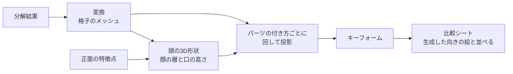

# 頭の3D形状による顔の向き

PoC-08 の分解結果から作ったパーツと、正面の特徴点から、頭の3D形状を作り、顔の向き（`AngleX` × `AngleY`）のキーフォームを、1つの回転と投影で作る仕組み（#39）。方法を選んだ理由は [ADR 0011](../adr/0011-face-rotation-by-head-3d-shape.md) にある。PoC-10 の推定（[対応づけと変形推定](keyform-estimation.md)）に代わって、`ugokue-pipeline keyforms` で使う。

3D形状は、キーフォームを作るときにだけ使う。中間形式には3D座標を持たせず、実行時は今までどおり2Dのキーフォームを補間する。前後関係は、パーツの描画順とビューの切り替えで表す（[ADR 0010](../adr/0010-defer-per-vertex-depth-ordering.md)）。

## 構成



| 場所 | 役割 |
| --- | --- |
| `pipeline/python/src/ugokue_pipeline/head3d.py` | 頭の3D形状（`HeadShape`）、当てはめ（`fit_head`）、パーツの付き方（`Attachment`、`attachments_for`）、回転と投影（`turn`）、キーフォームの作成（`build_keyforms`、`apply_keyforms`） |
| `.../keyforms.py`、`cli.py` | イラストごとにモデルを作り、比較シートと評価を書く `ugokue-pipeline keyforms` |
| `.../evaluate.py` | 中間の角度での三角形の品質 |
| `head3d.py` の `HeadParams`、`keyforms.py` の `load_params` | イラストごとの形の値（`params.json`） |

GPU は使わない。

## 頭の3D形状

画面の行 y ごとに、楕円の断面（中心 c、半幅 w、前面の奥行き h）を持つ。断面の上の点は、角度 φ（右の輪郭で 0、正面で π/2、左の輪郭で π）で x = c + w cos φ、z = h sin φ。奥行き z は、回す中心の面から手前が正（画素）。

当てはめ（`fit_head`）：

1. 顔の層（See-through が髪の下に補完した頭皮を含む）の不透明な画素から、行ごとの左端と右端を取り、中心と半幅にする。顔の層の高さの 2% の幅でならす。
2. 頭の半径 r は半幅の最大。回す中心は、顔の層の箱の中心。
3. 前面の奥行き h は、半幅の 0.8 倍。
4. 口の行（特徴点 `afd_24`〜`afd_27` の平均の高さ）より下は、あごの板にする。半幅は口の行の値のまま、奥行きは口の行の値から、いちばん下の行で 0.55 × r になるよう線形に変える。あごの輪郭（V 字）は横の輪郭ではないので、行ごとの幅で断面を作ると、輪郭の上で奥行きが急に 0 になる。
5. 形の範囲より上や下の行は、いちばん近い端の行の断面にする。

固定テストモデルと同じ形（球を奥行き方向に縮めた楕円体）は、`HeadShape.sphere(中心, 半径, 奥行きの倍率)` で作る。

## パーツの付き方

| 付き方 | パーツ（役割） | 奥行き |
| --- | --- | --- |
| 表面 | 顔 | 断面の上の点 |
| 浮かせた表面（なめらか） | 目（白目、黒目）、まぶた、眉、口、鼻、眼鏡 | 断面の上の点に、浮き（まぶた 0.01、眉 0.02、口 0.005、鼻 0.15、眼鏡 0.08。× r）を足す |
| 殻 | 前髪、頭の飾り、ほかの頭のパーツ | 断面の半幅と奥行きを 0.06 × r 太らせた楕円の上の点 |
| 板 | 耳 | 0（回す中心の面） |
| 奥の板 | 後ろ髪 | −0.3 × r |

- 断面の外の頂点（顔の横に垂れる髪など）は、奥行きを浮きの値にした板として回す。
- **なめらかにする：** 目・眉・鼻・口・眼鏡は、パーツの頂点の3D座標（x と z）を、輪郭の内側の頂点に当てはめた2次式で置き換える。まつ毛の目尻のように輪郭の外に出た頂点で奥行きが急に変わると、三角形が裏返るため。回したあと、パーツの重心の動きはそのままに、形の変化を 0.6 倍に弱める。

## 回転と投影

各頂点を、回す中心のまわりに yaw → pitch の順で回し、正射影する（[固定テストモデル](test-model.md#顔の向きanglex--angley)と同じ式）。

- x' = x cos(yaw) + z sin(yaw)
- y' = y cos(pitch) − (−x sin(yaw) + z cos(yaw)) sin(pitch)

- **左右の軸：** 頭の中心より 0.5 × r 奥の軸（首の付け根にあたる）で回す。頭全体が 0.5 × r × sin(AngleX) だけ向いた側へ動く。
- **上下：** `AngleY` の角度の 0.6 倍だけ回す。前面が深いので、角度どおりでは顔が上下に大きくずれる。
- **輪郭の合わせ直し：** 向いた側（AngleX が正なら画像の右）の断面の点の角度 φ（0〜π/2）を、φ' = φₛ + φ (1 − 2φₛ/π) に詰める。φₛ は、回したときに断面がいちばん外に出る点（外形線）の角度 atan(h sin|yaw| / (w cos|yaw|)) を 1.15 倍したもの（外形線ちょうどでは表面を真横から見るので、輪郭の近くの三角形がつぶれる）。輪郭は外形線の少し内側に来て、向いた側の頬は外形線まで縮み、あご先は向いた側へ寄る。反対側（手前に回ってくる側）は変えない。
- **輪郭の外の頂点：** 向いた側の輪郭の外の頂点（顔の横に垂れる髪）は、輪郭の合わせ直しで輪郭が動いたぶんを、輪郭からの距離 d に応じて exp(−(d / (0.15 × r))²) 倍だけ足す。耳（板）には足さない。耳は回す中心の面にあるので、向いた側の耳は輪郭の内側へ動き、顔の下に隠れていく。
- **首：** 首のメッシュにも顔の向きのグループを置く。あごの行より上は頭と一緒に回し、メッシュの下端に向かって追従を線形に 0 にする。上下は、あご先と同じ奥行きで回す（上を向いても、あごの下から首の上端が見えない）。左右は回す中心の面で回す（あご先と同じだけ横に動くと、首が大きくゆがむ）。
- **裏返り：** 格子点で三角形が裏返ったら、移動量をならして解き直す（[対応づけと変形推定](keyform-estimation.md#頂点の移動量)の `solve_without_flips`）。

格子は、`AngleX` が −45〜45 の 15° おき、`AngleY` が −20、0、20。モデルの `AngleX`、`AngleY` の範囲を格子に合わせて広げる。

## 実行のしかた

PoC-08 の `decompose_images` の結果（`artifacts/decomposition/`）と、PoC-09 の特徴点（`artifacts/views/<イラスト名>/landmarks.json`）があれば、リポジトリのルートで実行できる（GPU 不要、dotnet が必要）。

```bash
uv run --project pipeline/python ugokue-pipeline keyforms
```

`--names 01-long-straight` で一部だけを処理する。形の値（このページの倍率）は、`artifacts/keyforms/<イラスト名>/params.json` でイラストごとに変えられる（[エージェントによる顔の向きの判定](agent-review.md#イラストごとの値paramsjson)）。結果は `artifacts/keyforms/<イラスト名>/` に、`model/`（中間形式）、`renders/`（格子の各向きで描いた絵）、`evaluation.json`、`sheet.png` として書く。

- `sheet.png`：上向き・正面・下向きの行ごとに、−45〜45° の各向きで描いたモデルを並べる。その下の行には、PoC-09 で生成した向きの絵があれば同じ列に並べる（確認用。大きさと傾きはそろえていない）。
- `evaluation.json`：検証の結果、使った形の値（`params`）、頭の3D形状（中心、半径、行の数）と、`AngleX` −45〜45、`AngleY` −20〜20 を 5° おきに変形したときの三角形の品質（[評価](keyform-estimation.md#評価)の `quality` と同じ項目）、引き継げなかった手の修正のグループ（`droppedEdits`）。
- **手の修正の引き継ぎ：** `model/` に前のモデルがあれば、Unity エディタで作った手の修正のグループ（`<メッシュ>_angle_edit`。[キーフォームの手の修正](runtime-deformation.md#キーフォームの手の修正エディター)）を、作り直したモデルに引き継ぐ（`carry_edits`）。メッシュの頂点か格子が変わったグループは引き継がない。自動のグループの置き換えは ID で行い、手の修正のグループは消さない。

できたモデルは、プレイヤーを `-ugokue-model artifacts/keyforms/<イラスト名>/model` 付きで起動すると、Unity で動かせる。

## テスト

`pipeline/python/tests/test_head3d.py`。合成した左右対称の顔（楕円の顔、目、眉、鼻、口、前髪、耳、後ろ髪、首）と、固定テストモデルを使う。

| 確かめること | 方法 |
| --- | --- |
| 球の設定で、固定テストモデルの手作りのキーフォームと一致する | `HeadShape.sphere((256, 236), 120, 0.5)` と固定テストモデルの奥行きの表で、軸を中心にし、輪郭の合わせ直しと上下の弱めをなくして作り、すべての移動量が 0.01 画素以内で一致する |
| テンプレートの当てはめ | 合成した顔で、半径、中心、断面の幅と奥行き、あごの板が、楕円と口の位置に合う |
| 左右反転の一致 | 顔・前髪・鼻・目・耳・後ろ髪の頂点を、+θ に回した位置と、鏡に映した頂点を −θ に回して鏡に戻した位置が一致する（15°、30°・上 20°、45°・下 20°） |
| 奥の目の縮み | 30° で、手前の目の幅は 0.9 倍以上、奥の目は 0.85 倍未満。奥の目は目尻の側の半分ほど縮む |
| 鼻先と口の動き | 30° で、横の動きが 鼻 > 口 > 顔 の順で、鼻と口の差が 0.05 × r より大きい |
| あご先 | 30° で、あご先が頬の輪郭の中央より 0.1 × r 以上、向いた側にある |
| 正面が変わらない | 0° の移動量がすべて 0 |
| 目・眉が輪郭の外に出ない | −45〜45°（5° おき）× −20〜20°（10° おき）で、白目・黒目・眉の不透明な頂点が、同じ高さの顔の不透明な頂点の左右の範囲に入る |
| 裏返りと極端な伸び | −45〜45° × −20〜20°（5° おき）で、どのメッシュも裏返らず、顔と髪以外は伸びが 1/3〜3 倍 |
| 首の追従 | 首の上端は頭と一緒に動き、下端は動かない |
| 格子と範囲 | キーフォームの格子が −45〜45 × −20〜20 で、`AngleX` の範囲が ±45 に広がる |

## 実機の結果

PoC-08 の5枚で作った（2026-10-31）。処理時間はイラスト1枚あたり約 40 秒（Mac の CPU。21 の向きの描画を含む）。

| イラスト | 頭の半径 | 奥の目 / 手前の目の幅（30°） | 奥の目 / 手前の目の幅（45°） | 鼻 / 口の横の動き（30°） | 裏返り | 極端な伸びの角度 |
| --- | --- | --- | --- | --- | --- | --- |
| 01-long-straight | 188 px | 0.78 / 1.19 倍 | 0.68 / 1.21 倍 | 115 / 88 px | 0 | 143 |
| 02-twintails | 161 px | 0.73 / 1.21 倍（まぶた） | 0.61 / 1.23 倍 | 107 / 79 px | 0 | 114 |
| 03-bob-glasses | 260 px | 0.73 / 1.13 倍 | 0.61 / 1.12 倍 | 190 / 153 px | 0 | 209 |
| 04-boy | 246 px | 0.76 / 1.14 倍 | 0.64 / 1.14 倍 | 152 / 108 px | 0 | 144 |
| 05-swept-bangs | 227 px | 0.74 / 1.18 倍 | 0.62 / 1.19 倍 | 144 / 101 px | 0 | 186 |

- 5枚とも、中間の角度を含めて三角形の裏返りはない。極端な伸び（3 倍超か 1/3 未満）は、顔の層の縁と、前髪・頭の飾り・眼鏡のつるの、向いた側の輪郭の近く（表面が奥へ回り込むところ）と、首の上端に出る。まぶたの極端な伸びは、テクスチャの透明な部分の三角形で、描かれる部分は 0.56〜1.39 倍に収まる。
- 手前の目は 1.1〜1.2 倍に広がる。表面が見る向きに回ってくるため（球の上の目なら 30° で約 1.2 倍）。
- 試作の途中で見つかって直したこと：
  - 眼鏡を前髪と同じ殻にすると、レンズの形が崩れた。目と同じく、なめらかな表面から浮かせた。
  - 上下を角度どおりに回すと、上を向いたときに顔が大きく上がり、首の上端（補完の縁）があごの下に見えた。上下を 0.6 倍にし、首の上下の追従をあご先の奥行きにした。
  - 行ごとの幅であごの断面を作ると、上を向いたときにあごの輪郭がぎざぎざになった。口より下をあごの板にした。
  - 鼻先だけを突き出すと、鼻の線が 0.13 倍まで縮んだ。パーツ全体を前へ出した。
  - 目のくぼみを入れると、奥の目が目頭の側で強く縮んだ。入れないことにした。
  - 輪郭をちょうど外形線に合わせると、頭の飾りの三角形がつぶれた（45° で1つ）。外形線の点の角度を 1.15 倍、内側にした。
