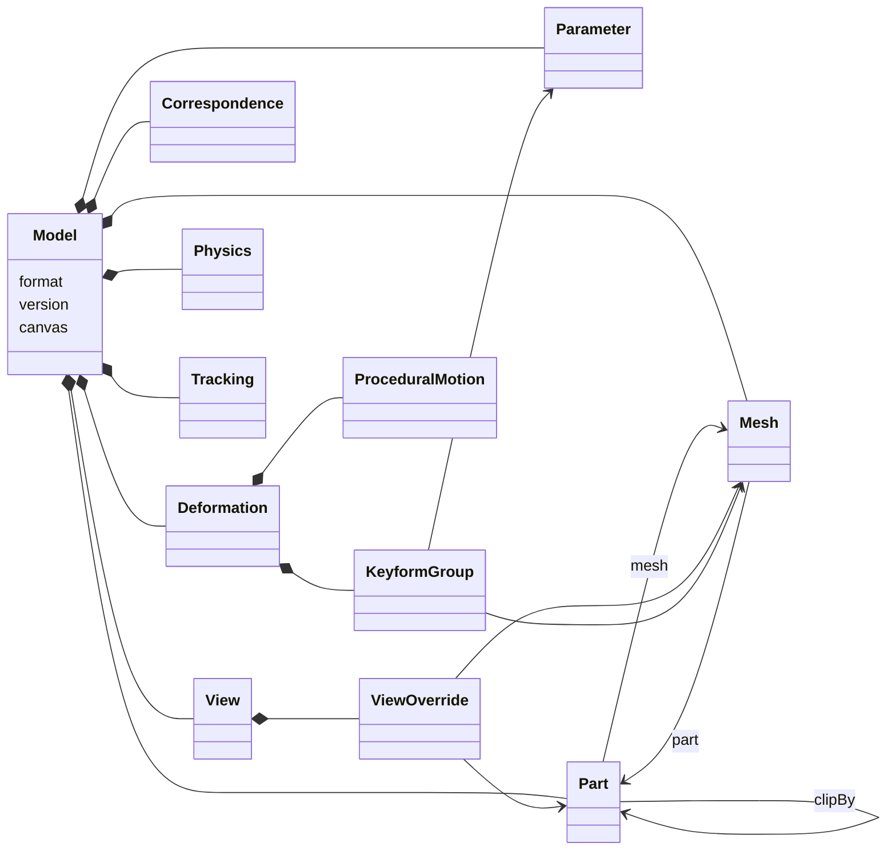

# 中間形式 v0

AI 生成パイプライン（Python）が書き出し、Unity ランタイム（C#）が読み込むモデルの保存形式。形式の決定理由は [ADR 0004](../adr/0004-intermediate-format-v0.md) にある。

- バージョン：`0.1.0`
- JSON Schema：[`format/schema/model.schema.json`](../../format/schema/model.schema.json)
- サンプル：[`format/samples/minimal/`](../../format/samples/minimal/)
- 検証ツール：`uv run --project format/python ugokue-format validate <モデルのフォルダ>`

## ファイル構成

1つのモデルは1つのフォルダで表す。

```
<モデル名>/
  model.json        モデル本体
  textures/*.png    メッシュのテクスチャ（RGBA の PNG）
```

- `model.json` は UTF-8、BOM なし。
- テクスチャのパスは `model.json` のあるフォルダからの相対パスで、区切りは `/`。フォルダの外（`..` を含むパスや絶対パス）は指せない。
- 書き出し側は、`meshes[].texture` から参照されるテクスチャだけを書く。読み込み側は、参照されないファイルを無視する。

## バージョン

`version` は `MAJOR.MINOR.PATCH` 形式。

- 読み込み側は、`MAJOR` と `MINOR` が自分と同じファイルだけを読む（`0.x` の間は MINOR の違いも互換性がないとみなす）。
- PATCH は説明の修正など、ファイルの読み書きに影響しない変更で上げる。
- 項目を追加・変更するときは MINOR を上げ、このページと JSON Schema を同じ PR で更新する。

## 座標系と単位

| 対象 | 規則 |
| --- | --- |
| 位置（頂点、アンカー、特徴点） | キャンバスのピクセル座標。原点は左上、x は右、y は下が正 |
| UV | テクスチャ内の正規化座標 `[0, 1]`。原点は左上、u は右、v は下が正 |
| 角度 | 度。`AngleX`（= yaw）は正の値で顔が画面の右を向く。`AngleY`（= pitch）は正の値で上を向く。`AngleZ` は正の値で画面上の時計回りに傾く |
| 割合 | `confidence`、`stiffness` などは `[0, 1]` |

Unity は y 軸が上向きのため、読み込み側で y を反転して使う。

## 全体の構成



`model.json` の最上位：

| 項目 | 型 | 必須 | 内容 |
| --- | --- | --- | --- |
| `format` | 文字列 | ○ | 常に `"ugokue-model"` |
| `version` | 文字列 | ○ | `"0.1.0"` |
| `canvas` | オブジェクト | ○ | `width`、`height`（正の整数、ピクセル） |
| `parameters` | 配列 | ○ | [Parameter](#parameter) |
| `parts` | 配列 | ○ | [Part](#part) |
| `meshes` | 配列 | ○ | [Mesh](#mesh) |
| `views` | 配列 | ○ | [View](#view) |
| `correspondence` | オブジェクト | ○ | [Correspondence](#correspondence) |
| `deformation` | オブジェクト | ○ | [Deformation](#deformation) |
| `physics` | オブジェクト | | [Physics](#physics) |
| `tracking` | オブジェクト | | [Tracking](#tracking) |

ここに書いていない項目は置けない（JSON Schema の `additionalProperties: false`）。

### ID の規則

- `parameters[].id` は `^[A-Za-z][A-Za-z0-9_]*$`。標準のパラメータは Live2D の標準名に合わせる（下表）。
- それ以外の ID は `^[a-z0-9][a-z0-9_.-]*$`。
- ID は種類ごとに一意（パラメータ、パーツ、メッシュ、ビュー、キーフォームグループ、振り子の各集合の中で重複しない）。特徴点は複数のビューで同じ ID を使うため、`id` と `view` の組で一意にする。

| パラメータ | 範囲の目安 | 内容 |
| --- | --- | --- |
| `AngleX`、`AngleY`、`AngleZ` | -30〜30 | 顔の向きと傾き（度） |
| `EyeOpenL`、`EyeOpenR` | 0〜1 | 目の開き（0 で閉じる） |
| `EyeSmileL`、`EyeSmileR` | 0〜1 | 笑い目 |
| `MouthOpenY` | 0〜1 | 口の開き |
| `MouthForm` | -1〜1 | 口の形 |
| `BodyAngleX`、`BodyAngleZ` | -10〜10 | 体の向きと傾き（度） |
| `Breath` | 0〜1 | 呼吸 |
| `HairFront`、`HairSide`、`HairBack` | -1〜1 | 髪の揺れ（物理の出力） |

## Parameter

モデルを動かす入力値。

| 項目 | 型 | 必須 | 内容 |
| --- | --- | --- | --- |
| `id` | 文字列 | ○ | パラメータ名 |
| `min`、`max` | 数値 | ○ | 範囲。`min < max` |
| `default` | 数値 | ○ | 初期値。`min ≤ default ≤ max` |

## Part

意味を持つ部品。角度をまたいで同じ ID で追跡する。

| 項目 | 型 | 必須 | 内容 |
| --- | --- | --- | --- |
| `id` | 文字列 | ○ | パーツ ID |
| `role` | 文字列 | ○ | 役割。推奨値は下表。推奨値以外も置ける |
| `parent` | 文字列 / null | ○ | 親パーツの ID。最上位は null。循環してはいけない |
| `anchor` | `[x, y]` | ○ | 回転・移動の基準点（キャンバス座標） |
| `drawOrder` | 整数 | ○ | 基準の描画順。大きいほど手前 |
| `mesh` | 文字列 / null | ○ | 基準のメッシュ ID。描画しないまとめ用のパーツは null |
| `clipBy` | 文字列の配列 | ○ | このパーツを切り抜くマスクとして使うパーツの ID。指定したパーツの形の内側だけを描く。自分自身は指定できない |

- 親子関係はまとまりを表す。[手続き的な動き](#proceduralmotion) は、対象のパーツとその子孫すべてに同じように適用する。
- `mesh` が指すメッシュの `part` は、このパーツでなければならない。

`role` の推奨値：`head`、`face`、`body`、`neck`、`eye_white`、`iris`、`eyelid`、`eyebrow`、`mouth`、`mouth_inner`、`teeth`、`tongue`、`nose`、`ear`、`hair_front`、`hair_side`、`hair_back`、`clothes`、`accessory`、`effect`

## Mesh

テクスチャを貼る三角形メッシュ。

| 項目 | 型 | 必須 | 内容 |
| --- | --- | --- | --- |
| `id` | 文字列 | ○ | メッシュ ID |
| `part` | 文字列 | ○ | このメッシュが属するパーツ |
| `texture` | 文字列 | ○ | PNG の相対パス |
| `vertices` | `[x, y]` の配列 | ○ | 基準の形の頂点位置（キャンバス座標）。3個以上 |
| `uvs` | `[u, v]` の配列 | ○ | 頂点ごとの UV。`vertices` と同じ個数で、各値は `[0, 1]` |
| `triangles` | `[i, j, k]` の配列 | ○ | 頂点番号（0 始まり）の組。1個以上 |

## View

AI が生成した角度ごとの絵に対応する。角度で切り替わる、連続的に補間できない情報（メッシュの差し替え、表示・非表示、描画順）を持つ。

| 項目 | 型 | 必須 | 内容 |
| --- | --- | --- | --- |
| `id` | 文字列 | ○ | ビュー ID |
| `yaw`、`pitch` | 数値 | ○ | この絵の顔の向き（度）。`AngleX`、`AngleY` と同じ向き |
| `overrides` | 配列 | ○ | このビューで基準から変えるパーツの設定 |

`overrides[]`：

| 項目 | 型 | 必須 | 内容 |
| --- | --- | --- | --- |
| `part` | 文字列 | ○ | パーツ ID。1つのビューの中で重複しない |
| `mesh` | 文字列 | | 差し替えるメッシュ。そのメッシュの `part` はこのパーツでなければならない |
| `visible` | 真偽値 | | 表示するかどうか。省略時は表示する |
| `drawOrder` | 整数 | | 描画順 |

`overrides` に `part` だけを書いても意味はないため、`mesh`、`visible`、`drawOrder` のどれか1つ以上を書く。

ビューの選び方：

- `yaw = 0`、`pitch = 0` のビューがちょうど1つあり、これを基準のビューとする。基準のビューの `overrides` は空にする。
- 実行時は、現在の (`AngleX`, `AngleY`) とのユークリッド距離が最も小さいビューを使う。距離が同じなら `views` の中で先にあるものを使う。
- 選ばれたビューの `overrides` にないパーツは、Part の `mesh`、`drawOrder` を使い、表示する。
- `overrides` は、隣のビューとの境界の角度で、切り替えの前後の見た目が一致するように置く（例：境界の角度ですでにほかのパーツに覆われているパーツだけを隠す・描画順を変える）。実行時はフェードせずに切り替える（[ADR 0005](../adr/0005-seamless-view-switching.md)）。

## Correspondence

角度をまたいだ対応づけの結果。実行時の描画には使わず、変形の推定と手修正に使う。

| 項目 | 型 | 必須 | 内容 |
| --- | --- | --- | --- |
| `landmarks` | 配列 | ○ | 特徴点 |
| `vertexMatches` | 配列 | ○ | 頂点の対応 |

`landmarks[]`：1件は「ある特徴点が、あるビューの絵のどこにあるか」。

| 項目 | 型 | 必須 | 内容 |
| --- | --- | --- | --- |
| `id` | 文字列 | ○ | 特徴点 ID（例：`eye_l_outer`）。同じ特徴点を複数のビューで持つときは同じ ID を使う |
| `part` | 文字列 | ○ | 特徴点が属するパーツ |
| `view` | 文字列 | ○ | ビュー ID |
| `position` | `[x, y]` | ○ | そのビューの絵での位置（キャンバス座標） |
| `confidence` | 数値 | ○ | 信頼度 `[0, 1]` |
| `source` | 文字列 | ○ | `"auto"`（推定）または `"manual"`（手修正） |

`id` と `view` の組は重複しない。

`vertexMatches[]`：1件は「あるメッシュの頂点が、あるビューの絵のどこに対応するか」。

| 項目 | 型 | 必須 | 内容 |
| --- | --- | --- | --- |
| `mesh` | 文字列 | ○ | メッシュ ID |
| `vertex` | 整数 | ○ | 頂点番号。メッシュの頂点数未満 |
| `view` | 文字列 | ○ | ビュー ID |
| `position` | `[x, y]` | ○ | 対応する位置（キャンバス座標） |
| `confidence` | 数値 | ○ | 信頼度 `[0, 1]` |
| `source` | 文字列 | ○ | `"auto"` または `"manual"` |

`mesh`、`vertex`、`view` の組は重複しない。

## Deformation

| 項目 | 型 | 必須 | 内容 |
| --- | --- | --- | --- |
| `keyformGroups` | 配列 | ○ | [KeyformGroup](#keyformgroup) |
| `procedural` | 配列 | ○ | [ProceduralMotion](#proceduralmotion) |

### KeyformGroup

1つのメッシュについて、1〜複数のパラメータの格子点ごとに頂点の移動量を持つ。

| 項目 | 型 | 必須 | 内容 |
| --- | --- | --- | --- |
| `id` | 文字列 | ○ | キーフォームグループ ID |
| `mesh` | 文字列 | ○ | 対象のメッシュ |
| `parameters` | 文字列の配列 | ○ | 格子の軸にするパラメータ。1個以上で重複しない |
| `keys` | 数値の配列の配列 | ○ | `parameters` と同じ順に、各軸の格子点の値。各軸 2 個以上で狭義の昇順。値はそのパラメータの範囲内 |
| `interpolation` | 文字列 | ○ | `"linear"` のみ |
| `keyforms` | 配列 | ○ | 格子点ごとのキーフォーム |

`keyforms[]`：

| 項目 | 型 | 必須 | 内容 |
| --- | --- | --- | --- |
| `at` | 数値の配列 | ○ | 格子点。`parameters` と同じ順の値で、各値は `keys` の該当する軸に含まれる |
| `offsets` | `[dx, dy]` の配列 | ○ | 基準の形（`vertices`）からの各頂点の移動量（ピクセル）。個数はメッシュの頂点数と同じ |

- 格子点のすべての組み合わせについて、キーフォームがちょうど1つずつある。キーフォームの数は各軸の格子点の数の積になる。
- 書き出し側は、最初のパラメータの変化が最も遅い順（行優先）に並べる。読み込み側は順番に依存しない。

変形の計算：

1. 各グループで、現在のパラメータ値を `keys` の最小値〜最大値に収め、それを囲む格子点の `offsets` を多重線形補間する。
2. 同じメッシュを指すグループの結果をすべて足す（加算合成）。
3. 頂点位置 = `vertices` + 合計の移動量。

ビューで差し替えたメッシュにも、そのメッシュ ID を指すグループの変形を適用する。

### ProceduralMotion

パラメータに比例してパーツを回転・移動する、手続き的な動き。

| 項目 | 型 | 必須 | 内容 |
| --- | --- | --- | --- |
| `type` | 文字列 | ○ | `"rotate"` または `"translate"` |
| `parameter` | 文字列 | ○ | 入力のパラメータ |
| `part` | 文字列 | ○ | 対象のパーツ。子孫のパーツにも適用する |
| `degreesPerUnit` | 数値 | `rotate` で必須 | パラメータ 1 あたりの回転角（度、画面上の時計回りが正）。回転の中心は対象パーツの `anchor` |
| `offsetPerUnit` | `[dx, dy]` | `translate` で必須 | パラメータ 1 あたりの移動量（ピクセル） |

キーフォームによる変形のあとに適用する。1つのパーツに複数の動きがかかる場合は、親に近いパーツの動きを後に適用する。

## Physics

最小限の振り子モデル。入力パラメータの変化で振り子を揺らし、その振れを出力パラメータに書き込む。出力パラメータはキーフォームで髪などを変形させる。

| 項目 | 型 | 必須 | 内容 |
| --- | --- | --- | --- |
| `pendulums` | 配列 | ○ | 振り子 |

`pendulums[]`：

| 項目 | 型 | 必須 | 内容 |
| --- | --- | --- | --- |
| `id` | 文字列 | ○ | 振り子 ID |
| `inputs` | 配列 | ○ | `{ "parameter": 文字列, "weight": 数値 }` の配列。1個以上 |
| `output` | 文字列 | ○ | 出力先のパラメータ。同じ振り子の `inputs` には使えない |
| `stiffness` | 数値 | ○ | 元の位置に戻る強さ `(0, 1]` |
| `damping` | 数値 | ○ | 揺れの減衰 `[0, 1]` |
| `scale` | 数値 | ○ | 振れの量から出力値への倍率 |

揺れの計算方法は、物理を実装するチケット（PoC-14、MVP）でこのページに追記する。

## Tracking

トラッキング値を受け取ったときの、モデルごとの調整。入力元の名前からモデルのパラメータへの変換は Unity 側の入力アダプターが持ち、この形式には含めない。

| 項目 | 型 | 必須 | 内容 |
| --- | --- | --- | --- |
| `parameters` | 配列 | ○ | パラメータごとの設定 |

`parameters[]`：

| 項目 | 型 | 必須 | 内容 |
| --- | --- | --- | --- |
| `parameter` | 文字列 | ○ | パラメータ名。重複しない |
| `smoothing` | 数値 | ○ | 平滑化の強さ `[0, 1)`。1/60 秒あたりに前の値を残す割合で、0 で平滑化しない（[入力アダプター](tracking-adapter.md#1フレームの処理)） |

## 検証

検証ツールは次を検出し、該当箇所の JSON パス付きでエラーを出す。

1. JSON Schema に合わない（必須項目の欠け、型の違い、範囲外の値、未定義の項目、ID の書式）
2. `format` が違う、または読めない `version`
3. 種類ごとの ID の重複、`landmarks` の (`id`, `view`)、`vertexMatches` の (`mesh`, `vertex`, `view`)、`overrides` の `part`、`tracking.parameters` の `parameter` の重複
4. 存在しない ID への参照
5. パーツの親子の循環、`clipBy` での自己参照
6. Part の `mesh`、ビューの `overrides[].mesh` が、別のパーツのメッシュを指している
7. パラメータの `min ≥ max`、`default` が範囲外
8. メッシュの `uvs` と `vertices` の個数の違い、範囲外の頂点番号
9. テクスチャのファイルがない、PNG でない、フォルダの外を指している
10. 基準のビュー（`yaw = 0`、`pitch = 0`）がちょうど1つでない、基準のビューの `overrides` が空でない
11. キーフォームグループの `keys` の個数が `parameters` と違う、昇順でない、パラメータの範囲外、格子点の欠け・重複・格子外の `at`、`offsets` の個数がメッシュの頂点数と違う
12. `vertexMatches[].vertex` がメッシュの頂点数以上
13. `rotate` に `degreesPerUnit` がない、`translate` に `offsetPerUnit` がない
14. 振り子の `output` が自分の `inputs` に含まれる

## 実装

| 言語 | 場所 | 内容 |
| --- | --- | --- |
| Python | `format/python/`（パッケージ `ugokue_format`） | 読み書き、検証ツール、サンプルと[固定テストモデル](test-model.md)の生成 |
| C# | `unity/Packages/com.ugokue.core/Runtime/Format/`（名前空間 `Ugokue.Core.Format`） | 読み書き |

両方の実装は、同じフォルダを読み込んで書き出すと、元と同じ内容になる（JSON は値として一致、PNG はバイト列が一致）。[CI のテスト](ci.md) で Python → C# → Python の往復を確かめる。
