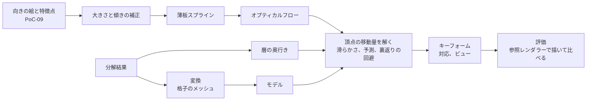

# 対応づけと変形推定

PoC-09 で生成した向きの絵（[向きと表情の差分の生成](view-generation.md)）と、PoC-08 の分解結果から作ったパーツ（[パーツ分解](part-decomposition.md)）を対応づけ、顔の向き（`AngleX` × `AngleY`）のキーフォームを推定する仕組み。方法を選んだ理由は [ADR 0009](../adr/0009-keyform-estimation-with-landmarks-flow-and-depth.md) にある。

表情（閉じ目、口開け）のキーフォームは扱わない。

#39 で、`ugokue-pipeline keyforms` は、生成した向きの絵を使わず、頭の3D形状を回して投影する方法に変わった（[頭の3D形状による顔の向き](head-rotation.md)、[ADR 0011](../adr/0011-face-rotation-by-head-3d-shape.md)）。このページの推定（`estimate_keyforms`）は、固定テストモデルとの比較のために残す。「書き出すもの」「評価」「実機の結果」は PoC-10 の時点の記録。

## 構成

| 場所 | 役割 |
| --- | --- |
| `pipeline/python/src/ugokue_pipeline/mesh.py` | 層の不透明な部分を覆う格子のメッシュ |
| `.../correspond.py` | 大きさと傾きの補正、薄板スプライン、オプティカルフロー、信頼度 |
| `.../estimate.py` | 正面で見えているパーツ、頂点の移動量の推定、キーフォームと対応の書き出し |
| `.../deform.py` | キーフォームの補間（中間形式の仕様と同じ）と、三角形の裏返り・伸びの検査 |
| `.../evaluate.py` | 特徴点のずれ、画像の差、中間の角度での三角形の品質 |
| `.../keyforms.py`、`cli.py` | イラストごとにモデルを作って評価する `ugokue-pipeline keyforms`（#39 から [頭の3D形状](head-rotation.md) で作る） |
| `.../render.py`、`dotnet/Ugokue.Format.Cli` | C# の参照レンダラーでモデルを描く（`ugokue-format-cs render`） |

GPU は使わない（OpenCV、SciPy、numpy と、C# の参照レンダラー）。

## メッシュ

変換（`convert.py`）は、各パーツに、層の箱を約「イラストの短い辺の 1/48（8 画素以上）」のマスに分け、不透明な画素を含むマスだけを残した格子のメッシュを付ける（896 × 1152 のイラストで 19 画素）。

## 対応点の推定

向きの絵（頭だけを元のイラストに戻したもの）ごとに、正面のイラストの頭の範囲の各画素が、向きの絵のどこに当たるかを求める（`correspond`）。

1. **大きさと傾きの補正**：画像編集モデルが変えた大きさと傾き（PoC-09 の持ち越し）を取り除く。正面の特徴点を、頭を硬い楕円体（中心は特徴点の平均、半径は特徴点の広がりの 1.15 倍、奥行きは半径の半分）として指定の角度に回した位置を予測し、向きの絵の特徴点をそこへ相似変換（拡大・回転・平行移動）で合わせる。
   - 使う特徴点は目・鼻・口（`afd_11`〜`afd_27`）だけ。輪郭（`afd_00`〜`afd_04`）は、横を向いたときや手が顔の近くにあるときに検出が外れやすい。
   - 回転が 30° を超えたら、特徴点の検出が外れたとみなし、回転は 0 にする（拡大率はそのまま使う）。拡大率は 0.5〜2 倍に収める。
   - 左右に回す軸を頭の中心より奥に置くとき（下の「回り方の強さ」）は、予測した位置にその軸で回したぶんの頭全体の横の動きを足す。足さないと、補正が頭全体の動きを打ち消す。
   - 以降の座標は、この補正をした向きの絵の座標。
2. **薄板スプライン**：正面の特徴点から、補正した向きの絵の特徴点への薄板スプライン（滑らかさ 1）で、全体をおおまかに合わせる。補正と同じく目・鼻・口の特徴点だけを使う。輪郭の特徴点は、横顔に近い絵で外れ、あごの輪郭を折り曲げる。
3. **オプティカルフロー**：向きの絵を薄板スプラインで正面に引き戻した絵と、正面の絵のあいだの残りのずれを、OpenCV の DIS（`PRESET_MEDIUM`、グレースケール）で求める。
4. **信頼度**：フローを行きと帰りで求め、往復のずれ e 画素から exp(−(e/2)²)。残りのずれが 40 画素を超える画素と、頭の範囲の外は 0。

## 頂点の移動量

頭の子孫のパーツのメッシュごと、向きごとに、次を最小にする移動量 d を解く（`solve_offsets`）。

Σ wᵢ |dᵢ − (tᵢ − vᵢ)|² + 2 Σ_辺 |(dᵢ − kpᵢ) − (dⱼ − kpⱼ)|² + λ Σ |dᵢ − pᵢ|²

- v は基準の頂点、t は対応点、w は重み、p は予測。辺はメッシュの三角形の辺。
- **重み w**：その頂点での信頼度。ただし、正面の絵でそのパーツがいちばん手前に見えていない頂点（周り 3 × 3 画素にそのパーツの画素がない）は 0。フローは見えている絵の動きなので、ほかのパーツに隠れた部分には使えない。
- **予測 p と λ**：パーツの種類で変える。

| パーツ | 予測 | λ | 重み w |
| --- | --- | --- | --- |
| 顔 | 特徴点（目・鼻・口）に近い頂点ほど薄板スプライン、遠い頂点ほど頭の前面の点として回した動き。混ぜる割合 n は exp(−(特徴点までの距離 / (0.25 × r))²)。奥行きがわからないときの r は、特徴点の広がりの 1.15 倍 | 0.05 n + 1.0 (1 − n) | 信頼度 |
| 親が顔のパーツ（目、眉、鼻、口、眼鏡） | パーツの頂点の、頭の前面の奥行きを平面で近似し、その 0.6 倍の奥行きで回した形を、薄板スプラインの位置（パーツの頂点の平均）へ平行に動かしたもの。`ugokue-pipeline keyforms` では、横の位置を、平面の奥行きそのもので回した位置にする | 0.05（`keyforms` では 1.0） | 信頼度（`keyforms` では × 0.2） |
| 顔より手前に描く頭のパーツ（前髪） | 頭の前面から 0.05 × r だけ浮いた点として、頭の中心のまわりに回した動き（頂点ごとに奥行きが違う） | 1.0 | 信頼度 × 0.2 |
| それ以外の頭のパーツ（横髪、後ろ髪、耳、頭の飾り） | 層の奥行きの中央値から求めた奥行き z の点を、頭の中心のまわりに回した動き | 1.0 | 信頼度 × 0.2 |

- 頭の前面：奥行きがわかるときは、顔の層（See-through が髪の下に補完した頭皮を含む）の形をふくらませて作る。輪郭からの距離を d、いちばん内側の距離を r として、奥行きは 0.5 √(r² − (r − d)²)。円なら球を奥行き方向に半分にした形で、輪郭では 0 になる。回す中心は顔の層の箱の中心。
- 輪郭の奥行きが 0 なので、横を向くと、輪郭は頭の外形としてほとんど動かず、目鼻は向いた側へ大きく動く。向いた側の頬は狭く、反対側は広くなり、あごの先も向いた側へ寄る。楕円体（特徴点の広がりや顔の層の箱から決めたもの）では、頬の輪郭の奥行きが 0 にならず、輪郭が目鼻と一緒に横へずれるだけだった。
- 奥行き z は、顔以外の頭のパーツの奥行きの中央値（See-through の値。小さいほど手前）のうち、いちばん手前を +0.5 × r、いちばん奥を −0.5 × r とする線形の換算。後ろ髪は顔と逆向きに動く。
- 前髪を層で一定の奥行きにすると、頭頂の生え際まで顔より大きく動き、髪の下に補完された頭皮（顔の層）がはみ出す。頭の表面に沿わせると、生え際は頭皮と一緒に動き、額にかかる毛先は顔より少し大きく動く。
- 回す式は、固定テストモデルと同じ（yaw → pitch の順。[固定テストモデル](test-model.md#顔の向きanglex--angley)）。
- **回り方の強さ**：`ugokue-pipeline keyforms` では、左右に回すときだけ、頭の前面の奥行き（顔と前髪）を 1.0 × √(r² − (r − d)²)（上下の倍）にし、頭の中心より 0.5 × r 奥の軸（首の付け根にあたる）で回す。奥の軸で回すと、頭全体（輪郭、髪）が r × 0.5 × sin(AngleX) だけ向いた側へ動く。固定テストモデルとの比較では、正解と同じ（前面 0.5、軸は中心）にする。
  - 生成した横向きの絵は ±30° より横顔に近い。前面が浅く軸が中心のままでは、輪郭と髪がその場に残り、顔だけが髪の中で横に滑っているように見えた（人の確認）。
  - 上下には効かせない。上下は浅い前面で、生成した絵とよく合う（特徴点のずれ 7 px 前後。深くすると 12 px）。
- 奥行きがわからないとき（分解結果を使わないとき）は、すべてのパーツで予測に薄板スプラインを使う（λ 0.05）。
- **滑らかさ**：奥行きから作った予測（髪、耳、頭の飾り）では k = 1 として予測からのずれにかけ、場所によって違う予測の動き（頭の表面に沿った前髪など）を残す。顔の層と、親が顔のパーツも k = 1 にする。奥行きがわからないときは、すべて k = 0 にする。薄板スプラインの予測には細かなゆがみがあり、形を残すと口やまぶたが極端に伸び縮みするため、親が顔のパーツの予測は、形を回転から、位置だけを薄板スプラインから取る。
- **裏返りの回避**：解いた形で三角形が裏返ったら、k = 0 にし、滑らかさの係数を 4 倍ずつ強めて解き直す（最大 5 回）。

髪や耳の重みを下げるのは、画像編集モデルが髪の流れや耳を描き直すため。生成した絵に合わせすぎると、髪が引き伸ばされてにじむ。顔の予測を、特徴点から遠いところで頭の前面の動きに寄せる（顔の層では強く寄せる）のは、薄板スプラインが特徴点から離れると大きく外れ、髪の下に補完された額や頭皮が前髪の横や上からはみ出すため。

## 書き出すもの

- **キーフォームグループ**：頭の子孫のメッシュごとに `<メッシュ ID>_angle`。パラメータは `AngleX`、`AngleY`、格子は向きの絵の角度に 0 を加えたもの（PoC-09 の絵なら `[-30, 0, 30]` × `[-20, 0, 20]`）。正面の格子点の移動量は 0。同じメッシュの顔の向きのグループがあれば置き換える。
- **ビュー**：向きごとに、`overrides` が空のビュー（ID は `x30_y-20` の形）を加える。対応がビューを参照するため。見た目は基準と同じ。
- **対応**：特徴点（`afd_00`〜`afd_27`、補正した向きの絵での位置、`source: "auto"`）と、信頼度 0.5 以上の頂点の対応。

## 評価

`ugokue-pipeline keyforms` は、イラストごとに次を測り、`evaluation.json` に書く。

| 項目 | 内容 |
| --- | --- |
| `landmarks` | 正面の特徴点を、その位置でいちばん手前のパーツのメッシュの変形で動かした位置と、補正した向きの絵の特徴点の距離の平均（`before` は変形しない場合） |
| `imageBefore`、`imageAfter` | 参照レンダラーで描いた正面と、変形したモデルを、補正した向きの絵と比べた差。比べる範囲は、正面の頭の範囲（あごの少し下まで。[頭だけを戻す](view-generation.md#頭だけを戻す) と同じ作り方）をイラストの短い辺の 4% 広げたもの |
| `quality` | `AngleX` −30〜30、`AngleY` −20〜20 を 5° おきに変形したときの、裏返った三角形の数、伸び（三角形ごとの線形変換の特異値）の最大・最小、伸びが 3 倍を超えるか 1/3 未満になった角度の数 |

確認用に、向きの 3 × 3 の位置に「補正した向きの絵」と「変形したモデル」を並べた `sheet.png` を書く。

## 実行のしかた

PoC-10 の時点では `ugokue-pipeline keyforms` でこの推定を実行していた。今の `keyforms` の実行のしかたは [頭の3D形状による顔の向き](head-rotation.md#実行のしかた) にある。

## 固定テストモデルでの比較

[固定テストモデル](test-model.md) を参照レンダラーで正面と 8 つの向き（±30° × ±30°）に描き、手作りの特徴点（17 点）を使って、手作りの顔の向きのキーフォームを外したモデルから推定し直す（Pipeline tests の `test_estimate.py`）。描画に効く頂点（テクスチャの不透明な画素の上）の、正解との距離の平均：

| パーツ | 変形しない場合 | 推定（奥行きなし） | 推定（奥行きあり） |
| --- | --- | --- | --- |
| 目、まぶた、黒目 | 32.4〜33.5 px | 3.7〜4.7 px | 3.5〜5.5 px |
| 眉 | 33.8 px | 6.3 px | 6.2〜6.3 px |
| 鼻、口、口の中、歯 | 29.1〜43.5 px | 1.6〜2.3 px | 1.6〜3.0 px |
| 顔 | 30.3 px | 8.0 px | 5.6 px |
| 前髪 | 33.6 px | 15.9 px | 13.6 px |
| 横髪 | 21.0 px | 15.4〜16.2 px | 9.1〜9.2 px |
| 耳 | 21.4 px | 19.8 px | 6.6 px |
| 後ろ髪 | 21.5 px | 29.2 px | 6.1 px |

奥行きありの値は、固定テストモデルの奥行きの表（[固定テストモデル](test-model.md#顔の向きanglex--angley)）を See-through と同じ向きにして渡したもの（顔の中心の奥行き 60 を、顔の層の奥行きとする）。固定テストモデルの顔の層は、See-through と違って髪の下の頭皮を含まない（頭の正解の球は半径 120、顔の層は幅 182・高さ 216）。そのため、顔の層をふくらませた前面は正解より小さく、頭頂の前髪は前面の外に出るので、前髪の誤差が大きい。正解のキーフォームと同じ奥行きを与えているので、奥行きの換算と回し方の向きが正しいことの確認であって、奥行きの推定の精度ではない。

## 実機の結果

PoC-10 で、PoC-08・PoC-09 の5枚から作った（2026-10-31）。処理時間はイラスト1枚あたり約 75 秒（Mac の CPU。評価の描画を含む）。

| イラスト | 特徴点のずれ（横向き 6 枚） | 特徴点のずれ（上下 2 枚） | 画像の不一致の割合 | 裏返り | 極端な伸び | 伸びの範囲 |
| --- | --- | --- | --- | --- | --- | --- |
| 01-long-straight | 79.8 → 38.7 px | 22.3 → 7.1 px | 52.0 → 52.6% | 0 | 49 | 0.05〜1.72 |
| 02-twintails | 66.6 → 24.9 px | 19.8 → 4.5 px | 47.1 → 44.6% | 0 | 29 | 0.11〜1.58 |
| 03-bob-glasses | 117.2 → 62.0 px | 33.6 → 14.3 px | 53.0 → 54.5% | 0 | 59 | 0.07〜1.89 |
| 04-boy | 102.1 → 45.7 px | 31.7 → 14.5 px | 50.7 → 50.1% | 0 | 75 | 0.02〜1.77 |
| 05-swept-bangs | 100.2 → 55.2 px | 27.0 → 10.1 px | 47.4 → 45.1% | 0 | 64 | 0.04〜4.78 |

- 5枚とも、中間の角度を含めて三角形の裏返りはない。極端な伸び（3 倍超か 1/3 未満）は、顔の層の縁（髪の下に補完された頭皮）と、前髪・頭の飾りの頭の縁に近い部分に出る。頭の縁では表面が奥へ回り込むので、横を向くと縮んで見える（遠近の縮み）。多くは髪に隠れる。左右の前面を深くしてから増えた（29〜75 角度）。目・眉・鼻・口には出ない。05 では、頭の縁にある髪留めが +30° で細く縮む。
- 特徴点のずれは、横向きで約 45〜65%、上下で約 55〜75% 減った。横向きは、目・眉・鼻・口の横の位置を特徴点ではなく頭の回転から取るので、特徴点に合わせた場合（約 60〜75%）より大きい。とくに奥の目の特徴点は生成した絵で外れているので、ずれの値の大きさは見た目の良し悪しとは一致しない。
- 画像の差は、ほとんど減らない。生成した絵には、正面の絵にない耳や横顔の輪郭が描かれていて、正面のパーツを曲げるだけでは再現できないため。変形したモデルの向きの変化は、生成した絵より控えめに見える。
- 最初の方法（すべてのパーツで薄板スプラインを予測にし、髪にも生成した絵の対応点を同じ重みで使う）では、横向きで髪が引き伸ばされてにじみ、前髪や後ろ髪に極端な縮み（最小 0.01）が出た。奥行きを使うようにして、髪の崩れはなくなった。
- 人の確認（01 を Unity で動かした）で、横向きと下向きで前髪の根元の横や上に肌色が見えた。前髪を層で一定の奥行きで回していて、頭頂の生え際まで顔より大きく動き、補完された頭皮がはみ出していた。前髪を頭の表面に沿わせ、顔の層の頭皮を同じ動きに寄せて直した。
- 2回目の人の確認で、左右で顔が横にずれるだけに見え、上向きであごの輪郭が折れた。頭の前面を顔の層の形から作って輪郭の奥行きを 0 にし、薄板スプラインから輪郭の特徴点を外して直した。
- 4回目の人の確認で、左右の方向性は良くなったが、回しても目の大きさが変わらないのが不自然だった。目・眉・鼻・口が薄板スプラインのまま、形を変えずに動いていたため。形を頭の前面と一緒に回したものにし、奥の目が細く、手前の目が少し大きくなるようにした。頭の前面と同じ奥行きでは、奥の黒目が縦の細い形まで縮んだので、0.6 倍にした。
- 6回目の人の確認で、奥の目と輪郭の間が空きすぎていた。奥の目の横の位置を、生成した絵の特徴点から取っていたため（01 を 30° 回して 45 px。頭の前面と一緒に回すと 102 px）。横顔に近い生成した絵では奥の目が隠れ、特徴点が当てにならない。`keyforms` では、目・眉・鼻・口の横の位置も頭の前面と一緒に回した位置にし、輪郭との間隔を頭の動きとそろえた。縦の位置は特徴点のまま。固定テストモデルとの比較では、向きの絵が正確なので特徴点の位置のままにする（テストモデルの顔の層は頭皮を含まず、頭の前面が正解より小さいので、回した位置は外れる）。
- 5回目の人の確認で、目の幅は縮んだが、まつ毛が縮んでいなかった。まつ毛（まぶたの層）の目尻は顔の輪郭の外まで伸びていて、そこで奥行きが急に 0 になり、回すと三角形が裏返った。裏返りを避ける解き直しで予測の形がならされ、幅が戻っていた（奥の側で 0.96 倍、白目は 0.68 倍）。パーツの奥行きを平面で近似し、パーツ全体が一様に縮むようにした（まつ毛も 0.61 倍）。
- 3回目の人の確認で、上向きは良くなったが、左右は頭全体が回らず、回り方も弱かった。左右だけ、前面を深くし、奥の軸で回すようにした（上の表はこの後の値。横向きの「変形しない場合」は、頭全体の横の動きを補正で打ち消さなくなったので大きい）。
- 大きさと傾きの補正で、拡大率は 1.0〜1.86 倍、回転は −28°〜21° だった（PoC-09 で測った、顔の大きさと傾きのずれに対応する）。

### 分かった問題

- 02 のリボンは、分解で層が出ていないため、モデルにない（PoC-08）。
- 01 で、首の上に服の襟が重なる。分解で、服の層が首の層より手前に並ぶため（PoC-08 の比較の差に含まれていたもの）。
- 横を向いたときに見えるはずの耳や横顔の輪郭は、正面のパーツの変形だけでは出せない。角度別のメッシュへの切り替え（ビュー）が必要。
- 頂点の対応を全部書くと、model.json が 2.8〜5.8 MB になる。
