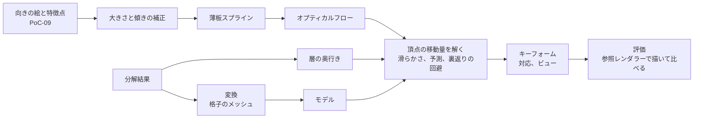

# 対応づけと変形推定

PoC-09 で生成した向きの絵（[向きと表情の差分の生成](view-generation.md)）と、PoC-08 の分解結果から作ったパーツ（[パーツ分解](part-decomposition.md)）を対応づけ、顔の向き（`AngleX` × `AngleY`）のキーフォームを推定する仕組み。方法を選んだ理由は [ADR 0009](../adr/0009-keyform-estimation-with-landmarks-flow-and-depth.md) にある。

表情（閉じ目、口開け）のキーフォームは扱わない。

## 構成



| 場所 | 役割 |
| --- | --- |
| `pipeline/python/src/ugokue_pipeline/mesh.py` | 層の不透明な部分を覆う格子のメッシュ |
| `.../correspond.py` | 大きさと傾きの補正、薄板スプライン、オプティカルフロー、信頼度 |
| `.../estimate.py` | 正面で見えているパーツ、頂点の移動量の推定、キーフォームと対応の書き出し |
| `.../deform.py` | キーフォームの補間（中間形式の仕様と同じ）と、三角形の裏返り・伸びの検査 |
| `.../evaluate.py` | 特徴点のずれ、画像の差、中間の角度での三角形の品質 |
| `.../keyforms.py`、`cli.py` | イラストごとにモデルを作って評価する `ugokue-pipeline keyforms` |
| `.../render.py`、`dotnet/Ugokue.Format.Cli` | C# の参照レンダラーでモデルを描く（`ugokue-format-cs render`） |

GPU は使わない（OpenCV、SciPy、numpy と、C# の参照レンダラー）。

## メッシュ

変換（`convert.py`）は、各パーツに、層の箱を約「イラストの短い辺の 1/48（8 画素以上）」のマスに分け、不透明な画素を含むマスだけを残した格子のメッシュを付ける（896 × 1152 のイラストで 19 画素）。

## 対応点の推定

向きの絵（頭だけを元のイラストに戻したもの）ごとに、正面のイラストの頭の範囲の各画素が、向きの絵のどこに当たるかを求める（`correspond`）。

1. **大きさと傾きの補正**：画像編集モデルが変えた大きさと傾き（PoC-09 の持ち越し）を取り除く。正面の特徴点を、頭を硬い楕円体（中心は特徴点の平均、半径は特徴点の広がりの 1.15 倍、奥行きは半径の半分）として指定の角度に回した位置を予測し、向きの絵の特徴点をそこへ相似変換（拡大・回転・平行移動）で合わせる。
   - 使う特徴点は目・鼻・口（`afd_11`〜`afd_27`）だけ。輪郭（`afd_00`〜`afd_04`）は、横を向いたときや手が顔の近くにあるときに検出が外れやすい。
   - 回転が 30° を超えたら、特徴点の検出が外れたとみなし、回転は 0 にする（拡大率はそのまま使う）。拡大率は 0.5〜2 倍に収める。
   - 以降の座標は、この補正をした向きの絵の座標。
2. **薄板スプライン**：正面の特徴点から、補正した向きの絵の特徴点への薄板スプライン（滑らかさ 1）で、全体をおおまかに合わせる。
3. **オプティカルフロー**：向きの絵を薄板スプラインで正面に引き戻した絵と、正面の絵のあいだの残りのずれを、OpenCV の DIS（`PRESET_MEDIUM`、グレースケール）で求める。
4. **信頼度**：フローを行きと帰りで求め、往復のずれ e 画素から exp(−(e/2)²)。残りのずれが 40 画素を超える画素と、頭の範囲の外は 0。

## 頂点の移動量

頭の子孫のパーツのメッシュごと、向きごとに、次を最小にする移動量 d を解く（`solve_offsets`）。

Σ wᵢ |dᵢ − (tᵢ − vᵢ)|² + 2 Σ_辺 |dᵢ − dⱼ|² + λ Σ |dᵢ − pᵢ|²

- v は基準の頂点、t は対応点、w は重み、p は予測。辺はメッシュの三角形の辺。
- **重み w**：その頂点での信頼度。ただし、正面の絵でそのパーツがいちばん手前に見えていない頂点（周り 3 × 3 画素にそのパーツの画素がない）は 0。フローは見えている絵の動きなので、ほかのパーツに隠れた部分には使えない。
- **予測 p と λ**：パーツの種類で変える。

| パーツ | 予測 | λ | 重み w |
| --- | --- | --- | --- |
| 顔と、親が顔のパーツ（目、眉、鼻、口、眼鏡） | 特徴点に近い頂点ほど薄板スプライン、遠い頂点ほど楕円体の表面として回した動き。混ぜる割合は exp(−(特徴点までの距離 / (0.25 × 半径))²) | 0.05 | 信頼度 |
| それ以外の頭のパーツ（髪、耳、頭の飾り） | 層の奥行きの中央値から求めた奥行き z の点を、頭の中心のまわりに回した動き | 1.0 | 信頼度 × 0.2 |

- 奥行き z は、顔以外の頭のパーツの奥行きの中央値（See-through の値。小さいほど手前）のうち、いちばん手前を +0.5 × 半径（楕円体の前面）、いちばん奥を −0.5 × 半径（背面）とする線形の換算。後ろ髪は顔と逆向きに、前髪は顔より大きく動く。
- 回す式は、固定テストモデルと同じ（yaw → pitch の順。[固定テストモデル](test-model.md#顔の向きanglex--angley)）。
- 奥行きがわからないとき（分解結果を使わないとき）は、すべてのパーツで予測に薄板スプラインを使う（λ 0.05）。
- **裏返りの回避**：解いた形で三角形が裏返ったら、滑らかさの係数を 4 倍にして解き直す（最大 4 回）。

髪や耳の重みを下げるのは、画像編集モデルが髪の流れや耳を描き直すため。生成した絵に合わせすぎると、髪が引き伸ばされてにじむ。顔の予測を、特徴点から遠いところで楕円体に寄せるのは、薄板スプラインが特徴点から離れると大きく外れ、髪の下に補完された額がはみ出すため。

## 書き出すもの

- **キーフォームグループ**：頭の子孫のメッシュごとに `<メッシュ ID>_angle`。パラメータは `AngleX`、`AngleY`、格子は向きの絵の角度に 0 を加えたもの（PoC-09 の絵なら `[-30, 0, 30]` × `[-20, 0, 20]`）。正面の格子点の移動量は 0。同じメッシュの顔の向きのグループがあれば置き換える。
- **ビュー**：向きごとに、`overrides` が空のビュー（ID は `x30_y-20` の形）を加える。対応がビューを参照するため。見た目は基準と同じ。
- **対応**：特徴点（`afd_00`〜`afd_27`、補正した向きの絵での位置、`source: "auto"`）と、信頼度 0.5 以上の頂点の対応。

## 評価

`ugokue-pipeline keyforms` は、イラストごとに次を測り、`evaluation.json` に書く。

| 項目 | 内容 |
| --- | --- |
| `landmarks` | 正面の特徴点を、その位置でいちばん手前のパーツのメッシュの変形で動かした位置と、補正した向きの絵の特徴点の距離の平均（`before` は変形しない場合） |
| `imageBefore`、`imageAfter` | 参照レンダラーで描いた正面と、変形したモデルを、補正した向きの絵と比べた差。比べる範囲は、正面の頭の範囲（あごの少し下まで。[頭だけを戻す](view-generation.md#頭だけを戻す) と同じ作り方）をイラストの短い辺の 4% 広げたもの |
| `quality` | `AngleX` −30〜30、`AngleY` −20〜20 を 5° おきに変形したときの、裏返った三角形の数、伸び（三角形ごとの線形変換の特異値）の最大・最小、伸びが 3 倍を超えるか 1/3 未満になった角度の数 |

確認用に、向きの 3 × 3 の位置に「補正した向きの絵」と「変形したモデル」を並べた `sheet.png` を書く。

## 実行のしかた

PoC-08 の `decompose_images` と PoC-09 の `generate_views` の結果（`artifacts/decomposition/`、`artifacts/views/`）があれば、リポジトリのルートで実行できる（GPU 不要、dotnet が必要）。

```bash
uv run --project pipeline/python ugokue-pipeline keyforms
```

`--names 01-long-straight` で一部だけを処理する。結果は `artifacts/keyforms/<イラスト名>/` に、`model/`（中間形式）、`renders/`（変形したモデルの絵）、`targets/`（補正した向きの絵）、`evaluation.json`、`sheet.png` として書く。

できたモデルは、プレイヤーを `-ugokue-model artifacts/keyforms/<イラスト名>/model` 付きで起動すると、Unity で動かせる（[実行時の変形と描画](runtime-deformation.md#モデルの場所)）。

## 固定テストモデルでの比較

[固定テストモデル](test-model.md) を参照レンダラーで正面と 8 つの向き（±30° × ±30°）に描き、手作りの特徴点（17 点）を使って、手作りの顔の向きのキーフォームを外したモデルから推定し直す（Pipeline tests の `test_estimate.py`）。描画に効く頂点（テクスチャの不透明な画素の上）の、正解との距離の平均：

| パーツ | 変形しない場合 | 推定（奥行きなし） | 推定（奥行きあり） |
| --- | --- | --- | --- |
| 目、まぶた、黒目 | 32.4〜33.5 px | 3.7〜4.7 px | 3.5〜4.6 px |
| 眉 | 33.8 px | 6.3 px | 4.9 px |
| 鼻、口、口の中、歯 | 29.1〜43.5 px | 1.6〜2.3 px | 1.6〜2.6 px |
| 顔 | 30.3 px | 8.0 px | 9.4 px |
| 前髪 | 33.6 px | 15.9 px | 5.2 px |
| 横髪 | 21.0 px | 15.4〜16.2 px | 8.9 px |
| 耳 | 21.4 px | 19.8 px | 11.4 px |
| 後ろ髪 | 21.5 px | 29.2 px | 11.9 px |

奥行きありの値は、固定テストモデルの奥行きの表（[固定テストモデル](test-model.md#顔の向きanglex--angley)）を See-through と同じ向きにして渡したもの。正解のキーフォームと同じ奥行きを与えているので、奥行きの換算と回し方の向きが正しいことの確認であって、奥行きの推定の精度ではない。

## 実機の結果

PoC-10 で、PoC-08・PoC-09 の5枚から作った（2026-10-31）。処理時間はイラスト1枚あたり約 75 秒（Mac の CPU。評価の描画を含む）。

| イラスト | 特徴点のずれ（横向き 6 枚） | 特徴点のずれ（上下 2 枚） | 画像の不一致の割合 | 裏返り | 極端な伸び | 伸びの範囲 |
| --- | --- | --- | --- | --- | --- | --- |
| 01-long-straight | 51.9 → 33.2 px | 22.3 → 10.2 px | 54.2 → 50.2% | 0 | 0 | 0.60〜1.32 |
| 02-twintails | 39.8 → 18.7 px | 19.8 → 4.5 px | 47.0 → 44.0% | 0 | 0 | 0.64〜1.45 |
| 03-bob-glasses | 88.1 → 49.2 px | 33.6 → 14.2 px | 52.1 → 57.0% | 0 | 1（眼鏡） | 0.32〜1.67 |
| 04-boy | 58.0 → 31.0 px | 31.7 → 14.6 px | 53.0 → 48.5% | 0 | 0 | 0.55〜1.32 |
| 05-swept-bangs | 66.8 → 36.8 px | 27.0 → 8.8 px | 48.9 → 42.7% | 0 | 0 | 0.53〜1.41 |

- 5枚とも、中間の角度を含めて三角形の裏返りはない。極端な伸びは 03 の眼鏡の1角度だけ。
- 特徴点のずれは、横向きで約 40〜50%、上下で約 55〜75% 減った。
- 画像の差は、ほとんど減らない。生成した絵には、正面の絵にない耳や横顔の輪郭が描かれていて、正面のパーツを曲げるだけでは再現できないため。変形したモデルの向きの変化は、生成した絵より控えめに見える。
- 最初の方法（すべてのパーツで薄板スプラインを予測にし、髪にも生成した絵の対応点を同じ重みで使う）では、横向きで髪が引き伸ばされてにじみ、前髪や後ろ髪に極端な縮み（最小 0.01）が出た。奥行きを使うようにして、髪の崩れはなくなった。
- 大きさと傾きの補正で、拡大率は 1.0〜1.86 倍、回転は −28°〜21° だった（PoC-09 で測った、顔の大きさと傾きのずれに対応する）。

### 分かった問題

- 02 のリボンは、分解で層が出ていないため、モデルにない（PoC-08）。
- 01 で、首の上に服の襟が重なる。分解で、服の層が首の層より手前に並ぶため（PoC-08 の比較の差に含まれていたもの）。
- 横を向いたときに見えるはずの耳や横顔の輪郭は、正面のパーツの変形だけでは出せない。角度別のメッシュへの切り替え（ビュー）が必要。
- 頂点の対応を全部書くと、model.json が 2.9〜6.1 MB になる。
