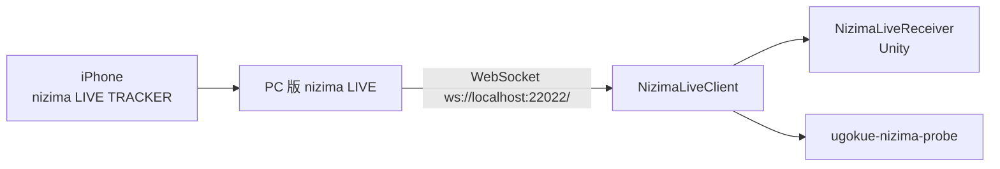
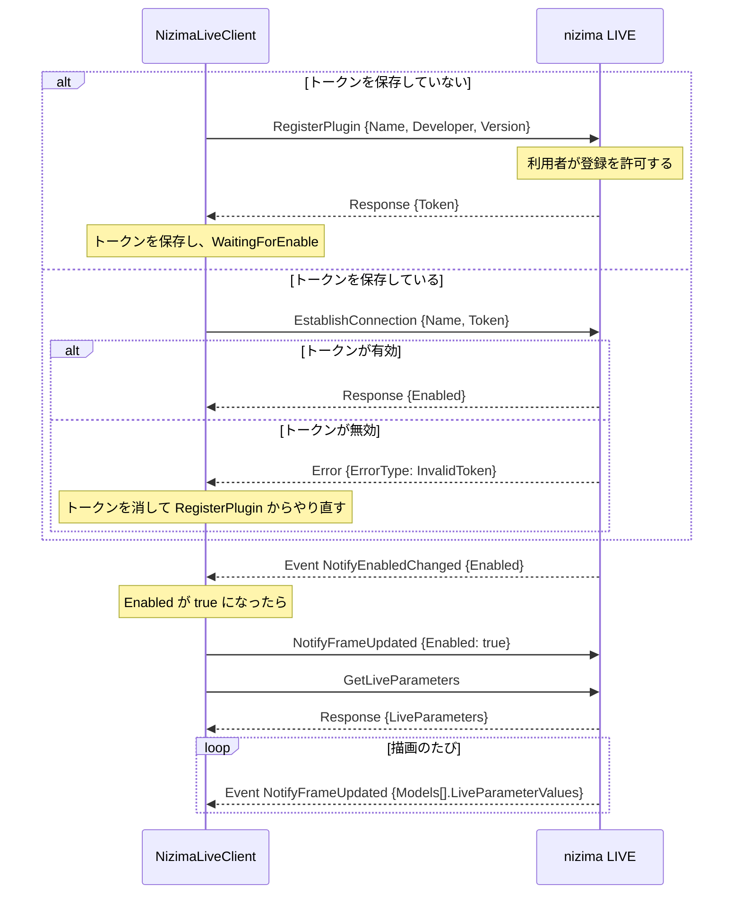

# nizima LIVE からの受信

PC 版 nizima LIVE の [Plugin API](https://github.com/Live2D/nizimaLIVEPluginAPI) に接続し、iPhone の nizima LIVE TRACKER のトラッキング値を受け取る仕組み。経路を選んだ理由は [ADR 0003](../adr/0003-tracking-via-nizima-live-relay.md) にある。受け取った値をモデルのパラメータに対応づけるのは PoC-07（#10）で扱う。

## 構成

| 場所 | 役割 |
| --- | --- |
| `unity/Packages/com.ugokue.core/Runtime/Live/` | Unity に依存しない受信処理。`NizimaLiveClient`（接続、再接続、状態）、`NizimaProtocol`（JSON の組み立てと読み取り）、`ReceiveRateMeter`（受信間隔の計測）、`TrackingFrame`（1回分の値） |
| `unity/Assets/Ugokue/Runtime/Live/NizimaLiveReceiver.cs` | Main シーンに置く MonoBehaviour。有効なあいだ接続を続け、F4 で接続状態と受け取った値を表示する |
| `dotnet/Ugokue.Live.Probe/` | 実機確認用のコマンドラインツール。届いたメッセージをそのまま記録し、受信レートとモデルの有無を集計する |



## 接続の流れ

すべてのメッセージは `{"nLPlugin":"1.0.0","Timestamp":…,"Id":…,"Type":…,"Method":…,"Data":{…}}` の形の JSON テキストで、`Type` は `Request`、`Response`、`Event`、`Error` のいずれか。



### 状態

| 状態 | 意味 | 画面の案内 |
| --- | --- | --- |
| `Disconnected` | 接続していない。0.5 秒から倍々に最大 5 秒の間隔で、つながるまで接続し直す | nizima LIVE を起動し、プラグイン API を有効にする |
| `Connecting` | WebSocket の接続中 | 同上 |
| `WaitingForRegistration` | RegisterPlugin の応答待ち | nizima LIVE 側で登録を許可する |
| `WaitingForEnable` | 登録済みで、プラグインが無効 | nizima LIVE のプラグイン一覧で有効にする |
| `Streaming` | 値を受け取っている | 受信レートを表示する。モデルのない通知が届いたら、その旨を表示する |

nizima LIVE を終了すると `Disconnected` に戻り、起動し直すと保存したトークンで自動的に `Streaming` に戻る。届いた JSON が読めないときは、そのメッセージだけを無視して接続を続ける。

### 値の読み取り

`NotifyFrameUpdated` の `Data.Models` のうち、`ModelId` を指定していればそのモデル、していなければ最初のモデルの `LiveParameterValues`（`[{Id, Value}]`）を読む。数値でない値と `Id` のない値は捨てる。`Models` が空のときは、前回の値をそのまま残す。

### トークンの保存先

| 使う側 | プラグイン名 | 保存先 |
| --- | --- | --- |
| Unity アプリ | `ugokue` | `Application.persistentDataPath/nizima-live-token` |
| 確認ツール | `ugokue probe` | `~/.ugokue/nizima-probe-token`（`--token-file` で変更できる） |

プラグイン名を分けているので、2つは nizima LIVE のプラグイン一覧に別々に表示され、それぞれ一度ずつ許可が必要になる。

## 受信レート

`ReceiveRateMeter` は、直近 5 秒（確認ツールは記録全体）に値を受け取った時刻から、毎秒の受信回数と、受信間隔の平均・p95・最大を計算する。時刻は単調増加する時計（`Stopwatch`）で測る。

## 初めて使うときの手順

1. PC 版 nizima LIVE を起動し、iPhone の nizima LIVE TRACKER とつなぐ（[公式の手順](https://docs.nizimalive.com/en/tutorials/how-to-connect-tracker/)）
2. nizima LIVE でプラグイン API を有効にする
3. ugokue を起動する。nizima LIVE に登録の確認が出たら許可する
4. nizima LIVE のプラグイン一覧で ugokue を有効にする
5. ugokue で F4 を押し、状態が `Streaming` になり、顔を動かすと値が変わることを確かめる

2回目からは 3 と 4 は不要。実機で確かめたあと、nizima LIVE 側の画面の名前に合わせてこの手順を直す。

## 実機での確認

確認ツールをリポジトリのルートで実行する。

```
dotnet run --project dotnet/Ugokue.Live.Probe -- --seconds 60
```

`artifacts/nizima-probe/<日時>/` に次を書き出す。

| ファイル | 内容 |
| --- | --- |
| `messages.jsonl` | 受け取ったメッセージ。1行に `{"atSeconds": 受信時刻, "message": 受け取った JSON}`（JSON として読めなければ文字列） |
| `summary.json` | 接続回数、状態の変化、モデルあり・なしの通知の数とモデルの ID、受信レート、届いたパラメータ名、`GetLiveParameters` の一覧 |

ダミーモデルの要否は、nizima LIVE にモデルを読み込まない状態と、読み込んだ状態の両方で記録して比べる。

## 実機の結果

2026-10-31 に macOS 版 nizima LIVE（Plugin API 1.2.0）と iPhone の nizima LIVE TRACKER で記録した。記録から取り出したメッセージ（トークンは伏せた）を `dotnet/Ugokue.Core.Tests/Live/Fixtures/` に置き、`RecordedNizimaMessageTests` で読み取りを確かめている。

### 接続

- nizima LIVE はメッセージの `nLPlugin` に `1.2.0` を返すが、こちらが `1.0.0` で送っても、登録・接続・値の受信は問題なく動く。
- 初回は RegisterPlugin の応答でトークンを受け取り、プラグイン一覧で有効にすると NotifyEnabledChanged が届く。2回目からは保存したトークンで、起動から約 0.05 秒で `Streaming` になる。

### 受信レート

| 記録 | 状態 | フレーム数 | 毎秒の受信回数 | 平均 | p95 | 最大 |
| --- | --- | --- | --- | --- | --- | --- |
| 3 分 | TRACKER 未接続 | 5,397 | 30.0 | 33.4 ms | 34.4 ms | 118.5 ms |
| 2 分 | TRACKER 接続、顔を動かす | 3,598 | 30.0 | 33.3 ms | 47.1 ms | 60.0 ms |

- 通知は毎秒 30 回で、0.2 秒を超える途切れはなかった。
- 1回の通知に、165 個すべての LiveParameter の値と、読み込んだモデルの Cubism パラメータの値が入る。

### 値の範囲

- 値は `GetLiveParameters` の範囲を超えることがある（例：`Yaw` が −39.8〜39.5、`Roll` が −38.3〜49.0、`EyeOpenLeft` が −0.11〜2.08、`FaceFound` が −0.06〜1.06）。範囲に収めるかどうかは PoC-07 で決める。
- 顔を見失っているあいだ（`FaceFound` が 0）は、どの値も初期値になる。

### ダミーモデルの要否

nizima LIVE は起動時にモデル（ID `10000`）を読み込んでおり、記録したすべての通知に、このモデルが入っていた。モデルを閉じた状態はまだ記録していないので、ダミーモデルが必要かどうかは未確認。

### パラメータ一覧

`GetLiveParameters` が返した 165 個（作成元、グループ、範囲、初期値、繰り返しが同じものをまとめた）。繰り返し（○）は、端の値どうしが同じ向きを表す角度。

| 作成元 | グループ | 範囲 | 初期値 | 繰り返し | パラメータ |
| --- | --- | --- | --- | --- | --- |
| nizima LIVE | Face | 0〜1 | 0 |  | `FaceFound` |
| nizima LIVE | Face | -30〜30 | 0 |  | `Yaw`、`Pitch`、`Roll` |
| nizima LIVE | Face | -1〜1 | 0 |  | `PositionX`、`PositionY`、`PositionZ` |
| nizima LIVE | Eye | -1〜1 | 0 |  | `BrowYLeft`、`BrowYRight`、`EyeLookX`、`EyeLookY` |
| nizima LIVE | Eye | 0〜2 | 1 |  | `EyeOpenLeft`、`EyeOpenRight` |
| nizima LIVE | Mouth | 0〜1 | 0 |  | `MouthOpen` |
| nizima LIVE | Mouth | -1〜1 | 0 |  | `MouthSpread` |
| nizima LIVE | iOS | -1〜1 | 0 |  | `EyeSmileLeft`、`EyeSmileRight`、`EyeWide`、`MouthX` |
| nizima LIVE | Desktop | -1〜1 | 0 |  | `MouseX`、`MouseY` |
| nizima LIVE | HandLeft | 0〜1 | 0 |  | `HandLeftFound` |
| nizima LIVE | HandLeft | -180〜180 | 0 | ○ | `HandLeftAngleX`、`HandLeftAngleZ` |
| nizima LIVE | HandLeft | -90〜90 | 0 |  | `HandLeftAngleY` |
| nizima LIVE | HandLeft | -1〜1 | 0 |  | `HandLeftPositionX`、`HandLeftPositionY`、`HandLeftPositionZ` |
| nizima LIVE | HandLeft | 0〜1 | 1 |  | `HandLeftOpen`、`HandLeftFingerThumb`、`HandLeftFingerIndex`、`HandLeftFingerMiddle`、`HandLeftFingerRing`、`HandLeftFingerPinky` |
| nizima LIVE | HandRight | 0〜1 | 0 |  | `HandRightFound` |
| nizima LIVE | HandRight | -180〜180 | 0 | ○ | `HandRightAngleX`、`HandRightAngleZ` |
| nizima LIVE | HandRight | -90〜90 | 0 |  | `HandRightAngleY` |
| nizima LIVE | HandRight | -1〜1 | 0 |  | `HandRightPositionX`、`HandRightPositionY`、`HandRightPositionZ` |
| nizima LIVE | HandRight | 0〜1 | 1 |  | `HandRightOpen`、`HandRightFingerThumb`、`HandRightFingerIndex`、`HandRightFingerMiddle`、`HandRightFingerRing`、`HandRightFingerPinky` |
| nizima LIVE | HandBoth | 0〜1 | 0 |  | `HandBothFound` |
| nizima LIVE | HandBoth | 0〜2 | 1 |  | `HandDistance` |
| ARKit | Eye | 0〜1 | 0 |  | `ARKitEyeBlinkLeft`、`ARKitEyeLookDownLeft`、`ARKitEyeLookInLeft`、`ARKitEyeLookOutLeft`、`ARKitEyeLookUpLeft`、`ARKitEyeSquintLeft`、`ARKitEyeWideLeft`、`ARKitEyeBlinkRight`、`ARKitEyeLookDownRight`、`ARKitEyeLookInRight`、`ARKitEyeLookOutRight`、`ARKitEyeLookUpRight`、`ARKitEyeSquintRight`、`ARKitEyeWideRight` |
| ARKit | Jaw | 0〜1 | 0 |  | `ARKitJawForward`、`ARKitJawLeft`、`ARKitJawRight`、`ARKitJawOpen` |
| ARKit | Mouth | 0〜1 | 0 |  | `ARKitMouthClose`、`ARKitMouthFunnel`、`ARKitMouthPucker`、`ARKitMouthLeft`、`ARKitMouthRight`、`ARKitMouthSmileLeft`、`ARKitMouthSmileRight`、`ARKitMouthFrownLeft`、`ARKitMouthFrownRight`、`ARKitMouthDimpleLeft`、`ARKitMouthDimpleRight`、`ARKitMouthStretchLeft`、`ARKitMouthStretchRight`、`ARKitMouthRollLower`、`ARKitMouthRollUpper`、`ARKitMouthShrugLower`、`ARKitMouthShrugUpper`、`ARKitMouthPressLeft`、`ARKitMouthPressRight`、`ARKitMouthLowerDownLeft`、`ARKitMouthLowerDownRight`、`ARKitMouthUpperUpLeft`、`ARKitMouthUpperUpRight` |
| ARKit | Brow | 0〜1 | 0 |  | `ARKitBrowDownLeft`、`ARKitBrowDownRight`、`ARKitBrowInnerUp`、`ARKitBrowOuterUpLeft`、`ARKitBrowOuterUpRight` |
| ARKit | Cheek | 0〜1 | 0 |  | `ARKitCheekPuff`、`ARKitCheekSquintLeft`、`ARKitCheekSquintRight` |
| ARKit | Nose | 0〜1 | 0 |  | `ARKitNoseSneerLeft`、`ARKitNoseSneerRight` |
| ARKit | Tongue | 0〜1 | 0 |  | `ARKitTongueOut` |
| LipSync | Mouth | 0〜1 | 0 |  | `LipSyncVolume`、`LipSyncMouthOpen`、`LipSyncMouthA`、`LipSyncMouthI`、`LipSyncMouthU`、`LipSyncMouthE`、`LipSyncMouthO` |
| LipSync | Mouth | -1〜1 | 0 |  | `LipSyncMouthSpread` |
| mocopi | Face | -30〜30 | 0 |  | `RollRelative` |
| mocopi | Body | -10〜10 | 0 |  | `HipSway` |
| mocopi | Body | -30〜30 | 0 |  | `TorsoAngleX`、`TorsoAngleY`、`TorsoAngleZ` |
| mocopi | Body | -1〜1 | 0 |  | `BodyPositionX`、`BodyPositionY`、`BodyPositionZ` |
| mocopi | ArmLeft | -90〜90 | 0 |  | `UpperArmLeftAngleY`、`LowerArmLeftAngleY` |
| mocopi | ArmLeft | -180〜180 | 0 | ○ | `UpperArmLeftAngleZ`、`UpperArmLeftAngleZRelative`、`LowerArmLeftAngleX`、`LowerArmLeftAngleZ`、`LowerArmLeftAngleZRelative` |
| mocopi | ArmLeft | 0〜180 | 0 |  | `ElbowLeftAngle` |
| mocopi | ArmLeft | -1〜1 | 0 |  | `ElbowLeftPositionX`、`ElbowLeftPositionY`、`ElbowLeftPositionZ` |
| mocopi | ArmRight | -90〜90 | 0 |  | `UpperArmRightAngleY`、`LowerArmRightAngleY` |
| mocopi | ArmRight | -180〜180 | 0 | ○ | `UpperArmRightAngleZ`、`UpperArmRightAngleZRelative`、`LowerArmRightAngleX`、`LowerArmRightAngleZ`、`LowerArmRightAngleZRelative` |
| mocopi | ArmRight | 0〜180 | 0 |  | `ElbowRightAngle` |
| mocopi | ArmRight | -1〜1 | 0 |  | `ElbowRightPositionX`、`ElbowRightPositionY`、`ElbowRightPositionZ` |
| mocopi | LegLeft | -30〜30 | 0 |  | `UpperLegLeftAngleY`、`UpperLegLeftAngleZ`、`LowerLegLeftAngleX`、`LowerLegLeftAngleY`、`LowerLegLeftAngleZ`、`LowerLegLeftAngleZRelative` |
| mocopi | LegLeft | 0〜180 | 0 |  | `KneeLeftAngle` |
| mocopi | LegLeft | -1〜1 | 0 |  | `KneeLeftPositionX`、`KneeLeftPositionY`、`KneeLeftPositionZ` |
| mocopi | LegRight | -30〜30 | 0 |  | `UpperLegRightAngleY`、`UpperLegRightAngleZ`、`LowerLegRightAngleX`、`LowerLegRightAngleY`、`LowerLegRightAngleZ`、`LowerLegRightAngleZRelative` |
| mocopi | LegRight | 0〜180 | 0 |  | `KneeRightAngle` |
| mocopi | LegRight | -1〜1 | 0 |  | `KneeRightPositionX`、`KneeRightPositionY`、`KneeRightPositionZ` |
| mocopi | FootLeft | -1〜1 | 0 |  | `FootLeftPositionX`、`FootLeftPositionY`、`FootLeftPositionZ` |
| mocopi | FootRight | -1〜1 | 0 |  | `FootRightPositionX`、`FootRightPositionY`、`FootRightPositionZ` |
