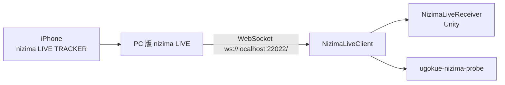
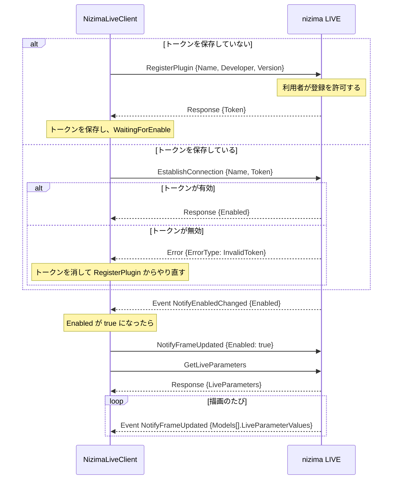

# nizima LIVE からの受信

PC 版 nizima LIVE の [Plugin API](https://github.com/Live2D/nizimaLIVEPluginAPI) に接続し、iPhone の nizima LIVE TRACKER のトラッキング値を受け取る仕組み。経路を選んだ理由は [ADR 0003](../adr/0003-tracking-via-nizima-live-relay.md) にある。受け取った値をモデルのパラメータに対応づけるのは PoC-07（#10）で扱う。

## 構成

| 場所 | 役割 |
| --- | --- |
| `unity/Packages/com.ugokue.core/Runtime/Live/` | Unity に依存しない受信処理。`NizimaLiveClient`（接続、再接続、状態）、`NizimaProtocol`（JSON の組み立てと読み取り）、`ReceiveRateMeter`（受信間隔の計測）、`TrackingFrame`（1回分の値） |
| `unity/Assets/Ugokue/Runtime/Live/NizimaLiveReceiver.cs` | Main シーンに置く MonoBehaviour。有効なあいだ接続を続け、F4 で接続状態と受け取った値を表示する |
| `dotnet/Ugokue.Live.Probe/` | 実機確認用のコマンドラインツール。届いたメッセージをそのまま記録し、受信レートとモデルの有無を集計する |



## 接続の流れ

すべてのメッセージは `{"nLPlugin":"1.0.0","Timestamp":…,"Id":…,"Type":…,"Method":…,"Data":{…}}` の形の JSON テキストで、`Type` は `Request`、`Response`、`Event`、`Error` のいずれか。



### 状態

| 状態 | 意味 | 画面の案内 |
| --- | --- | --- |
| `Disconnected` | 接続していない。0.5 秒から倍々に最大 5 秒の間隔で、つながるまで接続し直す | nizima LIVE を起動し、プラグイン API を有効にする |
| `Connecting` | WebSocket の接続中 | 同上 |
| `WaitingForRegistration` | RegisterPlugin の応答待ち | nizima LIVE 側で登録を許可する |
| `WaitingForEnable` | 登録済みで、プラグインが無効 | nizima LIVE のプラグイン一覧で有効にする |
| `Streaming` | 値を受け取っている | 受信レートを表示する。モデルのない通知が届いたら、その旨を表示する |

nizima LIVE を終了すると `Disconnected` に戻り、起動し直すと保存したトークンで自動的に `Streaming` に戻る。届いた JSON が読めないときは、そのメッセージだけを無視して接続を続ける。

### 値の読み取り

`NotifyFrameUpdated` の `Data.Models` のうち、`ModelId` を指定していればそのモデル、していなければ最初のモデルの `LiveParameterValues`（`[{Id, Value}]`）を読む。数値でない値と `Id` のない値は捨てる。`Models` が空のときは、前回の値をそのまま残す。

### トークンの保存先

| 使う側 | プラグイン名 | 保存先 |
| --- | --- | --- |
| Unity アプリ | `ugokue` | `Application.persistentDataPath/nizima-live-token` |
| 確認ツール | `ugokue probe` | `~/.ugokue/nizima-probe-token`（`--token-file` で変更できる） |

プラグイン名を分けているので、2つは nizima LIVE のプラグイン一覧に別々に表示され、それぞれ一度ずつ許可が必要になる。

## 受信レート

`ReceiveRateMeter` は、直近 5 秒（確認ツールは記録全体）に値を受け取った時刻から、毎秒の受信回数と、受信間隔の平均・p95・最大を計算する。時刻は単調増加する時計（`Stopwatch`）で測る。

## 初めて使うときの手順

1. PC 版 nizima LIVE を起動し、iPhone の nizima LIVE TRACKER とつなぐ（[公式の手順](https://docs.nizimalive.com/en/tutorials/how-to-connect-tracker/)）
2. nizima LIVE でプラグイン API を有効にする
3. ugokue を起動する。nizima LIVE に登録の確認が出たら許可する
4. nizima LIVE のプラグイン一覧で ugokue を有効にする
5. ugokue で F4 を押し、状態が `Streaming` になり、顔を動かすと値が変わることを確かめる

2回目からは 3 と 4 は不要。実機で確かめたあと、nizima LIVE 側の画面の名前に合わせてこの手順を直す。

## 実機での確認

確認ツールをリポジトリのルートで実行する。

```
dotnet run --project dotnet/Ugokue.Live.Probe -- --seconds 60
```

`artifacts/nizima-probe/<日時>/` に次を書き出す。

| ファイル | 内容 |
| --- | --- |
| `messages.jsonl` | 受け取ったメッセージ。1行に `{"atSeconds": 受信時刻, "message": 受け取った JSON}`（JSON として読めなければ文字列） |
| `summary.json` | 接続回数、状態の変化、モデルあり・なしの通知の数とモデルの ID、受信レート、届いたパラメータ名、`GetLiveParameters` の一覧 |

ダミーモデルの要否は、nizima LIVE にモデルを読み込まない状態と、読み込んだ状態の両方で記録して比べる。

## 実機の結果

PoC-06 の実機確認で記録したあとに書く。

- パラメータ一覧：未記録
- ダミーモデルの要否：未確認
- 受信レート：未計測
