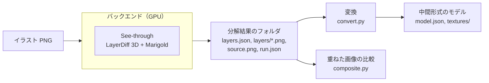

# パーツ分解

イラスト1枚を、動かすのに必要なパーツに分けて、中間形式 v0 のモデルとして書き出す仕組み。実行環境と変換を分けた理由は [ADR 0007](../adr/0007-decomposition-runner-and-backends.md) にある。

## 構成



| 場所 | 役割 |
| --- | --- |
| `pipeline/python/src/ugokue_pipeline/modal_app.py` | Modal のバックエンド。テストイラストの生成と、See-through による分解 |
| `.../result.py` | 分解結果のフォルダの読み書き。See-through の出力からの変換 |
| `.../convert.py` | 分解結果から中間形式のモデルへの変換 |
| `.../composite.py` | パーツを重ねた画像と、元のイラストの比較 |
| `.../report.py`、`cli.py` | 複数のイラストの変換・検証・比較をまとめる |
| `pipeline/samples/illustrations.json` | テストイラストの生成の設定（プロンプト、シード） |

GPU を使うのはバックエンドだけで、変換と比較は numpy と Pillow だけで、どの OS でも動く。

## 分解結果のフォルダ

バックエンドによらず、次の形で書き出す。あとで手元の Windows や ComfyUI のバックエンドを足すときも、この形を守る。

```
<分解結果>/
  layers.json      層の一覧
  layers/<名前>.png        層の画像（箱の大きさに切り抜いた RGBA）
  layers/<名前>_depth.png  層の深度（8 ビットのグレースケール、0 が手前）。任意
  source.png       分解したイラスト（RGB）
  run.json         実行の記録
```

`layers.json`：

| 項目 | 型 | 内容 |
| --- | --- | --- |
| `frameSize.width`、`frameSize.height` | 整数 | イラストの大きさ（ピクセル） |
| `layers[].tag` | 文字列 | See-through のタグ（例：`front hair`、`irides-r`）。左右に分けた層は `-r`（キャラクターの右＝画像の左）と `-l` を付ける |
| `layers[].file` | 文字列 | 層の画像の相対パス。タグの英数字と `-` 以外を `_` にした名前 |
| `layers[].depthFile` | 文字列 | 深度の画像の相対パス。任意 |
| `layers[].box` | `[x1, y1, x2, y2]` | 層の画像を置く位置（イラストの座標、x2・y2 は含まない） |
| `layers[].depthMedian` | 数値 | 層の深度の中央値。小さいほど手前 |

`run.json` は、バックエンド、GPU、See-through のリポジトリの版と重みの版、シード、解像度、段階ごとの処理時間、使った VRAM の最大値、イラストの SHA-256 を記録する（項目は `modal_app.py` の `decompose` を参照）。

## 変換

`convert.py` は、層をパーツにし、各パーツに層の箱と同じ大きさの四角形のメッシュ（頂点4つ、三角形2つ）と、層の画像のテクスチャを付ける。

| タグ | パーツ ID | 役割 | 親 |
| --- | --- | --- | --- |
| `front hair` | `hair_front` | `hair_front` | `head` |
| `back hair` | `hair_back` | `hair_back` | `head` |
| `face` | `face` | `face` | `head` |
| `eyewhite-r`、`-l` | `eye_white_r`、`_l` | `eye_white` | `face` |
| `irides-r`、`-l` | `iris_r`、`_l` | `iris` | `face` |
| `eyelash-r`、`-l` | `eyelid_r`、`_l` | `eyelid` | `face` |
| `eyebrow-r`、`-l` | `eyebrow_r`、`_l` | `eyebrow` | `face` |
| `ears-r`、`-l` | `ear_r`、`_l` | `ear` | `head` |
| `nose` | `nose` | `nose` | `face` |
| `mouth` | `mouth` | `mouth` | `face` |
| `headwear`、`earwear` | 同じ名前 | `accessory` | `head` |
| `eyewear` | `eyewear` | `accessory` | `face` |
| `neck` | `neck` | `neck` | `body` |
| `neckwear`、`topwear`、`handwear`、`bottomwear`、`legwear`、`footwear` | 同じ名前 | `clothes` | `body` |
| `head` | 使わない（頭全体を合成した層で、個別の層と重なるため） | | |
| それ以外 | 小文字にして英数字以外を `_` にしたもの | `accessory` | `body` |

- 左右に分けていない層（`irides` など）は、`_r`、`_l` を付けない ID（`iris` など）にする。
- 描画のまとまりとして、メッシュを持たない `body`（最上位）と `head`（親は `body`）を加える。
- 描画順は、深度の中央値の大きい（奥の）層から 10、20、30… と付ける。同じ深度なら、パーツ ID の順。
- 黒目は、同じ側の白目があれば、それで切り抜く（`clipBy`）。
- パラメータは標準の7つ（`AngleX`、`AngleY`、`AngleZ`、`EyeOpenL`、`EyeOpenR`、`MouthOpenY`、`Breath`）を置き、キーフォームは持たない（変形は PoC-10 で作る）。ビューは正面の1つだけ。
- See-through は口の中・歯・舌には分けない。口の開いた絵と口のパーツの分け方は PoC-09 で扱う。

## 重ねた画像の比較

`composite.py` は、変換に使う層を奥から順にアルファ合成し、元のイラストと比べる。比べるのは、重ねた画像の不透明度が半分以上の画素だけ（背景は層にならないため）。

| 値 | 内容 |
| --- | --- |
| `meanAbsDiff` | 画素ごとの RGB の差の絶対値の平均（0〜255）の、平均 |
| `p95AbsDiff` | 同じく、95 パーセンタイル |
| `mismatchRatio` | 差が 32 を超える画素の割合 |
| `coverage` | イラスト全体のうち、比べた画素の割合 |

`diff.png` は、比べた画素の差の絶対値を RGB で表した画像（比べない画素は黒）。

## 実行のしかた

Modal の認証（`uvx modal setup`）を済ませてから、リポジトリのルートで実行する。

| 目的 | コマンド |
| --- | --- |
| テストイラストの生成 | `uv run --project pipeline/python --extra modal modal run pipeline/python/src/ugokue_pipeline/modal_app.py::generate_illustrations` |
| 分解、変換、比較 | `uv run --project pipeline/python --extra modal modal run pipeline/python/src/ugokue_pipeline/modal_app.py::decompose_images` |
| 同じ設定での再現性の確認 | `uv run --project pipeline/python --extra modal modal run pipeline/python/src/ugokue_pipeline/modal_app.py::check_determinism` |
| 分解結果の変換・比較だけ（GPU 不要） | `uv run --project pipeline/python ugokue-pipeline report artifacts/decomposition` |

結果は `artifacts/decomposition/<イラスト名>/` に、`result/`（分解結果）、`model/`（中間形式）、`composite.png`、`diff.png` として書き出し、まとめを `artifacts/decomposition/summary.json` に書く。

## テストイラスト

[Animagine XL 4.0](https://huggingface.co/cagliostrolab/animagine-xl-4.0) で、`pipeline/samples/illustrations.json` のプロンプトとシードから5枚を生成し、`pipeline/samples/illustrations/` に置く。髪型（ロング、ツインテール、ボブ、短髪、流した前髪）、眼鏡、男性キャラクターを含めて、分解の難しさに幅を持たせる。

## 利用するモデルとライセンス

| モデル | 用途 | ライセンス |
| --- | --- | --- |
| [See-through](https://github.com/shitagaki-lab/see-through)（コード） | 分解 | Apache-2.0 |
| [LayerDiff 3D](https://huggingface.co/layerdifforg/seethroughv0.0.2_layerdiff3d)（重み） | 層の生成 | Apache-2.0 の上に、元のモデルの CreativeML Open RAIL++-M（SDXL、Animagine XL 4.0）と CreativeML Open RAIL-M（LayerDiffuse）を引き継ぐ |
| [Marigold（See-through 版）](https://huggingface.co/layerdifforg/seethroughv0.0.1_marigold)（重み） | 深度 | Apache-2.0 の上に、Open RAIL++-M（Marigold、Stable Diffusion 2）を引き継ぐ |
| [Animagine XL 4.0](https://huggingface.co/cagliostrolab/animagine-xl-4.0) | テストイラストの生成 | CreativeML Open RAIL++-M |

Open RAIL 系のライセンスは商用利用を認めるが、使い方の制限（ライセンスの Attachment A）がある。製品として配るときの扱いは、MVP で利用規約と合わせて確かめる。

## 実機の結果

PoC-08 で Modal で実行したあとに書く。

- 1枚あたりの処理時間：未計測
- VRAM の最大値：未計測
- 重ねた画像の比較：未計測
- 同じ設定での再現性：未確認
