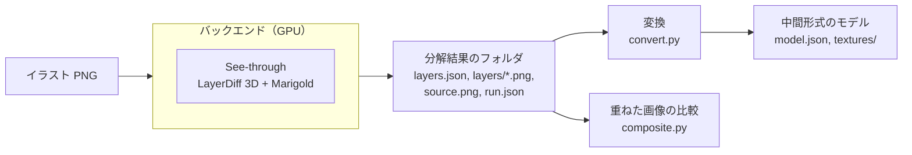

# パーツ分解

イラスト1枚を、動かすのに必要なパーツに分けて、中間形式 v0 のモデルとして書き出す仕組み。実行環境と変換を分けた理由は [ADR 0007](../adr/0007-decomposition-runner-and-backends.md) にある。

## 構成



| 場所 | 役割 |
| --- | --- |
| `pipeline/python/src/ugokue_pipeline/modal_app.py` | Modal のバックエンド。テストイラストの生成と、See-through による分解 |
| `.../result.py` | 分解結果のフォルダの読み書き。See-through の出力からの変換 |
| `.../convert.py` | 分解結果から中間形式のモデルへの変換 |
| `.../composite.py` | パーツを重ねた画像と、元のイラストの比較 |
| `.../report.py`、`cli.py` | 複数のイラストの変換・検証・比較をまとめる |
| `pipeline/samples/illustrations.json` | テストイラストの生成の設定（プロンプト、シード） |

GPU を使うのはバックエンドだけで、変換と比較は numpy と Pillow だけで、どの OS でも動く。

## 分解結果のフォルダ

バックエンドによらず、次の形で書き出す。あとで手元の Windows や ComfyUI のバックエンドを足すときも、この形を守る。

```
<分解結果>/
  layers.json      層の一覧
  layers/<名前>.png        層の画像（箱の大きさに切り抜いた RGBA）
  layers/<名前>_depth.png  層の深度（8 ビットのグレースケール、0 が手前）。任意
  source.png       分解したイラスト（RGB）
  run.json         実行の記録
```

`layers.json`：

| 項目 | 型 | 内容 |
| --- | --- | --- |
| `frameSize.width`、`frameSize.height` | 整数 | イラストの大きさ（ピクセル） |
| `layers[].tag` | 文字列 | See-through のタグ（例：`front hair`、`irides-r`）。左右に分けた層は `-r`（キャラクターの右＝画像の左）と `-l` を付ける |
| `layers[].file` | 文字列 | 層の画像の相対パス。タグの英数字と `-` 以外を `_` にした名前 |
| `layers[].depthFile` | 文字列 | 深度の画像の相対パス。任意 |
| `layers[].box` | `[x1, y1, x2, y2]` | 層の画像を置く位置（イラストの座標、x2・y2 は含まない） |
| `layers[].depthMedian` | 数値 | 層の深度の中央値。小さいほど手前 |

`run.json` は、バックエンド、GPU、See-through のリポジトリの版と重みの版、シード、解像度、段階ごとの処理時間、VRAM の制限と最大値、イラストの SHA-256 を記録する（項目は `modal_app.py` の `decompose` を参照）。VRAM の最大値は、実際に使った量（`peakVramAllocatedGiB`）と、PyTorch が確保した量（`peakVramReservedGiB`）の両方を残す。確保した量は、GPU に空きがあると使い終わったメモリも抱えたままになるので、必要な量の判断には使った量を使う。

### See-through の座標からの戻し方

See-through は、イラストの短い辺の両側に黒の余白を足して正方形にし、解像度（1280）に拡大してから層を作る。層の位置と大きさも、この正方形の座標になる。`from_see_through` は、層を元のイラストの座標に戻してから書き出す（`result.py` の `to_source_frame`）。

- 箱の座標を `元のイラストの長い辺 / 解像度` 倍し、余白の幅を引く。箱の端は外側に丸める。
- 層の画像を、戻した箱の大きさに縮小する（RGBA は Lanczos、深度は双線形）。
- 余白にはみ出した部分は切り落とし、すべて余白にある層は捨てる。

## 変換

`convert.py` は、層をパーツにし、各パーツに格子のメッシュと、層の画像のテクスチャを付ける。格子は、層の箱をおよそ「イラストの短い辺の 1/48（8 画素以上）」の大きさのマスに分け、不透明な画素を含むマスだけを残したもの（`mesh.py`。PoC-10 で、四角形1枚のメッシュから変えた）。各マスを2つの三角形にし、三角形の向きは固定テストモデルとそろえる。

| タグ | パーツ ID | 役割 | 親 |
| --- | --- | --- | --- |
| `front hair` | `hair_front` | `hair_front` | `head` |
| `back hair` | `hair_back` | `hair_back` | `head` |
| `face` | `face` | `face` | `head` |
| `eyewhite-r`、`-l` | `eye_white_r`、`_l` | `eye_white` | `face` |
| `irides-r`、`-l` | `iris_r`、`_l` | `iris` | `face` |
| `eyelash-r`、`-l` | `eyelid_r`、`_l` | `eyelid` | `face` |
| `eyebrow-r`、`-l` | `eyebrow_r`、`_l` | `eyebrow` | `face` |
| `ears-r`、`-l` | `ear_r`、`_l` | `ear` | `head` |
| `nose` | `nose` | `nose` | `face` |
| `mouth` | `mouth` | `mouth` | `face` |
| `headwear`、`earwear` | 同じ名前 | `accessory` | `head` |
| `eyewear` | `eyewear` | `accessory` | `face` |
| `neck` | `neck` | `neck` | `body` |
| `neckwear`、`topwear`、`handwear`、`bottomwear`、`legwear`、`footwear` | 同じ名前 | `clothes` | `body` |
| `head` | 使わない（頭全体を合成した層で、個別の層と重なるため） | | |
| それ以外 | 小文字にして英数字以外を `_` にしたもの | `accessory` | `body` |

- 左右に分けていない層（`irides` など）は、`_r`、`_l` を付けない ID（`iris` など）にする。
- 描画のまとまりとして、メッシュを持たない `body`（最上位）と `head`（親は `body`）を加える。
- 描画順は、深度の中央値の大きい（奥の）層から 10、20、30… と付ける。同じ深度なら、パーツ ID の順。
- ただし前髪は、顔と、親が顔のパーツのどれよりも手前に描く（それらの深度の最小値より 0.001 小さい深度として並べる）。前髪の層は、横や後ろに垂れた髪も含むので、層全体の深度の中央値が顔より奥になることがあるため。
- 黒目は、同じ側の白目があれば、それで切り抜く（`clipBy`）。
- パラメータは標準の7つ（`AngleX`、`AngleY`、`AngleZ`、`EyeOpenL`、`EyeOpenR`、`MouthOpenY`、`Breath`）を置き、キーフォームは持たない（変形は PoC-10 で作る）。ビューは正面の1つだけ。
- See-through は口の中・歯・舌には分けない。口の開いた絵と口のパーツの分け方は PoC-09 で扱う。

## 重ねた画像の比較

`composite.py` は、変換に使う層をモデルの描画順（奥から手前）にアルファ合成し、元のイラストと比べる。比べるのは、重ねた画像の不透明度が半分以上の画素だけ（背景は層にならないため）。

| 値 | 内容 |
| --- | --- |
| `meanAbsDiff` | 画素ごとの RGB の差の絶対値の平均（0〜255）の、平均 |
| `p95AbsDiff` | 同じく、95 パーセンタイル |
| `mismatchRatio` | 差が 32 を超える画素の割合 |
| `coverage` | イラスト全体のうち、比べた画素の割合 |

`diff.png` は、比べた画素の差の絶対値を RGB で表した画像（比べない画素は黒）。

## 実行のしかた

Modal の認証（`uvx modal setup`）を済ませてから、リポジトリのルートで実行する。

| 目的 | コマンド |
| --- | --- |
| テストイラストの生成 | `uv run --project pipeline/python --extra modal modal run pipeline/python/src/ugokue_pipeline/modal_app.py::generate_illustrations` |
| 分解、変換、比較 | `uv run --project pipeline/python --extra modal modal run pipeline/python/src/ugokue_pipeline/modal_app.py::decompose_images` |
| 同じ設定での再現性と、VRAM 16GB で動くかの確認 | `uv run --project pipeline/python --extra modal modal run pipeline/python/src/ugokue_pipeline/modal_app.py::check_determinism` |
| 分解結果の変換・比較だけ（GPU 不要） | `uv run --project pipeline/python ugokue-pipeline report artifacts/decomposition` |

`check_determinism` は、PyTorch が使える VRAM を 15 GiB に絞り（`--vram-limit-gib` で変えられる）、See-through の group offload（重みを少しずつ GPU に載せる。`--no-group-offload` で切る）を使って、同じイラストを2回分解し、層の画素の違いを `artifacts/determinism/determinism.json` に書く。15 GiB は、VRAM 16GB の GPU から CUDA の実行環境が使う分を除いた量の目安。

結果は `artifacts/decomposition/<イラスト名>/` に、`result/`（分解結果）、`model/`（中間形式）、`composite.png`、`diff.png` として書き出し、まとめを `artifacts/decomposition/summary.json` に書く。

## テストイラスト

[Animagine XL 4.0](https://huggingface.co/cagliostrolab/animagine-xl-4.0) で、`pipeline/samples/illustrations.json` のプロンプトとシードから5枚を生成し、`pipeline/samples/illustrations/` に置く。髪型（ロング、ツインテール、ボブ、短髪、流した前髪）、眼鏡、男性キャラクターを含めて、分解の難しさに幅を持たせる。

## 利用するモデルとライセンス

| モデル | 用途 | ライセンス |
| --- | --- | --- |
| [See-through](https://github.com/shitagaki-lab/see-through)（コード） | 分解 | Apache-2.0 |
| [LayerDiff 3D](https://huggingface.co/layerdifforg/seethroughv0.0.2_layerdiff3d)（重み） | 層の生成 | Apache-2.0 の上に、元のモデルの CreativeML Open RAIL++-M（SDXL、Animagine XL 4.0）と CreativeML Open RAIL-M（LayerDiffuse）を引き継ぐ |
| [Marigold（See-through 版）](https://huggingface.co/layerdifforg/seethroughv0.0.1_marigold)（重み） | 深度 | Apache-2.0 の上に、Open RAIL++-M（Marigold、Stable Diffusion 2）を引き継ぐ |
| [Animagine XL 4.0](https://huggingface.co/cagliostrolab/animagine-xl-4.0) | テストイラストの生成 | CreativeML Open RAIL++-M |

Open RAIL 系のライセンスは商用利用を認めるが、使い方の制限（ライセンスの Attachment A）がある。製品として配るときの扱いは、MVP で利用規約と合わせて確かめる。

## 実機の結果

PoC-08 で、Modal の L4（VRAM 24GB）で、`pipeline/samples/illustrations/` の5枚を分解した（2026-10-31、See-through `df019de`、シード 42、解像度 1280）。

### 処理時間と VRAM

| 設定 | 1枚あたりの処理時間 | 内訳（層の生成 / 深度 / 後処理） | VRAM（使った量 / 確保した量） |
| --- | --- | --- | --- |
| 既定（group offload なし） | 410〜501 秒 | 389〜456 / 19〜46 / 2〜3 秒 | 未記録 / 16.0〜19.2 GiB |
| 既定のまま 15 GiB に制限 | 失敗（層の生成の途中でメモリ不足。使った量 13.6 GiB で、さらに 0.45 GiB を求めた） | | |
| group offload、15 GiB に制限 | 658〜670 秒 | 615〜632 / 36〜40 / 2 秒 | 9.6 / 11.0 GiB |

- 処理時間は、重みを GPU に読み込む時間を含む（各イラストを別のコンテナで1回ずつ実行したため）。
- **VRAM 16GB の GPU では、group offload が必要**。既定の設定は、16GB の GPU では足りない。group offload なら 11 GiB 以下に収まり、12GB の GPU でも動く見込み。代わりに処理時間は約 1.4 倍になる。

### 重ねた画像の比較

| イラスト | 層の数 | `meanAbsDiff` | `p95AbsDiff` | `mismatchRatio` | `coverage` |
| --- | --- | --- | --- | --- | --- |
| 01-long-straight | 19 | 9.8 | 49.7 | 7.4% | 66% |
| 02-twintails | 15 | 8.2 | 34.3 | 5.3% | 71% |
| 03-bob-glasses | 17 | 7.0 | 19.3 | 2.6% | 93% |
| 04-boy | 17 | 9.4 | 37.0 | 5.6% | 83% |
| 05-swept-bangs | 18 | 6.1 | 23.0 | 3.0% | 92% |

（group offload なしの結果。前髪の描画順の規則を入れたあと。）

- 差の大部分は、層の輪郭の1〜2画素のにじみ。絵の大きな欠けは次の2つだけ。
  - 02：ツインテールのリボン（`headwear`）の層が出ない。白目（`eyewhite`）の層も出ない。黒目とまつげの層で白目の部分も描かれるので、見た目は崩れない。
  - 05：前髪の層の深度の中央値が顔より奥になり、前髪が顔の下に描かれた。前髪を顔より手前に描く規則（[変換](#変換)）で直した。この規則で、`mismatchRatio` は 6.6% から 3.0% に下がった。
- 03 は、眉が左右に分かれず1つの層（`eyebrow`）になり、後ろ髪の層が出ない（ボブで、後ろ髪がほとんど見えないため）。
- 隠れていた部分の補完：後ろ髪は頭の裏まで、顔は前髪の下まで、白目と黒目はまぶたに隠れた部分まで描かれる。04 の顔の層には、前髪の影が残る。
- 01 と 02 の `coverage` が低いのは、背景が広いため。

### 同じ設定での再現性

01-long-straight を、group offload と 15 GiB の制限付きで2回分解すると、すべての層の箱と画素が一致した（`identical: true`）。

group offload の有無を変えると、層の箱はほぼ同じだが画素は変わる（19層のうち15層は同じ箱で画素が異なり、4層は箱がずれる）。比べた画像の差はほぼ同じ（`mismatchRatio` 7.4% と 7.5%）。分解結果を固定のテスト用データとして比べるときは、group offload の有無も含めて設定をそろえる（`run.json` の `seeThrough.groupOffload`）。
