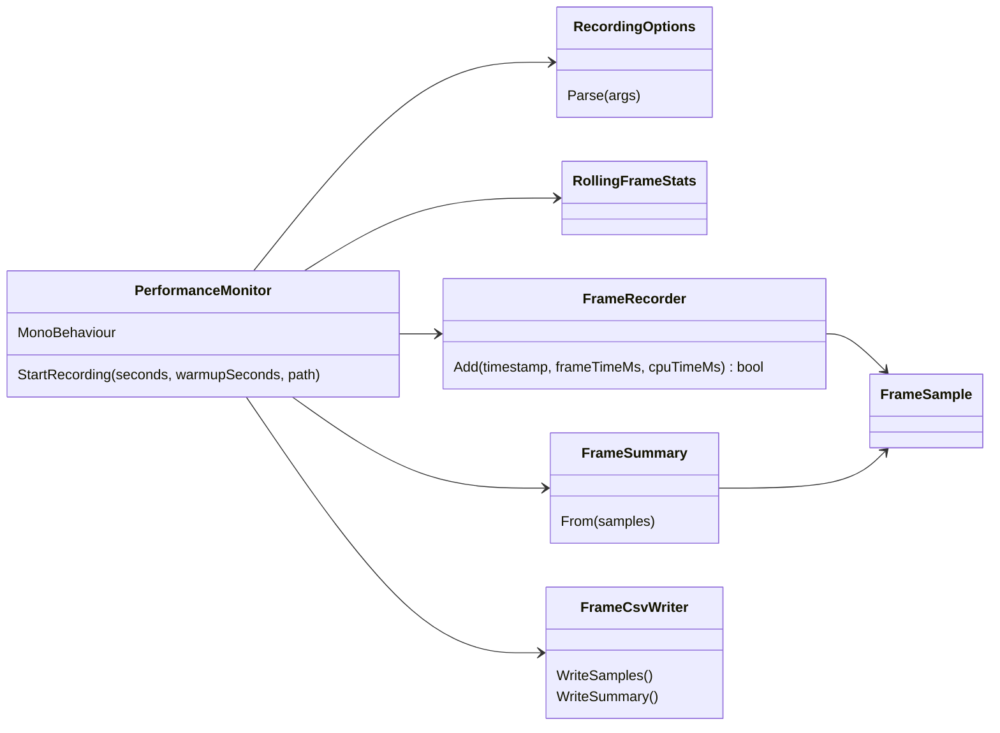

# 性能の計測

プレイヤーの fps と1フレームの処理時間を画面に表示し、指定した秒数ぶんを CSV に記録する仕組み。判定の基準は [PoC の数値目標](performance-targets.md) にある。

## 構成



- `PerformanceMonitor` だけが Unity に依存する（`unity/Assets/Ugokue/Runtime`）。
- ほかのクラスは `com.ugokue.core` パッケージにあり、Unity を参照しない。`dotnet test` で単体テストする。

## 計測値

| 値 | 取得元 | 単位 |
| --- | --- | --- |
| フレーム時間 | `Time.unscaledDeltaTime` | ms |
| CPU 時間 | `FrameTimingManager` の `cpuMainThreadFrameTime`。取れないフレームは空欄 | ms |
| 時刻 | `Time.realtimeSinceStartupAsDouble`。記録開始のフレームを 0 とする | 秒 |

`FrameTimingManager` を使うため、Player Settings の Frame Timing Stats をオンにする。配信中は OBS などにフォーカスがあるため、Run In Background もオンにする。どちらも EditMode テストで確かめる。

## 記録の規則

- 記録開始から、ウォームアップの秒数が経つまでのフレームは記録しない。
- ウォームアップ後の最初のフレームを時刻 0 とし、時刻が指定秒数に達したフレームまでを記録する。そのフレームも含める。
- フレーム番号は 0 から欠けなく連番になる。

## 操作

| 操作 | 内容 |
| --- | --- |
| F1 | 表示の切り替え（fps、フレーム時間、CPU 時間、記録の状態） |
| F9 | 10 秒の記録を開始する（ウォームアップなし） |

## 起動引数

| 引数 | 値 | 既定値 |
| --- | --- | --- |
| `-ugokue-record-seconds` | 記録する秒数（正の数）。指定すると起動時に記録を始める | 記録しない |
| `-ugokue-record-warmup` | ウォームアップの秒数（0 以上） | 2 |
| `-ugokue-record-out` | 本体 CSV のパス | `<persistentDataPath>/perf/perf_<日時>.csv` |
| `-ugokue-quit-after-record` | 記録を保存したら終了する | 終了しない |

## 出力形式

数値は小数点にピリオドを使い、小数第3位まで出す（実行環境の言語設定に依存しない）。

本体 CSV（`<name>.csv`）：1フレーム1行。

```
frame,timestamp_s,frame_time_ms,cpu_time_ms
0,0,17.431,15.851
1,0.017,16.972,17.493
```

集計 CSV（`<name>_summary.csv`）：

| metric | 内容 |
| --- | --- |
| `frame_count` | 記録したフレーム数 |
| `duration_s` | 最後のフレームの時刻 |
| `average_fps` | `frame_count` ÷ 全フレーム時間の合計 |
| `average_frame_time_ms` | フレーム時間の平均 |
| `p95_frame_time_ms`、`p99_frame_time_ms` | フレーム時間を昇順に並べ、順位 ⌈n × p⌉ の値 |
| `max_frame_time_ms` | フレーム時間の最大 |
| `average_cpu_time_ms` | CPU 時間が取れたフレームの平均。1つも取れなければ空欄 |

## CI での確認

ビルドしたプレイヤーを Windows と Mac で起動し、記録を検証する。検証の内容は [CI のテスト](ci.md) の「Launch and record」にある。
