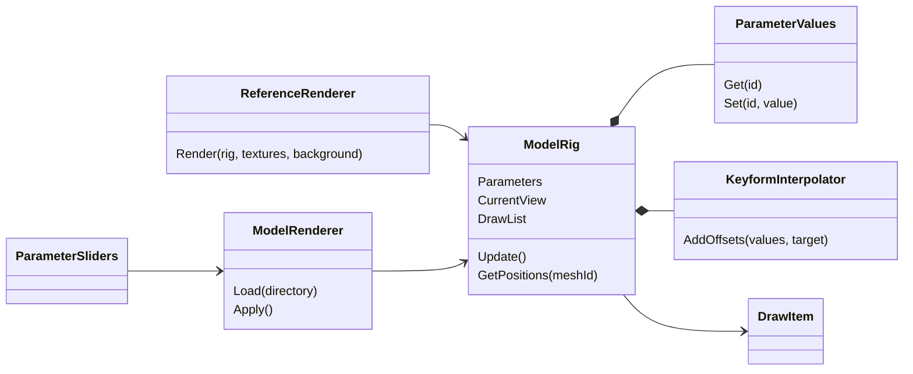
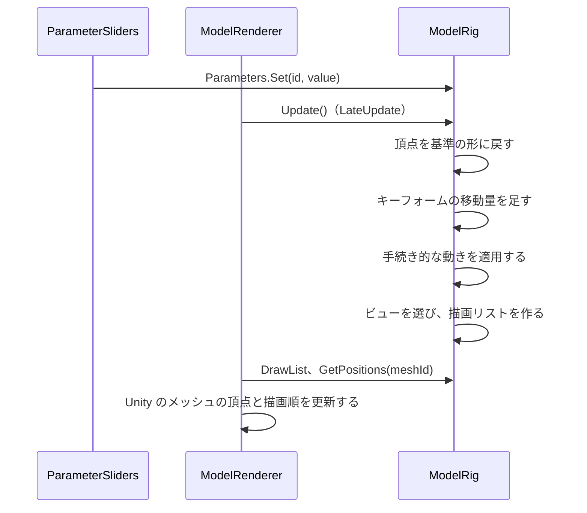

# 実行時の変形と描画

[中間形式 v0](intermediate-format.md) のモデルを、パラメータの値に応じて変形し、Unity で描く仕組み。計算の規則は中間形式の「変形の計算」「ビューの選び方」に従う。このページでは、そこに書いていない実装上の決まりを書く。

## 構成



| クラス | 場所 | 役割 |
| --- | --- | --- |
| `ModelRig`、`ParameterValues`、`KeyformInterpolator`、`DrawItem` | `com.ugokue.core/Runtime/Rig/`（Unity に依存しない） | パラメータの値から、各メッシュの頂点位置、ビュー、描画リストを求める |
| `ReferenceRenderer` | 同上 | CPU で描く参照用のレンダラー。画像回帰テストに使う |
| `Png`、`RgbaImage` | `com.ugokue.core/Runtime/Imaging/` | PNG の読み書き（参照レンダラーとテスト用） |
| `ModelRenderer`、`ParameterSliders`、`DrawOrderDebugView`、`ModelLocation` | `Assets/Ugokue/Runtime/Rig/` | Unity での描画（切り抜きを含む）、デバッグ用のスライダー、マスクと描画順のデバッグ表示、モデルの場所の決定 |
| `ClipMask`、`DebugColors` | `com.ugokue.core/Runtime/Rig/` | 描画リストの各項目のマスク、デバッグ表示の色 |

## 1フレームの流れ



## 計算の決まり

| 項目 | 決まり |
| --- | --- |
| パラメータの値 | 設定時にモデルの `min`〜`max` に収める。NaN とモデルにないパラメータは無視する。モデルにないパラメータの値は 0 として扱う |
| 格子の区間 | 値をその軸の `keys` の範囲に収め、`keys[i] ≤ 値 ≤ keys[i+1]` となる最初の区間 i で補間する。内側の格子点ちょうどの値は、下側の区間の端（t = 1）として計算する。結果はどちらの区間でも同じになる |
| 補間 | 囲む格子点（2^軸数 個）の移動量を、各軸の t と 1 − t の積で重み付けして足す |
| 手続き的な動き | メッシュの属するパーツから親へたどり、パーツごとに `procedural` の並び順で適用する（自分に近いパーツの動きが先） |
| 回転 | 中心は対象パーツの `anchor`（基準の位置のまま）。キャンバス座標（y 下向き）で x' = cx + dx cos θ − dy sin θ、y' = cy + dx sin θ + dy cos θ。θ が正なら画面上で時計回り |
| ビュー | (`AngleX`, `AngleY`) とのユークリッド距離が最小のもの。同じ距離なら `views` の先のもの |
| 描画リスト | 表示するパーツを、描画順の小さい順に並べる。描画順が同じなら `parts` の並び順 |
| `clipBy` | 描画リストの各項目に、`clipBy` の順でマスク（マスクにするパーツと、現在のビューでそのパーツが使うメッシュ）を持たせる。マスクのパーツが非表示でも、形はマスクに使う。メッシュがなければマスクは空で、切り抜かれるパーツは描かれない |
| マスクの内側 | マスクのパーツのテクスチャのアルファ（バイリニア補間）が 0.5 以上の位置。複数のマスクは共通部分 |

## Unity での描画

- 1パーツに1つの GameObject（MeshFilter と MeshRenderer）を作る。中間形式のメッシュごとに Unity の Mesh を1つ作り、ビューの差し替えでは使う Mesh を入れ替える。
- 座標：ワールド座標 = ((x − 幅 / 2) / ppu, (高さ / 2 − y) / ppu, 0)。ppu（1 ユニットあたりのピクセル数）の初期値は 100。
- UV：v を 1 − v にして、Unity の左下原点に合わせる。
- 描画順：描画リストを先頭から数えるカウンタ c で `sortingOrder` を決める。切り抜かないパーツは c を使い、c を 1 進める。マスクを n 個持つパーツは、c を「切り抜かれる部分」のデバッグ表示用、c+1〜c+n をマスク、c+n+1 をパーツ自身に使い、c を n+2 進める。描画リストにないパーツ（とそのマスク）は MeshRenderer を無効にする。
- 3つのシェーダーはすべて Queue Transparent なので、前後関係は `sortingOrder` だけで決まる。
- シェーダー：`Ugokue/UnlitTransparent`（ストレートアルファ、`Blend SrcAlpha OneMinusSrcAlpha`、深度を書かない、裏面も描く）。テクスチャはミップマップなし、Clamp、Bilinear。

### 切り抜き（ステンシル）

- マスク1つにつき、子の GameObject（`<パーツ>.mask<番号>`）を作る。マスクのパーツの Unity の Mesh を共有し、シェーダー `Ugokue/StencilMask`（色を書かない、テクスチャのアルファが 0.5 未満の画素は捨てる）でステンシルだけを書く。マスクのパーツが非表示でも頂点は毎フレーム更新する。
- ステンシルの値：`parts` の順に切り抜かれるパーツを数え、1 から順に割り当てる。マスクを n 個持つパーツは v〜v+n−1 を使う（255 を超えるモデルは読み込みで例外にする）。

| 描くもの | 比較 | Ref | 通過したとき |
| --- | --- | --- | --- |
| 1つ目のマスク | Always | v | Replace |
| j 番目のマスク（j > 1） | Equal | v+j−2 | IncrSat |
| パーツ自身 | Equal | v+n−1 | Keep |

- ステンシルはカメラのクリアで毎フレーム消える。ステンシルの設定はマテリアルの値でしか変えられないため、切り抜かれるパーツごとにマテリアルを複製する（読み込みで作り、破棄で消す）。テクスチャとデバッグ色は MaterialPropertyBlock で渡す。
- マスクのメッシュがない（空のマスク）場合は、マスクとパーツを描かない。

### デバッグ表示

- F3 キーで切り替える（初期状態はオフ）。キーの割り当ては F1 が計測、F2 がスライダー、F3 がデバッグ表示。
- 各パーツを `Ugokue/DebugColor` で、`DebugColors.ForRank`（描画リストの順番、奥が青、手前が赤）の色 × テクスチャのアルファで塗る。切り抜きはそのまま効く。
- 切り抜かれるパーツは、マスクの直前に、切り抜く前の形全体を `DebugColors.ClippedAway`（マゼンタ、アルファ 90/255 × テクスチャのアルファ）で塗る（`<パーツ>.clippedAway`）。
- 左下に凡例（「Draw order (F3)」）を出す。描画リストの奥から順に、色、パーツ ID、描画順、`clip: <マスクのパーツ>` を並べる。
- 色は参照レンダラーのデバッグ表示と同じ。プロジェクトはガンマ色空間なので、色は変換せずに渡す。
- カメラ：プレイ中にモデルを読み込んだとき、正射影カメラの大きさを max(高さ / 2, 幅 / 2 / 画面の縦横比) / ppu × 1.05 にする（5% の余白）。

### モデルの場所

| 状況 | 読み込むフォルダ |
| --- | --- |
| 起動引数 `-ugokue-model <フォルダ>` がある | そのフォルダ |
| エディター | `<リポジトリ>/format/samples/test-face` |
| ビルドしたプレイヤー | `StreamingAssets/Models/test-face` |

ビルドの前処理（`StreamingModelBuildHook`）で `format/samples/test-face` の model.json と textures/*.png を `Assets/StreamingAssets/Models/test-face` に複製し、後処理で消す。`Assets/StreamingAssets/` はリポジトリに含めない。読み込みに失敗した場合はエラーをログに出し、モデルなしで動き続ける。

### デバッグ用のスライダー

画面の右上（幅 320 px）に、パラメータごとのスライダーと「Reset」（初期値に戻す）ボタンを表示する。初期状態で表示し、F2 キーで表示・非表示を切り替える（F1 は計測の表示）。値は次の LateUpdate で反映する。

## 画像回帰テスト

`ReferenceRenderer` で、固定のパラメータ値の[固定テストモデル](test-model.md)を描き、基準画像と比べる。GPU を使わないため、CI の Linux でも同じ結果になる。Unity の描画そのものは、スライダーを動かして人が確かめる。

参照レンダラーの描き方：

- 出力はキャンバスと同じ大きさの不透明な画像。背景は (240, 240, 246)。
- 三角形は画素の中心で内外を判定する。辺の上にある画素は、辺の向き（y が増える向き、y が同じなら x が増える向き）で片方の三角形だけに含める。
- テクスチャはバイリニア補間（端は Clamp）。色は乗算済みアルファで補間し、source-over で重ねる。
- アンチエイリアスはしない。
- `clipBy` があるパーツは、マスクの内側の画素だけに描く。
- デバッグ表示（`debug: true`）では、各パーツを描画リストの順番の色（`DebugColors.ForRank`、奥が青、手前が赤）で塗る。切り抜かれるパーツは、先に切り抜く前の形全体を半透明のマゼンタ（`DebugColors.ClippedAway`）で塗り、切り抜かれた部分がわかるようにする。

比較の基準：

| 項目 | 値 |
| --- | --- |
| 画素が違うとみなす差 | RGBA のどれかのチャンネルの差が 8 より大きい |
| 許す違いの量 | 画素数の 0.1% 以下 |

`AngleZ` の回転は三角関数を使うため、OS や CPU によって最後の桁が違うことがある。上の許容は、その差で境界の画素が変わる分を見込んだもの。

基準画像は `dotnet/Ugokue.Core.Tests/Rig/Baselines/` にある。描き方やテストモデルを変えて結果が変わる PR では、`UGOKUE_UPDATE_BASELINES=1 dotnet test dotnet/Ugokue.sln` で作り直し、差分の画像を PR で人が確かめる。失敗したときは、実際の画像（`.actual.png`）と違いの画像（`.diff.png`、違う画素が赤）を `artifacts/render-regression/` に書き出す。CI では成果物 `render-regression` として保存する。

| 名前 | パラメータ |
| --- | --- |
| `default` | すべて初期値 |
| `angle-right` | AngleX = 30 |
| `angle-up-left` | AngleX = −30、AngleY = 30 |
| `angle-down` | AngleY = −30 |
| `angle-between` | AngleX = 12.5、AngleY = −7.5 |
| `eyes-closed` | EyeOpenL = EyeOpenR = 0 |
| `mouth-open` | MouthOpenY = 1 |
| `tilt-breath` | AngleZ = 20、Breath = 1 |
| `combined` | AngleX = −18、AngleY = 10、AngleZ = −8、EyeOpenL = 0.4、EyeOpenR = 0.7、MouthOpenY = 0.5、Breath = 0.5 |
| `sweep-x-30`〜`sweep-x+30` | AngleX = −30、−20、…、30（10° おき） |
| `sweep-y-30`〜`sweep-y+30` | AngleY = −30、−20、−10、10、20、30 |
| `debug-default` | MouthOpenY = 1、デバッグ表示 |
| `debug-angle-right` | AngleX = 30、MouthOpenY = 1、デバッグ表示 |

## 角度スイープのテスト

`OcclusionTests` で、AngleX または AngleY を −30 から 30 まで 1° ずつ変えて描き、次を確かめる。スイープは4通り：AngleX、AngleY、口を開けた AngleX、口と目を半分開けた AngleY。

| 確かめること | 基準 |
| --- | --- |
| 切り抜かれるパーツがマスクからはみ出さない（二重像がない） | パーツが描かれる画素で、マスクのパーツの不透明度が 0.25 以上 |
| 前髪、目、眉が顔の手前にある | 描画リストで `face` より後ろにある |
| 1° ごとの変化が大きすぎない | 隣の角度との間で、RGB の差が 8 を超える画素が全体の 3% 以下 |
| ちらつきがない | 1° だけ前後と違う色になる画素（前後の角度どうしは同じ色）が全体の 0.05% 以下 |

1° ごとの変化は、通常の変形で最大約 1.5% になる。ちらつきとみなす画素は、細い線が 1 画素ずれる分として 10 画素ほど出る。許容は、この2つの実測値に余裕を持たせて決めた。検出できることを確かめるため、1° の間だけ前髪が消えるモデルで、ちらつきの検査が失敗することもテストする（`FlickerCheckDetectsPartMissingForOneDegree`）。

### ビューの境界での見た目の一致

[ADR 0005](../adr/0005-seamless-view-switching.md) のとおり、ビューの切り替えは境界で見た目が一致しなければならない。`ViewSwitchIsSeamlessAtBoundary` で、ビューの格子の境界線（AngleX = ±15° と AngleY = ±15°）の上の点（もう一方の角度は −30〜30 を 10° おき）で、境界のすぐ手前とすぐ先（±0.001°）を描き比べる。

| 項目 | 値 |
| --- | --- |
| 違うとみなす画素 | RGB のどれかの差が 8 を超える |
| 許す画素数 | 20 以下（固定テストモデルの実測は 0〜3） |

検出できることを確かめるため、`right` のビューで横髪を顔の後ろに回したモデルでは、この検査が失敗することもテストする（`SeamCheckDetectsVisibleDrawOrderSwap`）。

## 頂点ごとの奥行きの試作

#27 で、頂点ごとの奥行きで画素ごとに前後を決める方式を参照レンダラーで試作し、今の方式（描画順とビューの切り替え）と比べた。結果から採用を見送った（[ADR 0010](../adr/0010-defer-per-vertex-depth-ordering.md)）。試作はランタイムには入れず、テスト（`dotnet/Ugokue.Core.Tests/Rig/DepthPrototype/`）として残す。

| クラス | 役割 |
| --- | --- |
| `TestFaceDepth` | 固定テストモデルの頂点の奥行き。[顔の向きの表](test-model.md)の奥行き（半径 120 の球の 0.5 倍＋パーツごとのかさ上げ。耳 −30、後ろ髪 −35、首と体 −40）を、頭の中心 (256, 236) のまわりに yaw → pitch の順で回す。首と体は回さない |
| `DepthCompositor` | 参照レンダラーと同じ規則で三角形を画素の断片にし、奥行きを重心座標で補間して、並べ方と重ね方を変えて重ねる |
| `DepthOrderingTests` | 正面の一致、スイープ、奥の横髪、縁の食い違いを確かめる |

並べ方と重ね方：

| 名前 | 内容 |
| --- | --- |
| `DrawOrder` | 描画順だけ（今の方式と同じ） |
| `Depth` | 奥行きだけ |
| `BiasedDepth` | パーツごとのかさ上げを足した奥行き。正面で重なる断片の前後が描画順と同じになる最小の値に、余裕を足す |
| `VertexBiasedDepth` | 頂点ごとのかさ上げを足した奥行き。その頂点を含む三角形の断片で必要な値の最大に、余裕を足す |
| `Sorted` | 画素ごとに断片を並べて、奥から重ねる（正確） |
| `Prepass` | 不透明度 0.5 以上の断片で手前の深度を決め、それより奥の断片を捨ててから、描画順に重ねる（GPU の深度の事前描画） |

試作では、ビューの切り替えを使わない（正面のビューだけを残したモデルで比べる）。スイープの基準は、[角度スイープのテスト](#角度スイープのテスト)と同じ。

比べる動画は、`UGOKUE_DEPTH_SWEEP_OUT` に出力先のフォルダを設定して `WritesSweepForReview` を動かすと作れる。AngleX、AngleY の順に −30〜30 を 1° おきに描き、左から今の方式、頂点ごとのかさ上げ（余裕 1）、同（余裕 5）、同（余裕 5、深度の事前描画）を横に並べる。

```bash
UGOKUE_DEPTH_SWEEP_OUT=/tmp/depth-sweep dotnet test dotnet/Ugokue.sln --filter "FullyQualifiedName~WritesSweepForReview"
ffmpeg -framerate 15 -i /tmp/depth-sweep/frame%03d.png -pix_fmt yuv420p depth-sweep.mp4
```
