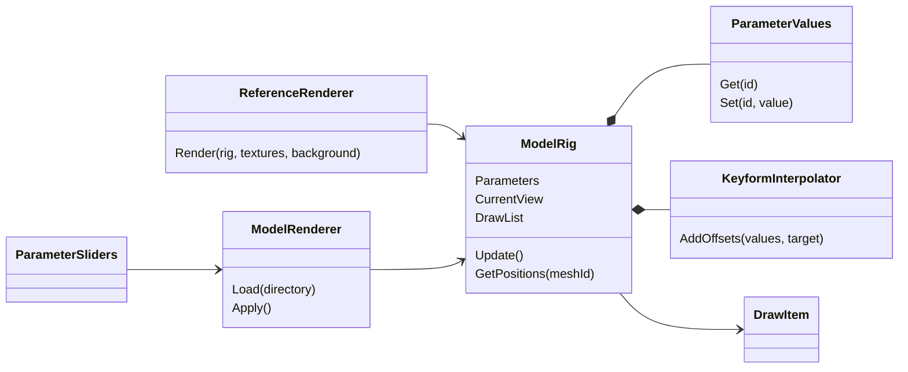
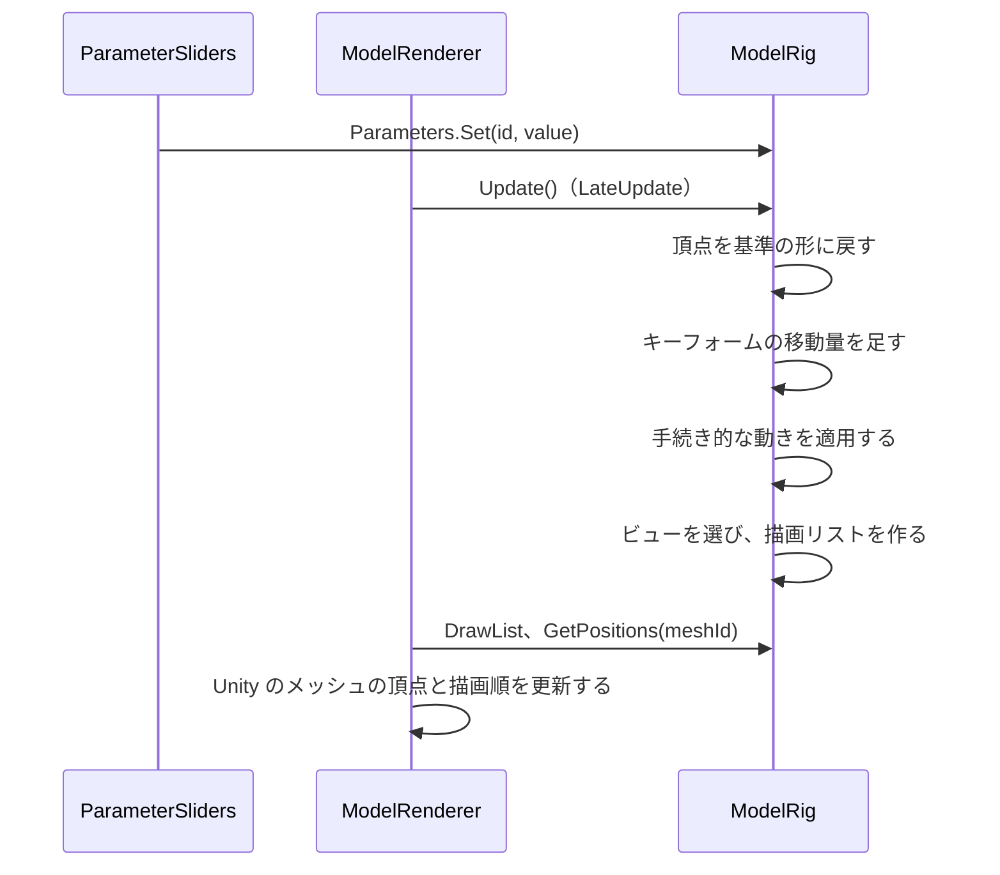

# 実行時の変形と描画

[中間形式 v0](intermediate-format.md) のモデルを、パラメータの値に応じて変形し、Unity で描く仕組み。計算の規則は中間形式の「変形の計算」「ビューの選び方」に従う。このページでは、そこに書いていない実装上の決まりを書く。

## 構成

| クラス | 場所 | 役割 |
| --- | --- | --- |
| `ModelRig`、`ParameterValues`、`KeyformInterpolator`、`DrawItem` | `com.ugokue.core/Runtime/Rig/`（Unity に依存しない） | パラメータの値から、各メッシュの頂点位置、ビュー、描画リストを求める |
| `ReferenceRenderer` | 同上 | CPU で描く参照用のレンダラー。画像回帰テストに使う |
| `Png`、`RgbaImage` | `com.ugokue.core/Runtime/Imaging/` | PNG の読み書き（参照レンダラーとテスト用） |
| `ModelRenderer`、`ParameterSliders`、`ModelLocation` | `Assets/Ugokue/Runtime/Rig/` | Unity での描画、デバッグ用のスライダー、モデルの場所の決定 |

## 1フレームの流れ

## 計算の決まり

| 項目 | 決まり |
| --- | --- |
| パラメータの値 | 設定時にモデルの `min`〜`max` に収める。NaN とモデルにないパラメータは無視する。モデルにないパラメータの値は 0 として扱う |
| 格子の区間 | 値をその軸の `keys` の範囲に収め、`keys[i] ≤ 値 ≤ keys[i+1]` となる最初の区間 i で補間する。内側の格子点ちょうどの値は、下側の区間の端（t = 1）として計算する。結果はどちらの区間でも同じになる |
| 補間 | 囲む格子点（2^軸数 個）の移動量を、各軸の t と 1 − t の積で重み付けして足す |
| 手続き的な動き | メッシュの属するパーツから親へたどり、パーツごとに `procedural` の並び順で適用する（自分に近いパーツの動きが先） |
| 回転 | 中心は対象パーツの `anchor`（基準の位置のまま）。キャンバス座標（y 下向き）で x' = cx + dx cos θ − dy sin θ、y' = cy + dx sin θ + dy cos θ。θ が正なら画面上で時計回り |
| ビュー | (`AngleX`, `AngleY`) とのユークリッド距離が最小のもの。同じ距離なら `views` の先のもの |
| 描画リスト | 表示するパーツを、描画順の小さい順に並べる。描画順が同じなら `parts` の並び順 |
| `clipBy` | まだ使わない（PoC-05 で実装する） |

## Unity での描画

- 1パーツに1つの GameObject（MeshFilter と MeshRenderer）を作る。中間形式のメッシュごとに Unity の Mesh を1つ作り、ビューの差し替えでは使う Mesh を入れ替える。
- 座標：ワールド座標 = ((x − 幅 / 2) / ppu, (高さ / 2 − y) / ppu, 0)。ppu（1 ユニットあたりのピクセル数）の初期値は 100。
- UV：v を 1 − v にして、Unity の左下原点に合わせる。
- 描画順：描画リストの順番を `sortingOrder` にする。描画リストにないパーツは MeshRenderer を無効にする。
- シェーダー：`Ugokue/UnlitTransparent`（ストレートアルファ、`Blend SrcAlpha OneMinusSrcAlpha`、深度を書かない、裏面も描く）。テクスチャはミップマップなし、Clamp、Bilinear。
- カメラ：プレイ中にモデルを読み込んだとき、正射影カメラの大きさを max(高さ / 2, 幅 / 2 / 画面の縦横比) / ppu × 1.05 にする（5% の余白）。

### モデルの場所

| 状況 | 読み込むフォルダ |
| --- | --- |
| 起動引数 `-ugokue-model <フォルダ>` がある | そのフォルダ |
| エディター | `<リポジトリ>/format/samples/test-face` |
| ビルドしたプレイヤー | `StreamingAssets/Models/test-face` |

ビルドの前処理（`StreamingModelBuildHook`）で `format/samples/test-face` の model.json と textures/*.png を `Assets/StreamingAssets/Models/test-face` に複製し、後処理で消す。`Assets/StreamingAssets/` はリポジトリに含めない。読み込みに失敗した場合はエラーをログに出し、モデルなしで動き続ける。

### デバッグ用のスライダー

画面の右上（幅 320 px）に、パラメータごとのスライダーと「Reset」（初期値に戻す）ボタンを表示する。初期状態で表示し、F2 キーで表示・非表示を切り替える（F1 は計測の表示）。値は次の LateUpdate で反映する。

## 画像回帰テスト

`ReferenceRenderer` で、固定のパラメータ値の[固定テストモデル](test-model.md)を描き、基準画像と比べる。GPU を使わないため、CI の Linux でも同じ結果になる。Unity の描画そのものは、スライダーを動かして人が確かめる。

参照レンダラーの描き方：

- 出力はキャンバスと同じ大きさの不透明な画像。背景は (240, 240, 246)。
- 三角形は画素の中心で内外を判定する。辺の上にある画素は、辺の向き（y が増える向き、y が同じなら x が増える向き）で片方の三角形だけに含める。
- テクスチャはバイリニア補間（端は Clamp）。色は乗算済みアルファで補間し、source-over で重ねる。
- アンチエイリアスはしない。

比較の基準：

| 項目 | 値 |
| --- | --- |
| 画素が違うとみなす差 | RGBA のどれかのチャンネルの差が 8 より大きい |
| 許す違いの量 | 画素数の 0.1% 以下 |

`AngleZ` の回転は三角関数を使うため、OS や CPU によって最後の桁が違うことがある。上の許容は、その差で境界の画素が変わる分を見込んだもの。

基準画像は `dotnet/Ugokue.Core.Tests/Rig/Baselines/` にある。描き方やテストモデルを変えて結果が変わる PR では、`UGOKUE_UPDATE_BASELINES=1 dotnet test dotnet/Ugokue.sln` で作り直し、差分の画像を PR で人が確かめる。失敗したときは、実際の画像（`.actual.png`）と違いの画像（`.diff.png`、違う画素が赤）を `artifacts/render-regression/` に書き出す。CI では成果物 `render-regression` として保存する。

| 名前 | パラメータ |
| --- | --- |
| `default` | すべて初期値 |
| `angle-right` | AngleX = 30 |
| `angle-up-left` | AngleX = −30、AngleY = 30 |
| `angle-down` | AngleY = −30 |
| `angle-between` | AngleX = 12.5、AngleY = −7.5 |
| `eyes-closed` | EyeOpenL = EyeOpenR = 0 |
| `mouth-open` | MouthOpenY = 1 |
| `tilt-breath` | AngleZ = 20、Breath = 1 |
| `combined` | AngleX = −18、AngleY = 10、AngleZ = −8、EyeOpenL = 0.4、EyeOpenR = 0.7、MouthOpenY = 0.5、Breath = 0.5 |
