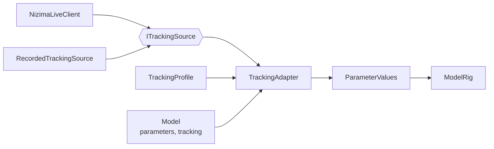

# 入力アダプター

入力元から届いたトラッキング値を、モデルのパラメータの値に変換する仕組み。処理の順と数値を選んだ理由は [ADR 0006](../adr/0006-tracking-adapter-pipeline.md) にある。入力元の nizima LIVE については [nizima LIVE からの受信](nizima-live.md) を参照。

## 構成

| 場所 | 役割 |
| --- | --- |
| `unity/Packages/com.ugokue.core/Runtime/Live/ITrackingSource.cs` | 入力元。最新のフレームだけを渡す。`NizimaLiveClient` と `RecordedTrackingSource` が実装する |
| `.../Live/TrackingProfile.cs`、`TrackingMapping.cs` | 入力元ごとの変換表 |
| `.../Live/TrackingAdapter.cs`、`TrackingAdapterOptions.cs` | 校正、範囲の置き換え、上限、平滑化、途切れの処理 |
| `.../Live/RecordedTrackingSource.cs` | `ugokue-nizima-probe` の記録（`messages.jsonl`）を再生する入力元 |
| `.../Live/TrackingClock.cs` | 受信の時刻とアダプターの時刻をそろえる時計 |
| `.../Live/LatencyMeter.cs` | 遅延の測定値の統計 |
| `unity/Assets/Ugokue/Runtime/Live/TrackingDriver.cs` | Main シーンのモデルに付ける MonoBehaviour。毎フレーム、入力元 → アダプター → モデルのパラメータの順に値を流す |

`TrackingDriver` は、`Update` でアダプターを進めてパラメータに書き込む。`ModelRenderer` は `LateUpdate` でパラメータからメッシュを作り直すので、その同じフレームの描画に反映される。

## 変換表

nizima LIVE の変換表（`TrackingProfile.NizimaLive`）。顔を捉えているかは `FaceFound` で判定する。

| 入力元 | 入力の範囲 | パラメータ | 出力の範囲 | 校正 |
| --- | --- | --- | --- | --- |
| `Yaw` | −30〜30 | `AngleX` | −30〜30 | ○ |
| `Pitch` | −30〜30 | `AngleY` | −30〜30 | ○ |
| `Roll` | −30〜30 | `AngleZ` | −30〜30 | ○ |
| `EyeOpenLeft` | 0〜1 | `EyeOpenL` | 0〜1 | |
| `EyeOpenRight` | 0〜1 | `EyeOpenR` | 0〜1 | |
| `MouthOpen` | 0〜1 | `MouthOpenY` | 0〜1 | |

- 入力の範囲から出力の範囲へ線形に置き換え、範囲の外の値は同じ傾きで外へ延ばしてから、パラメータの範囲（`parameters[].min`〜`max`）に収める。たとえば `Yaw` が −39.8 なら `AngleX` は −30、`EyeOpenLeft` が 2.07（目を見開いた）なら `EyeOpenL` は 1。
- 入力元の値が届かないパラメータは、前の値（最初はパラメータの初期値）のままにする。
- モデルにないパラメータへの規則は使わない。変換表にないパラメータ（`Breath` など）には書き込まない。
- 向き（左右・上下・傾き）の符号と、左右の目の対応は、実機で確かめて必要なら直す。

## 1フレームの処理

`TrackingAdapter.Update(最新のフレーム, 今の時刻)` は、次の順に処理する。時刻はすべて `TrackingClock` の秒数で、フレームの受信時刻と同じ時計を使う。

1. 新しいフレーム（前回と別のオブジェクト）が届いていて、`FaceFound` が 0.9 以上なら有効とし、その値から目標の値を作る。目標の値は「入力元の値 − 校正の値」を変換表で置き換え、パラメータの範囲に収めたもの。最初の有効なフレームでは、出力を目標の値にそのまま合わせる。
2. 最後の有効なフレームの受信時刻からの経過で、状態を決める。

| 状態 | 条件 | 出力が向かう値 | 追従の速さ |
| --- | --- | --- | --- |
| `NoInput` | 有効なフレームをまだ受け取っていない | —（パラメータに書き込まない） | — |
| `Live` | 経過 0.2 秒以下 | 目標の値 | 平滑化の強さ `s`。復帰から 0.5 秒は、時定数 0.12 秒より速くしない |
| `Holding` | 0.2 秒を超え、1.2 秒以下 | 最後の有効な目標の値 | 平滑化の強さ `s` |
| `Returning` | 1.2 秒を超える | パラメータの初期値 | 時定数 0.5 秒 |

3. 出力を `出力 += (向かう値 − 出力) × α` で進める。前回の `Update` からの経過を `dt` 秒として、α は次のとおり。
   - 平滑化の強さ `s` のとき：`α = 1 − s^(60·dt)`。`s` は「1/60 秒あたりに前の値を残す割合」で、`s = 0` なら平滑化しない（α = 1）。
   - 時定数 `τ` のとき：`α = 1 − exp(−dt / τ)`。
4. `ApplyTo` で、出力をモデルのパラメータに書き込む。

平滑化の強さ `s` は、モデルの `tracking.parameters[]` にそのパラメータの `smoothing` があればそれを、なければ 0.5 を使う（時定数に直すと約 24 ms）。

数値（0.9、0.2 秒、1 秒、0.5 秒、0.12 秒、0.5）は `TrackingAdapterOptions` の既定値で、人の確認で調整する。

## 校正

`Calibrate()` は、最後の有効なフレームの `Yaw`、`Pitch`、`Roll` を校正の値として覚え、以後はそれを差し引く。目と口は校正しない。`ResetCalibration()` で取り消す。校正の値は保存せず、アプリを起動し直すと消える。

Unity では、F4 の「Tracking adapter」の窓のボタンか、C キーで校正する。

## 記録の再生

`RecordedTrackingSource.Load` は、`ugokue-nizima-probe` が書き出した `messages.jsonl` から、モデルを含む `NotifyFrameUpdated` の Event だけを読み、`atSeconds` を受信時刻としたフレームの列にする。`Seek(秒)` で、その時点までに受け取った最後のフレームを `LatestFrame` にする。

プレイヤーやエディターを `-ugokue-tracking-playback <messages.jsonl>` 付きで起動すると、nizima LIVE の代わりに記録を再生する。再生は起動してから最初のフレームで始まり、最後まで再生したら止まる（そのあとは途切れとして扱われ、正面に戻る）。

テストでは、PoC-06 で記録した実機のデータから切り出した次の記録を再生する（`dotnet/Ugokue.Core.Tests/Live/Fixtures/`）。

| ファイル | 内容 |
| --- | --- |
| `playback-short-loss.jsonl` | 4 秒。途中で 0.83 秒顔を見失い、捉え直すと `Roll` が 0.2 秒で約 20° 動く |
| `playback-long-loss.jsonl` | 6 秒。途中から顔を見失ったまま終わる |
| `playback-out-of-range.jsonl` | 3 秒。`Yaw` が −39.8 まで振れる |

記録は、変換表で使う値と `FaceFound` 以外の LiveParameter と、Cubism パラメータを取り除いてある。

## 遅延

### アプリの中で測る部分

nizima LIVE はメッセージに送った時刻（`Timestamp`、UNIX 時間のミリ秒）を付ける。`TrackingDriver` は、新しいフレームを使うたびに「今の時刻 − `Timestamp`」を `LatencyMeter` に加え、直近 300 回の平均と p95 を F4 の窓に表示する。nizima LIVE と Unity は同じ PC の時計を使うので、これが nizima LIVE からアダプターまでの遅延になる。PoC-06 の記録では、中央値 3〜4 ms、p95 5〜11 ms だった。

### 全体（iPhone の動き → Unity の画面）を測る方法

iPhone から nizima LIVE までの遅延は、アプリからは測れない。全体は、スマートフォンのスローモーション撮影で測る。

1. Main シーンを再生し、F5 を押す。画面の右下に、`MouthOpenY`（アダプターの出力）が 0.5 を超えると白、それ以外は黒になる四角が出る。
2. 自分の口元と PC の画面の右下が両方写るように、別のスマートフォンで 240 fps のスローモーション撮影をする。
3. 口を閉じた状態から、素早く大きく開ける。これを 10 回くり返す。
4. 動画をコマ送りし、口が開き始めたコマから四角が白くなったコマまでのコマ数を数える。240 fps なら 1 コマは約 4.2 ms。
5. 10 回の値の中央値と最大を、[数値目標](performance-targets.md) の総遅延（150 ms 以内）と比べ、このページに記録する。

四角はアダプターの出力（平滑化のあと）で点くので、測った遅延には平滑化による遅れも含まれる。

## 実機の結果

PoC-07 の人の確認で記録したあとに書く。

- 総遅延：未計測
- 向きの符号、左右の目の対応：未確認
