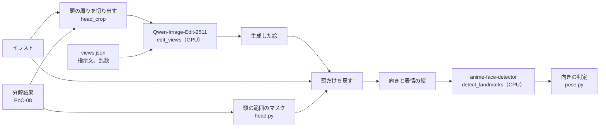

# 向きと表情の差分の生成

テストイラストごとに、顔の向き 3×3 と、閉じ目・口を開けた絵を生成する仕組み。PoC-10 で、これらの絵とパーツを対応づけて変形を推定する。方法を選んだ理由は [ADR 0008](../adr/0008-view-generation-with-image-editing.md) にある。

## 構成



| 場所 | 役割 |
| --- | --- |
| `pipeline/samples/views.json` | 生成の設定（モデル、ステップ数、乱数、絵ごとの指示文） |
| `pipeline/python/src/ugokue_pipeline/views.py` | 設定の読み込み、結果のフォルダの書き出し、確認用の一覧の画像 |
| `.../head.py` | 切り出す範囲、頭の範囲のマスク、頭だけを戻す処理、頭以外の変化の量 |
| `.../pose.py` | 特徴点からの向きの値と、指定した向きを向いているかの判定 |
| `.../modal_app.py` | `edit_views`（生成）、`detect_landmarks`（特徴点の検出）、`generate_views`、`check_view_determinism` |

## 生成する絵

| 名前 | AngleX | AngleY | 内容 |
| --- | --- | --- | --- |
| `x-30_y+20`、`x+00_y+20`、`x+30_y+20` | −30、0、30 | 20 | 上を向く |
| `x-30_y+00`、`x+30_y+00` | −30、30 | 0 | 横を向く |
| `x-30_y-20`、`x+00_y-20`、`x+30_y-20` | −30、0、30 | −20 | 下を向く |
| `eyes-closed` | 0 | 0 | 両目を閉じる |
| `mouth-open` | 0 | 0 | 口を大きく開ける（「あ」） |

- 正面（`x+00_y+00`）は生成せず、元のイラストをそのまま使う。
- 向きの符号は [中間形式](intermediate-format.md) と同じで、AngleX が正なら画面の右、AngleY が正なら上を向く。
- 指示文は英語で、向き（画面のどちら側か、何度くらいか）と、変えないもの（体、服、手、髪型、絵柄、色、構図、背景）を書く。共通の「変えないもの」の文は `views.json` の `keep` にあり、各指示文の `{keep}` を置き換える。
- 生成の設定は Qwen-Image-Edit-2511 の例に合わせる（bf16、40 ステップ、`true_cfg_scale` 4.0、`negative_prompt` は空白1文字）。乱数はすべての絵で同じ値（0）を使う。

## 頭の周りを切り出す

イラスト全体を渡すと、指示文で「体はそのまま」と書いても、向きを変える編集では体の向きや手の位置まで描き直される（01 で、頭の範囲の外の不一致が 17〜31%）。そこで、頭の周りだけを切り出して編集する。

`head_crop` は、分解結果の `face` の層の箱を、左右に顔の幅の 0.5 倍、上に顔の高さの 0.6 倍（髪の分）、下に 0.3 倍（首の分）広げ、イラストの内側に収めた範囲を返す。`edit_views` はこの範囲を切り出して編集し、生成した絵を切り出した範囲の大きさに戻す（`run` の `outputSize` に生成時の大きさ、`crop` に範囲を残す）。生成した絵を元のイラストの同じ位置に置いたものを、生の生成結果（`raw/`）とする。

## 頭だけを戻す

`head.py` の `head_mask` は、分解結果の層をモデルの描画順（[パーツ分解](part-decomposition.md#変換)）に重ねたとき、いちばん手前に見える層が頭の層（変換で親が `head` か `face` になる層：前髪、後ろ髪、顔、目、眉、鼻、口、耳、頭と顔の飾り）である画素を集める。

- 見えている画素だけを使うのは、後ろ髪の層が体の裏まで補完されていて、不透明な部分をそのまま使うと体の大部分が入るため。
- 顔の下端から顔の高さの 0.15 倍より下は含めない。肩より下に垂れた髪は、頭の向きでは変えない（揺れは物理で扱う）。
- それをイラストの短い辺の 2% だけ広げ、4 画素ぼかしてマスクにする。

`paste_head` は、マスクの値の割合で生の生成結果と元のイラストを混ぜる（マスクが 1 なら生成した絵、0 なら元のイラスト）。

## 頭以外の変化

`outside_difference` は、生の生成結果と元のイラストを、マスクが 0 の画素だけで比べる。切り出した範囲の外は元のイラストのままなので、差が出るのは切り出した範囲の中の、頭以外の部分（首、肩、襟元、背景）だけ。

| 値 | 内容 |
| --- | --- |
| `area` | イラスト全体のうち、比べた画素（頭の範囲の外）の割合 |
| `meanAbsDiff` | 画素ごとの RGB の差の絶対値の平均（0〜255）の、平均 |
| `mismatchRatio` | 差が 32 を超える画素の割合 |

頭だけを戻した絵では、マスクの外は元のイラストと同じになる。この値は、画像編集モデルが指示どおり頭だけを変えたかを表す。

## 向きの判定

`detect_landmarks` は、[anime-face-detector](https://github.com/hysts/anime-face-detector)（YOLOv3 の顔検出と HRNet の28点）で、正面と各絵（頭を戻したもの）の特徴点を検出する。

`pose.py` は、いちばん確からしい顔の特徴点から、次の2つの値を求める。どちらも角度ではなく、正面の絵と比べるための値。

| 値 | 求め方 | 正の向き |
| --- | --- | --- |
| `yaw` | 目の中心（12点の平均）の x が、輪郭の左右の端（0 番と 4 番）の中央からどれだけ右にあるか ÷ 輪郭の幅 | 画面の右 |
| `pitch` | 鼻（23 番）の y が、目の中心と口の中心（24〜27 番の平均）のあいだのどこにあるか（0 で目、1 で口）を、符号を反転したもの。上を向くと鼻先が目に近づく | 上 |

`judge` は、正面からの変化（`yawDelta`、`pitchDelta`）が、指定した角度と同じ符号で、大きさが 0.02 以上なら合格とする。角度が 0 の軸は判定しない（`null`）。顔を検出できなければ不合格。

## 結果のフォルダ

```
artifacts/views/
  summary.json            イラストごとの views.json の中身
  <イラスト名>/
    generated/<名前>.png  生成した絵（切り出した範囲の大きさ）と、生成の記録 run.json
    raw/<名前>.png        生成した絵を元のイラストの切り出した位置に置いたもの
    views/<名前>.png      頭だけを戻した絵。正面（x+00_y+00）は元のイラスト
    mask.png              頭の範囲のマスク
    landmarks.json        各絵の特徴点
    views.json            生成の記録（run）と、絵ごとの頭以外の変化（outsideHead）と向きの判定（pose）
    sheet.png             向きの 3×3 と表情を並べた、人の確認用の画像
```

`run` には、GPU、モデルの版（Hugging Face のコミット）、精度、ステップ数、`true_cfg_scale`、乱数、絵ごとの指示文、イラストの SHA-256、モデルの読み込みと絵ごとの処理時間、VRAM の最大値、マスクの設定を残す。

## 実行のしかた

Modal の認証と、そのイラストの分解（[パーツ分解](part-decomposition.md#実行のしかた) の `decompose_images`）を済ませてから、リポジトリのルートで実行する。

| 目的 | コマンド |
| --- | --- |
| 全イラストの生成と判定 | `uv run --project pipeline/python --extra modal modal run pipeline/python/src/ugokue_pipeline/modal_app.py::generate_views` |
| 一部のイラストだけ | 上のコマンドに `--only 01-long-straight,02-twintails` を付ける |
| 生成し直さず、頭の戻しと判定だけをやり直す | 上のコマンドに `--reuse` を付ける（`generated/` の絵を使う） |
| 同じ設定での再現性の確認 | `uv run --project pipeline/python --extra modal modal run pipeline/python/src/ugokue_pipeline/modal_app.py::check_view_determinism` |

`check_view_determinism` は、01-long-straight の `x+30_y+00` を同じ設定で2回生成し、画素の違いを `artifacts/views-determinism/determinism.json` に書く。

## 利用するモデルとライセンス

| モデル | 用途 | ライセンス |
| --- | --- | --- |
| [Qwen-Image-Edit-2511](https://huggingface.co/Qwen/Qwen-Image-Edit-2511) | 向きと表情の絵の生成 | Apache-2.0 |
| [anime-face-detector](https://github.com/hysts/anime-face-detector) | 顔の特徴点の検出（確認だけに使い、製品には含めない） | MIT |

## 実機の結果

PoC-09 で、Modal の A100 80GB で、`pipeline/samples/illustrations/` の5枚から各10枚（向き8、表情2）を生成した（2026-10-31、Qwen-Image-Edit-2511 `6f3ccc0`、bf16、40 ステップ、乱数 0）。各イラストの `sheet.png` が、人の確認用の一覧。

### 処理時間と VRAM

| 項目 | 値 |
| --- | --- |
| モデルの読み込み | 27〜43 秒（初回は重みのダウンロードを含めて 238 秒） |
| 1枚の生成 | 80〜95 秒（切り出した範囲を約 1M 画素にして生成） |
| イラスト1枚（10枚の生成） | 約 15 分 |
| VRAM（使った量） | 57.9 GiB |

### 頭以外の変化（生の生成結果）

| イラスト | 切り出した範囲 | 向きの8枚の `mismatchRatio` | 表情の2枚の `mismatchRatio` |
| --- | --- | --- | --- |
| 01-long-straight | 759×737 | 4.5〜5.8% | 0% |
| 02-twintails | 655×603 | 4.5〜6.1% | 1.4〜1.7% |
| 03-bob-glasses | 895×540 | 5.7〜8.9% | 0% |
| 04-boy | 896×932 | 35.7〜37.9% | 0〜5.1% |
| 05-swept-bangs | 851×666 | 4.6〜6.6% | 1.3〜1.4% |

- イラスト全体を渡していた最初の方法では、01 の向きの絵で 17〜31% だった。頭の周りを切り出すと 4.5〜5.8% に下がった。
- 04 は、顔が大きく、切り出す範囲がほぼイラスト全体になった。モデルが構図を引いて枠線を描き足したため、頭の位置と大きさがずれ、変化が大きい。

### 向きの判定

| 軸 | 合格 / 判定した枚数 | 不合格 |
| --- | --- | --- |
| 左右（AngleX ≠ 0） | 30 / 30 | なし |
| 上下（AngleY ≠ 0） | 25 / 30 | 01 の `x-30_y-20`、`x+30_y-20`、02 の `x-30_y-20`、`x+00_y-20`、03 の `x+00_y+20` |

- 左右の向きは、すべての絵で指定した向きに変わった。
- 上下は、下向きの判定が弱い。鼻の位置の変化が小さく、横を向くと鼻の位置も変わるため。上下の値の求め方は、PoC-10 で特徴点の対応を使うときに見直す。
- 表情の2枚は、どれも向きがほとんど変わらなかった（`yawDelta` の絶対値 0.013 以下）。口を開けた絵は、口が下に伸びるので `pitchDelta` が 0.12〜0.24 になる。

### 同じ設定での再現性

01-long-straight の `x+30_y+00` を同じ設定で2回生成すると、画素単位で一致した（`identical: true`）。

### 目で見て分かった問題

- 04 で、構図が引かれ、枠線が描き足される（上の表）。
- 03 と 05 で、生成した絵に描き足された手（顔の周りや胸元）が、頭の範囲の内側にあると一緒に戻る。
- あごの下のマスクの境界で、髪の流れが切り替わって見える。
- 頭の範囲の外に出た髪や飾り（02 のリボンの端など）は、元のイラストのものが残る。
